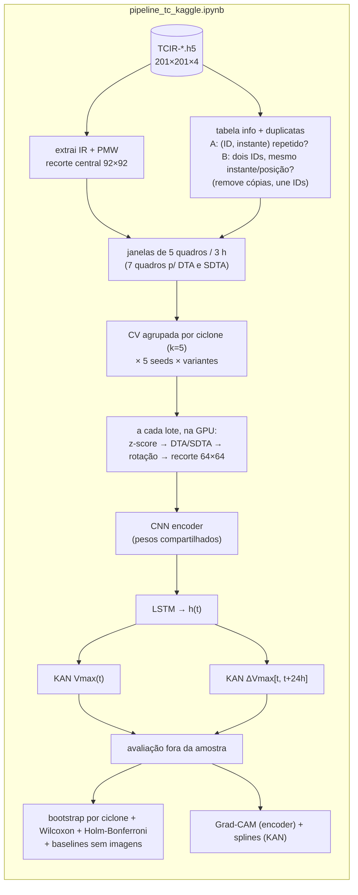
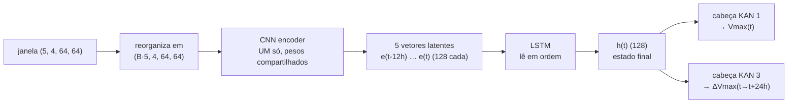

# Documentação da pipeline — CNN encoder + LSTM + KAN multitarefa para a intensidade de ciclones tropicais

> Explicação completa do funcionamento da implementação (`pipeline_tc_kaggle.ipynb`) e da verificação de duplicatas (feita dentro do notebook; o script `verificar_duplicatas.py` é o relatório de auditoria independente), com os conceitos por trás de cada etapa. É o complemento "como foi feito" do documento `metodologia_proposta.md` ("o que fazer"). O código do notebook também está comentado com os mesmos conceitos.

## Sumário

0. [Resumo executivo](#0-resumo-executivo)
1. [Arquivos entregues](#1-arquivos-entregues)
2. [Visão geral e mapa metodologia → código](#2-visão-geral-e-mapa-metodologia--código)
3. [Os dados: TCIR](#3-os-dados-tcir)
4. [Verificação de duplicatas (script à parte)](#4-verificação-de-duplicatas-script-à-parte)
5. [Pré-processamento: do HDF5 ao tensor (4, 64, 64)](#5-pré-processamento-do-hdf5-ao-tensor-4-64-64)
6. [Sequências temporais: janelas deslizantes e rótulos](#6-sequências-temporais-janelas-deslizantes-e-rótulos)
7. [O modelo: CNN encoder → LSTM → cabeças KAN](#7-o-modelo-cnn-encoder--lstm--cabeças-kan)
8. [Treino de uma execução](#8-treino-de-uma-execução)
9. [Protocolo de validação: CV agrupada por ciclone × 5 seeds](#9-protocolo-de-validação-cv-agrupada-por-ciclone--5-seeds)
10. [Testes estatísticos: Wilcoxon pareado + Holm-Bonferroni](#10-testes-estatísticos-wilcoxon-pareado--holm-bonferroni)
11. [Explicabilidade: Grad-CAM e splines da KAN](#11-explicabilidade-grad-cam-e-splines-da-kan)
12. [Como rodar no Kaggle](#12-como-rodar-no-kaggle)
13. [Decisões de projeto e diferenças em relação à metodologia/TCC](#13-decisões-de-projeto-e-diferenças-em-relação-à-metodologiatcc)
14. [Como o código foi verificado](#14-como-o-código-foi-verificado)
15. [Limitações e trabalhos futuros](#15-limitações-e-trabalhos-futuros)
16. [Perguntas em aberto (atualizadas)](#16-perguntas-em-aberto-atualizadas)
17. [Primeira execução no Kaggle: resultados e ajustes](#17-primeira-execução-no-kaggle-resultados-e-ajustes)
18. [Glossário](#18-glossário)
19. [Referências](#19-referências)

---

## 0. Resumo executivo

**O que foi feito**

* Implementada a pipeline da metodologia **sem a cabeça de Pmin** (pressão mínima): o modelo é multitarefa com **duas** cabeças KAN — `Vmax(t)` (principal) e `ΔVmax = Vmax(t+24h) − Vmax(t)` (intensificação rápida).
* A **verificação de ciclones duplicados** é feita **dentro do notebook** (seção 2.2), só com a tabela de metadados: ele detecta, une IDs e remove as cópias sozinho — **não precisa anexar nenhum arquivo extra** no Kaggle. O script `verificar_duplicatas.py` continua disponível como relatório independente (auditoria, hash de todas as imagens); sua execução sobre os dados reais deu o mesmo resultado que a detecção do notebook (72 registros, 2 IDs unificados).
* A pipeline roda **num único notebook** (`pipeline_tc_kaggle.ipynb`), pensado para o Kaggle: acha os dados sozinho, usa GPU se houver, grava cada treino ao terminar e **retoma** de onde parou se a sessão cair.
* Tudo está comentado no código e explicado neste documento.

**O que a verificação de duplicatas encontrou** (detalhes na [seção 4](#4-verificação-de-duplicatas-script-à-parte))

| verificação | resultado |
|---|---|
| Definição literal: mesmo ID de ciclone no mesmo instante | **0 duplicatas** em 75.079 imagens |
| Mesmo ciclone gravado com **dois IDs** (mesmo instante, mesma posição) | **72 registros redundantes** em 2 ciclones físicos: `201616L`/`201622E` (71 instantes; datas coincidem com o furacão Otto, nov/2016) e `201010L`/`201011E` (1 instante). 70 dos 72 pares são **idênticos bit a bit**; 2 são quase-duplicatas |
| Varredura por *hash* de **todas** as imagens (48 GB) | nenhuma outra duplicata exata |
| *(achado extra)* Dado ausente | **479 imagens (0,64%) com o canal IR 100% vazio** — não são duplicatas, mas a pipeline precisa descartá-las |

Consequência prática: sem tratamento, o furacão Otto entraria **duas vezes** nos dados e, na validação cruzada, uma cópia poderia cair no treino e a outra no teste (**vazamento**). A pipeline remove as cópias e trata os dois IDs como **um** ciclone.

**Números do dataset após as regras da pipeline** (calculados sobre os dados reais)

| item | valor |
|---|---|
| Imagens no TCIR | 75.079 (1.379 IDs) |
| Após remover duplicatas e unir IDs | 75.007 imagens, 1.377 ciclones |
| Quadros inválidos (IR com > 10% de pixels ausentes) | 549 |
| **Janelas de 5 quadros utilizáveis** | **65.670** (1.373 ciclones) |
| Janelas com rótulo de ΔVmax (existe Vmax em t+24h) | 55.072 |
| Intensificação rápida (ΔVmax ≥ 30 nós em 24 h) | 3.669 (6,66% das rotuladas) |
| Vmax das janelas | média 51,8 nós, desvio padrão 28,9 nós (mediana 43; de 10 a 185 nós) — como é calculado: [seção 6.5](#65-números) |

**Primeira execução completa no Kaggle e ajustes** (2026-10-12; detalhes na [seção 17](#17-primeira-execução-no-kaggle-resultados-e-ajustes))

A primeira execução (75 treinos, T4, 4 h 31) rodou a versão anterior do notebook — **sem** remover as duplicatas (65.730 janelas, não 65.670); o efeito foi desprezível (≤ 0,01 nó), mas o número final deve vir do notebook atual.

| Achado | Consequência |
|---|---|
| A **LSTM** reduz o RMSE de Vmax em 15% (11,29 → 9,58 nós), nos 5 folds | conclusão robusta |
| **KAN ≈ MLP** (−0,05 nó; p ≈ 0,12 com 1 ponto por fold) | o argumento a favor da KAN é interpretabilidade, não acurácia |
| **ΔVmax não supera um baseline sem imagens** (15,87 × 15,71 nós) | baselines sem imagens entram no notebook |
| O teste "por execução" tinha **pseudorreplicação** (25 pares ≈ 5 observações independentes) | o teste principal passa a ser o **bootstrap por ciclone** |
| RI medido só no limiar de 30 nós enganava (o baseline de histórico, com limiar ajustado, tem AUC 0,80) | limiar ajustado na validação + AUC/AP |
| Faixa de janelas previstas em ≈ 25 nós pelos 3 modelos; ablação da multitarefa não rodada | diagnóstico de janelas com erro grande; `cnn_lstm_kan_vmax` vira variante padrão |

**Como rodar** (detalhes na [seção 12](#12-como-rodar-no-kaggle))

```text
1. Kaggle → New Notebook → File → Import notebook → pipeline_tc_kaggle.ipynb
2. Add data → dataset com os 3 arquivos TCIR-*.h5 (só eles; as duplicatas o notebook trata)
3. Settings → Accelerator: GPU
4. Primeiro MODO = "teste" (minutos). Depois MODO = "completo" → Save Version → Save & Run All
```

---

## 1. Arquivos entregues

| Arquivo | O que é |
|---|---|
| `verificar_duplicatas.py` | Script **independente** de auditoria: mesma verificação que o notebook faz internamente, mais a varredura por hash de todas as imagens. **O notebook não depende dele.** |
| `resultados_duplicatas/relatorio_duplicatas.md` | Relatório legível da execução do script sobre os dados reais. |
| `resultados_duplicatas/resumo_duplicatas.json` | Os mesmos números em formato de máquina. |
| `resultados_duplicatas/duplicatas_tcir.csv` | Lista de cada registro duplicado com a decisão *manter/remover*. Só para consulta: o notebook **não** lê este arquivo (ele detecta as duplicatas sozinho). |
| `estatisticas_janelas.py` | Script **independente** que reproduz as regras de janelas do notebook (sem PyTorch) e calcula os números do resumo: nº de janelas, RI, **média e desvio do Vmax**, splits e folds. Na 1ª vez varre as imagens (≈ 30 s no Mac); depois usa o cache. |
| `resultados_janelas/` | Saída do script: `estatisticas_janelas.md` (relatório), `estatisticas_janelas.json` (os mesmos números) e `frac_invalido_ir.csv` (cache: fração de IR ausente de cada imagem). |
| `analisar_resultados_kaggle.py` | Script **independente** (sem PyTorch) que analisa o notebook baixado do Kaggle com os logs: decomposição fold × seed, comparação com 1 ponto por fold, reprodução das janelas/folds da execução (vazamento por duplicata) e baselines de ΔVmax. Roda com `python3 -I` (o notebook baixado é lido como JSON, nunca executado). Ver seção 17.7. |
| `resultados_kaggle/` | Saída do script: `analise_kaggle.json` (todos os números da seção 17) e `metricas_por_execucao_log.csv` (os 75 treinos extraídos do log). |
| `pipeline_tc_kaggle.ipynb` | A pipeline completa: dados → tensor → CNN+LSTM+KAN → CV agrupada × seeds → baselines sem imagens → bootstrap por ciclone + Wilcoxon + Holm → diagnóstico de janelas → Grad-CAM e splines. |
| `DOCUMENTACAO_PIPELINE.md` | Este documento. |
| `metodologia_proposta.md` | Documento de referência (já existente). |

---

## 2. Visão geral e mapa metodologia → código



**Onde cada ponto da metodologia está implementado**

| Metodologia (`metodologia_proposta.md`) | Onde | Observação |
|---|---|---|
| §4.2 Deduplicação por ID | `2.2` do notebook (detecta e remove); `verificar_duplicatas.py` = relatório de auditoria | o notebook detecta sozinho |
| §4.3 Bandas IR+PMW, limpeza, z-score | notebook `2.3` e `3` | igual ao TCC |
| §4.4 DTA e SDTA simultâneos | notebook `3` (`montar_lote`) | calculados antes da rotação |
| §4.5 Rotação aleatória só no treino | notebook `3` (`rotacionar_e_recortar`) | prob. 0,55 (a confirmar) |
| §4.6 Tensor (4, 64, 64) | notebook `3` | |
| §5 Sequência + CNN encoder compartilhado | notebook `2.4` e `4.1` | |
| §6 LSTM | notebook `4.2` | `h_t = LSTM(e(t_i), h_{t-1})` |
| §7 Cabeças KAN multitarefa | notebook `4.3`, `5.2` | **2 cabeças** (Pmin fora) |
| §8.1 CV agrupada por ciclone (k=5) | notebook `5.1` | |
| §8.2 5 seeds | notebook `6` | |
| §8.3 Wilcoxon pareado | notebook `7.3`; teste principal em `7.3b` (bootstrap por ciclone); baselines em `7.2b` | ver seção 10 |
| §8.4 Holm-Bonferroni | notebook `7.3` (`holm_bonferroni`) | confere com o `statsmodels` |
| §9.1 Grad-CAM no encoder | notebook `8.1` | |
| §9.2 Funções spline da KAN | notebook `8.2` | |
| §12 Cuidados de implementação 1–5 | ver tabela abaixo | |

**Os cuidados de implementação da metodologia (§12) e como o código os garante**

| Cuidado | Como é garantido |
|---|---|
| 1. Mesma rotação em todos os canais do quadro | os 4 canais são empilhados antes de girar |
| 2. Mesma rotação em todos os 5 quadros da janela | os 5 quadros × 4 canais = 20 "canais" de **uma** imagem; uma só chamada de `grid_sample` com um ângulo por janela |
| 3. Diferença antes da rotação | `montar_lote` calcula DTA/SDTA na grade original 92×92 e só depois gira e recorta |
| 4. Deduplicação antes da janela deslizante | a detecção roda na construção da tabela, antes de `construir_janelas`; um `assert` recusa (ciclone, instante) repetido |
| 5. Sem vazamento na cabeça de ΔVmax | as cabeças só recebem `h(t)`; o alvo `Vmax(t+24h)` é só rótulo (vem da tabela), nunca entrada |

---

## 3. Os dados: TCIR

O **TCIR** (*Tropical Cyclone for Image-to-Intensity Regression*, Chen et al., 2018) vem em 3 arquivos HDF5:

| Arquivo | Imagens | Ciclones (IDs) | Anos | Bacias |
|---|---|---|---|---|
| `TCIR-ATLN_EPAC_WPAC-001.h5` | 47.381 | 861 | 2003–2016 | Atlântico, Pacífico Leste, Pacífico Oeste |
| `TCIR-CPAC_IO_SH-002.h5` | 23.118 | 424 | 2003–2016 | Pacífico Central, Índico, Hemisfério Sul |
| `TCIR-ALL_2017-003.h5` | 4.580 | 94 | 2017 | todas |
| **Total** | **75.079** | **1.379** | | |

Cada arquivo tem duas partes:

* **`matrix`** — tensor `(N, 201, 201, 4)` em `float32`: uma imagem de 201×201 pixels (≈ 7,8 km por pixel, ≈ 1.500 km de lado) por linha. Canais, na ordem: **0 = IR** (infravermelho, temperatura de brilho em Kelvin; ≈ 184–297 K numa imagem típica), **1 = WV** (vapor d'água), **2 = VIS** (luz visível — vem toda `NaN` à noite) e **3 = PMW** (taxa de chuva por micro-ondas passivas, mm/h).
* **`info`** — tabela com uma linha por imagem: `data_set` (**a bacia**, e não "treino/teste"), `ID` (ex.: `201616L` = ano 2016, ciclone nº 16, bacia `L`), `lon`, `lat`, `time` (`AAAAMMDDHH`), `Vmax` (nós), `R35_4qAVG` (raio de ventos de 35 nós) e `MSLP` (pressão central, hPa).

**Fatos verificados nos dados reais**

* O espaçamento é de **3 h** para quase todos os pares consecutivos: dos 73.700 intervalos entre imagens do mesmo ciclone, **73.698 são de exatamente 3 h**; só há **duas lacunas** em todo o dataset (uma de 9 h e uma de 15 h). A preocupação com intervalos irregulares praticamente não se aplica ao TCIR em si — o que cria buracos são os quadros inválidos (seção 4.6).
* **A coluna `MSLP` existe e está completa** (nenhum valor ausente; 872–1024 hPa). A pendência "crítica" da metodologia §13.1 (de onde vem o rótulo de Pmin) tem resposta simples: já está no TCIR, não precisa de IBTrACS. A cabeça de Pmin ficou de fora por decisão do projeto, mas poderia ser adicionada depois sem nenhuma fonte externa.
* O `info` é gravado no formato "fixed" do pandas, com as colunas de texto dentro de um *pickle*. `pandas.read_hdf` falha com pandas 3.x + PyTables (o atributo `pandas_type` vem como `bytes`). Por isso tanto o script quanto o notebook leem o `info` direto com `h5py`, com um *unpickler* restrito que só aceita os três objetos NumPy necessários (desserializar pickle arbitrário é inseguro).
* **Splits do TCC** (por ano do ID): treino 2003–2014 (1.097 ciclones), validação 2015–2016 (188), teste 2017 (94). Neste projeto o split fixo é substituído pela validação cruzada agrupada por ciclone (seção 9); os splits por ano só aparecem no relatório de duplicatas e como referência de comparação.

---

## 4. Verificação de duplicatas (script à parte)

### 4.1 Por que verificar

Uma **duplicata** é um dado redundante: a rede enxerga o *mesmo* exemplo como se fossem dois. Isso causa dois problemas:

1. **Vicia o treino.** O gradiente passa a dar peso dobrado àquele exemplo.
2. **Vaza informação na validação cruzada.** Se as duas cópias caírem em folds diferentes, a que está no treino "entrega a resposta" da que está no teste, e o erro de teste fica artificialmente baixo.

O caso esperado é o satélite tirar duas fotos do mesmo ciclone no mesmo instante, gerando duas linhas com o mesmo `ID` e o mesmo horário.

### 4.2 O que é verificado

O notebook faz **A e B** (só a tabela `info`) e **C** de forma informativa (lê as poucas imagens removidas). O `verificar_duplicatas.py` roda as quatro verificações abaixo, da mais barata à mais cara; **D** só existe no script:

| | Verificação | Custo |
|---|---|---|
| **A** | **Duplicata estrita** (a definição literal): o par `(ID, instante)` aparece mais de uma vez | instantâneo |
| **B** | **Mesmo ciclone físico com IDs diferentes**: IDs distintos, mesmo instante, posição a ≤ 0,25° (≈ 28 km) | instantâneo |
| **C** | **Comparação de pixels** dos candidatos de A e B: idênticos bit a bit? correlação do IR? | segundos |
| **D** | **Varredura por hash** (`--varrer-imagens`): resume cada uma das 75.079 imagens num hash de 128 bits e agrupa as repetidas — pega duplicatas exatas mesmo que os metadados não denunciem | ≈ 100 s (lê 48 GB) |

**Por que a verificação B?** Um ciclone que cruza de uma bacia para outra (por exemplo, do Atlântico para o Pacífico Leste na América Central) pode receber **um ID em cada bacia**. Durante a transição os dois catálogos descrevem a mesma tempestade — o mesmo centro, o mesmo instante. Para a rede, são duas amostras iguais; para a validação cruzada agrupada *por ID*, são dois "ciclones" que podem cair em folds diferentes.

**Por que a tolerância de 0,25°?** Um pixel do TCIR tem ≈ 0,07°; 0,25° são ~3,5 pixels. Nos dados há uma folga nítida: os 72 pares duplicados ficam a no máximo **0,100°** um do outro, e o par de ciclones *diferentes* mais próximo fora dessa tolerância está a **0,93°**. O relatório mostra esses dois números para que a escolha seja auditável.

**Como decide o que manter.** Os IDs que compartilham ao menos um par candidato são unidos (*union-find*) num mesmo "ciclone físico". O `id_canonico` desse ciclone é o ID com mais registros (empate: o menor ID). Dentro do ciclone, linhas no mesmo instante são duplicatas; fica uma por instante — a do ID com mais registros — e as outras recebem `acao = remover`.

### 4.3 Resultados da execução sobre os dados reais

```bash
python verificar_duplicatas.py --dados data --saida resultados_duplicatas --varrer-imagens
```

**A — mesmo ID, mesmo instante:** **0 duplicatas.** Nenhum par `(ID, instante)` se repete nos 75.079 registros, nem dentro de um arquivo nem entre arquivos.

**B — IDs diferentes, mesmo ciclone físico:** **2 ciclones físicos, 72 registros redundantes.**

| IDs | Bacias | Linhas por ID | Instantes duplicados | Período | Split do TCC | Imagens idênticas |
|---|---|---|---|---|---|---|
| `201010L` + `201011E` | ATLN + EPAC | 43 / 9 | 1 | 2010-09-04 18h | treino | 1/1 |
| `201616L` + `201622E` | ATLN + EPAC | 71 / 71 | 71 | 2016-11-17 18h → 2016-11-26 12h | validação | 69/71 |

O segundo caso é o ciclone inteiro duplicado: os **71 instantes** do `201616L` existem também no `201622E` (as datas coincidem com o furacão Otto de 2016, que cruzou a América Central). Registros a remover por split do TCC: treino 1, validação 71, teste 0.

**C — pixels:** dos 72 pares candidatos, **70 são idênticos bit a bit** nos 4 canais. Os outros 2 são *quase-duplicatas*: mesma hora, posição a ≈ 0,1°, recorte deslocado em 1–2 pixels (correlação do IR de 0,95 e 0,94). Também são tratados como redundantes.

**D — hash de todas as imagens:** 72 grupos de imagens completas idênticas (537 linhas): 70 são os pares acima; os 2 restantes são **imagens vazias** (tudo `NaN`) repetidas, que não são duplicata de captura (seção 4.6). **Zero grupos não explicados**: não existe nenhuma outra duplicata exata no dataset.

### 4.4 Como a pipeline usa o resultado

O notebook (seção 2.2, função `detectar_duplicatas`) aplica as regras A e B acima e faz três coisas:

1. **Remove** as linhas repetidas (72 registros): onde sobra mais de uma linha para o mesmo (ciclone, instante), fica a do ID com mais registros.
2. **Une os IDs**: `201622E → 201616L` e `201011E → 201010L`. A série temporal de cada ciclone passa a ser a união das linhas dos IDs equivalentes (se um ID tivesse instantes que o outro não tem, eles se completariam).
3. Usa o `id_ciclone` unificado como **grupo** da validação cruzada: as duas cópias nunca ficam em folds diferentes.

A remoção vale para **todos** os dados, e não só para o treino, como previa a especificação original. Motivo: a janela deslizante exige instantes únicos e regulares — um instante duplicado no teste quebraria a regularidade de 3 h tanto quanto no treino. Na prática afeta 72 de 75.079 registros (0,1%).

Com `cfg.detectar_duplicatas = False` o notebook **avisa em destaque** e segue sem remover nada (vazamento possível). Se existir `(ciclone, instante)` repetido depois da detecção, um `assert` interrompe a execução. Ao fim, o notebook lê os pixels dos registros removidos e registra no log quantos são idênticos bit a bit à cópia mantida (**70 de 72**), como a verificação C do script. A tolerância de posição é `cfg.tol_duplicata_graus` (0,25°).

### 4.5 Uso do script

```bash
python verificar_duplicatas.py --dados data/                    # rápido (≈ 5 s): metadados + pixels dos candidatos
python verificar_duplicatas.py --dados data/ --varrer-imagens   # + hash de todas as imagens (≈ 100 s)
python verificar_duplicatas.py --dados data/ --tol-graus 0.5    # outra tolerância de posição
python verificar_duplicatas.py --help
```

Saídas em `resultados_duplicatas/` (`--saida` muda a pasta). Não precisa de GPU nem de PyTorch — só `numpy`, `pandas` e `h5py`.

### 4.6 Achado extra: imagens vazias (dado ausente)

A varredura mostrou que **479 imagens (0,64%)**, distribuídas em **63 ciclones**, têm o canal IR **100% vazio** no recorte central (treino 441, validação 20, teste 18). 397 delas são imagens (quase) integralmente `NaN` nos 4 canais e idênticas entre si — por isso aparecem como "grupos de imagens idênticas" no hash. Provavelmente são instantes sem cobertura do satélite.

Com a limpeza do TCC (`NaN → 0`), uma imagem dessas vira um quadro **todo zerado** que ainda carrega um rótulo de Vmax: o modelo seria treinado a "prever a velocidade de uma imagem em branco". Além disso, ~4,5% das imagens têm uma fração pequena de IR ausente (linhas de varredura do satélite).

A pipeline trata isso com uma regra simples: **quadro com mais de 10% de pixels de IR ausentes é inválido** (`cfg.max_frac_nan_ir`) e é tirado da série. Isso abre um buraco de ≥ 6 h ao lado dele, e nenhuma janela atravessa buracos. São 549 quadros inválidos no total (0,73%); eles custam 1.085 janelas (de 66.755 possíveis se todos os quadros fossem válidos).

---

## 5. Pré-processamento: do HDF5 ao tensor (4, 64, 64)

Esta é a **Etapa 1** da metodologia. Parte acontece **uma vez** (extração e cache), parte **a cada lote** (normalização, diferenças e rotação, na GPU).

### 5.1 Seleção de bandas

Das 4 bandas, ficam **IR** e **PMW**:

* **VIS** (luz visível) é descartada: à noite não tem informação (vem toda `NaN`).
* **WV** (vapor d'água) é descartada: é muito parecida com o IR, o que favorece *overfitting*.
* **IR** mostra a temperatura do topo das nuvens (nuvens mais frias = convecção mais profunda); **PMW** mostra a chuva, que enxerga *através* das nuvens a estrutura da parede do olho.

### 5.2 Extração e limpeza (uma vez, com cache)

Para cada imagem lemos só as **linhas** do recorte central 92×92 (um trecho contíguo no disco — a leitura é rápida: ~2.700 imagens/s no teste local) e cortamos as colunas na memória. Pixels `NaN` ou `> 1000` são marcados como inválidos (guardados como `NaN` no `float16`). O resultado, `(75.079, 2, 92, 92)` em `float16`, ocupa ≈ 2,5 GB e vai para um cache em disco; também guardamos a **fração de IR inválido** de cada quadro (usada na regra de quadro inválido).

**Tratamento dos pixels inválidos dentro de um quadro válido** (`cfg.tratamento_invalidos`):

| Política | O que faz | Quando usar |
|---|---|---|
| `"tcc"` (padrão) | `NaN → 0` **antes** do z-score — exatamente como o TCC | reproduzir o TCC |
| `"mascara"` | `NaN →` média (z = 0); DTA/SDTA ficam 0 nesses pixels | evitar picos artificiais |

A política `"tcc"` tem um efeito colateral visível nos testes: onde falta dado, o IR vira `0` K, que após o z-score é ≈ −7,7σ, e o DTA/SDTA ali ficam enormes. Aparece como faixas retas brilhantes (linhas de varredura do satélite). A rede aprende a conviver com isso (o TCC também), mas a política `"mascara"` é uma alternativa limpa para uma ablação.

### 5.3 Normalização z-score

$$x_{norm}=\frac{x-\mu}{\sigma}$$

μ e σ são **globais por canal** (IR e PMW têm valores próprios), calculados numa amostra de ~3.000 quadros do **treino de cada fold** — nada do teste entra. Global, e não "por imagem": normalizar cada imagem por sua própria média apagaria justamente a informação de **temperatura absoluta** do topo das nuvens. (Valores típicos: IR μ ≈ 252 K, σ ≈ 32; PMW μ ≈ 1,2 mm/h, σ ≈ 2,5.)

### 5.4 Canais de diferença temporal: DTA e SDTA

Para cada pixel $i$ e instante $n$ (calculados sobre o IR já normalizado, como na Figura 3 do TCC):

$$\mathrm{DTA}^n_i=\left|I^n_i-I^{n-1}_i\right|\qquad
\mathrm{SDTA}^n_i=\left|I^n_i-2I^{n-1}_i+I^{n-2}_i\right|$$

* **DTA** (diferença temporal absoluta, 1ª ordem) é a "velocidade" com que as nuvens mudaram nas últimas 3 h.
* **SDTA** (2ª ordem) é a "aceleração": a diferença entre duas diferenças consecutivas.

Na metodologia nova os dois entram **ao mesmo tempo** (no TCC eram alternativas excludentes). O IR é usado por ter a maior resolução espacial (evita reamostrar o PMW).

### 5.5 Rotação aleatória (*data augmentation*)

Ciclones não têm uma rotação canônica (um furacão girado 90° continua sendo um furacão), então giramos as amostras de treino por um ângulo $\theta\sim\mathcal U(0°,360°)$ — a rede aprende **invariância angular** em vez de memorizar a posição angular.

* **Só no treino** (validação e teste ficam sem rotação).
* **Com probabilidade `cfg.prob_rotacao = 0,55`**: a anotação manuscrita em `1.jpeg` foi lida como "0,55" após ampliação (uma leitura anterior hesitava entre 0,5 e 0,55) — **a confirmar**.
* **Não é um canal**: é uma transformação geométrica aplicada ao tensor inteiro.

### 5.6 A ordem das operações — e por que importa

```text
 (92×92, grade original)                       (gira)       (corta)
 IR, PMW → z-score → DTA, SDTA → empilha 5×4 canais → rotação → recorte 64×64
```

1. **Diferença antes da rotação.** DTA/SDTA comparam o *mesmo pixel* em instantes diferentes; para isso as imagens têm que estar alinhadas. Girar cada quadro do par separadamente e só depois subtrair mediria o artefato da rotação, não o movimento do ciclone.
2. **Uma rotação para tudo.** Os 5 quadros × 4 canais = 20 canais são empilhados numa só imagem de 20 canais e girados de uma vez, com **um** ângulo por janela. Se cada quadro girasse diferente, a sequência ficaria espacialmente incoerente e a LSTM não aprenderia a dinâmica.
3. **Rotação antes do corte** (como no TCC, Figura 3). Por isso guardamos 92×92 e não já 64×64: o círculo que circunscreve um quadrado 64×64 tem raio $64\sqrt2/2\approx45{,}3$ px, menor que 46 px (metade de 92). Assim, qualquer ângulo produz um 64×64 **sem cantos pretos**. (Se girássemos o 64×64 diretamente, os cantos ficariam vazios.)

A rotação usa `affine_grid` + `grid_sample` (interpolação bilinear). Com ângulo 0, cada pixel de saída cai exatamente num pixel de entrada, então o recorte é exato (sem borrar); com 90° também é exato.

### 5.7 O tensor final

Para cada janela, a rede recebe `(5, 4, 64, 64)`: 5 instantes × `[IR, PMW, DTA, SDTA]` × 64×64 pixels (≈ 2° de lat/lon, ≈ 28 pixels de raio — a região do olho e da parede do olho, que é o que mais pesa na intensidade, como o SHAP do TCC mostrou). O notebook gera duas figuras de conferência (`01_tensor_normal.png`, `01_tensor_giro.png`): na segunda, todos os canais e todos os quadros giram **juntos**.

**Tudo isso acontece na GPU**: o array de quadros inteiro (2,5 GB em `float16`) fica na memória da GPU e cada lote é montado por indexação. Isso elimina `DataLoader`, processos auxiliares e a CPU como gargalo.

---

## 6. Sequências temporais: janelas deslizantes e rótulos

### 6.1 A janela deslizante

Em vez de uma imagem isolada, cada amostra é uma **sequência de 5 quadros** do mesmo ciclone: `t-12h, t-9h, t-6h, t-3h, t`. "Deslizante" porque a janela avança de 3 em 3 horas pela vida do ciclone: um ciclone com 60 imagens gera ~54 janelas, quase todas sobrepostas (4 dos 5 quadros em comum com a vizinha).

### 6.2 Por que cada janela exige 7 quadros consecutivos

Cada quadro da janela é um tensor de 4 canais, inclusive o **mais antigo** (`t-12h`). O SDTA dele precisa de dois quadros anteriores (`t-15h` e `t-18h`). Então cada janela usa 7 quadros `t-18h … t` — os dois primeiros só participam do cálculo de DTA/SDTA.

### 6.3 Regra de continuidade

Uma **corrida** é um trecho de um mesmo ciclone com quadros válidos exatamente a cada 3 h. Uma janela só existe se os 7 quadros estiverem na mesma corrida. Isso decorre da natureza da LSTM: ela só enxerga "o próximo item da sequência" e **não tem noção de quanto tempo passou**. Um buraco de 6 h seria tratado como se fosse de 3 h e confundiria a dinâmica aprendida — é a limitação "horizonte fixo e discreto". Em vez de tentar consertar, descartamos essas janelas.

### 6.4 Rótulos

| Tarefa | Rótulo | Observações |
|---|---|---|
| `vmax` | $V_{max}(t)$ em nós | tarefa principal (*nowcasting*) |
| `dvmax` | $\Delta V_{max}=V_{max}(t+24h)-V_{max}(t)$ | previsão (*forecasting*) da intensificação rápida |

* O rótulo futuro é buscado na série **completa** do ciclone (inclusive em quadros cuja imagem é inválida: o rótulo do *best track* continua valendo). Se o ciclone acabou antes de `t+24h`, o rótulo é `NaN`.
* **Máscara na perda:** janelas sem `ΔVmax` seguem treinando `vmax`; a perda de `dvmax` as ignora.
* **Intensificação rápida (RI):** operacionalmente, aumento de Vmax ≥ **30 nós em 24 h** (Kaplan & DeMaria, 2003). Nos dados: **6,66%** das janelas rotuladas. O valor Δ = 24 h é configurável (`cfg.horizonte_horas`) e **deve ser confirmado**.
* Os rótulos futuros **nunca** são entrada da rede. A notação "h(t)+Δ" do diagrama é interpretada como o horizonte do *alvo* (metodologia §12.5).

### 6.5 Números

Calculados por `estatisticas_janelas.py` sobre os dados completos (saída em `resultados_janelas/estatisticas_janelas.md`):

| item | valor |
|---|---|
| Janelas utilizáveis | 65.670, em 1.373 ciclones (mediana de 45 janelas por ciclone, máx. 195) |
| Divisão do TCC | treino 2003–2014: 52.275 · validação 2015–2016: 9.428 · teste 2017: 3.967 |
| Validação cruzada (5 folds) | 13.134 janelas por fold e 274–276 ciclones |
| Janelas com ΔVmax | 55.072; RI (ΔVmax ≥ 30 nós em 24 h): 3.669 (6,66%) |
| Janelas perdidas por quadros inválidos/lacunas | 1.085 (66.755 se todos os quadros fossem válidos e contínuos) |

**Média e desvio padrão do Vmax das janelas (o que o resumo cita).** É a estatística descritiva do rótulo `vmax` = Vmax(t) sobre as 65.670 janelas:

1. cada janela tem **um** rótulo: o Vmax (nós, do *best track* do TCIR) do **último** quadro, `t`;
2. juntam-se os rótulos de **todas** as janelas utilizáveis — a unidade é a **janela**, e não o ciclone, então ciclones longos pesam mais;
3. média = soma dos rótulos ÷ 65.670 = **51,77 nós**; desvio padrão = $\sqrt{\frac{1}{N-1}\sum (V_i-\bar V)^2}$ = **28,90 nós**. Com N tão grande, a versão populacional (÷ N) dá o mesmo valor (28,90).

| estatística (Vmax(t), nós) | valor |
|---|---|
| mínimo / Q25 / mediana / Q75 / máximo | 10 / 30 / 43 / 65 / 185 |
| ΔVmax = Vmax(t+24h) − Vmax(t) (55.072 janelas) | média −0,39; desvio 19,72 |
| Vmax por split (média ± desvio) | treino 51,0 ± 28,7 · validação 56,3 ± 30,2 · teste 50,8 ± 27,1 |

Como ler: a média (≈ tempestade tropical forte) é puxada para baixo pela maioria fraca — 33% das janelas são depressões (< 34 nós), 40% tempestades tropicais (34–63 nós), 11% categoria 1 e só 16% categoria 2 ou mais (tabela completa em `estatisticas_janelas.md`). O desvio de 28,9 nós é também a **régua mínima de erro**: um "modelo" que sempre prevê a média teria RMSE ≈ 28,9 nós, a ser comparado ao RMSE de 9–10 nós do TCC. Nada disso entra na normalização do treino, que usa média/desvio **só do treino de cada fold** (seção 8, passo 3).

Para recalcular: `python3 estatisticas_janelas.py` (usa `data/`; detecta as duplicatas com a mesma função do notebook; as funções de janelas são cópias das do notebook — se mudar a regra lá, mude no script).

---

## 7. O modelo: CNN encoder → LSTM → cabeças KAN



O modelo inteiro (`ModeloTC`, seção 4 do notebook) tem **≈ 1,08 milhão de parâmetros**: encoder 913.856, LSTM 132.096, cabeças KAN 2 × 18.576.

### 7.1 CNN encoder com pesos compartilhados

**Papel:** comprimir cada quadro `(4, 64, 64)` num vetor latente $e(t_i)\in\mathbb R^{128}$ ("amassar a imagem num resumo").

**Pesos compartilhados.** O encoder é **uma única rede** aplicada aos 5 quadros — não são 5 redes. Na prática, os 5 quadros de cada janela são empilhados no eixo do lote: `x.flatten(0, 1)` transforma `(B, 5, 4, 64, 64)` em `(B·5, 4, 64, 64)`, a mesma CNN processa tudo, e `.view(B, 5, 128)` devolve a estrutura de sequência. É como olhar 5 fotos com os mesmos óculos: aprendemos *uma* forma de descrever uma imagem de ciclone, e a tarefa de ligar as 5 descrições numa "história" fica para a LSTM.

**Arquitetura** (estilo CNN-TC do TCC: convoluções com *stride* 2, sem *pooling* — imagens de ciclone não têm bordas nítidas e o *pooling* joga informação fora):

| Camada | Saída | Parâmetros |
|---|---|---|
| entrada | (4, 64, 64) | |
| Conv 3×3, *stride* 2, 32 + BatchNorm + ReLU | (32, 32, 32) | 1.216 |
| Conv 3×3, *stride* 2, 64 + BatchNorm + ReLU | (64, 16, 16) | 18.560 |
| Conv 3×3, *stride* 2, 128 + BatchNorm + ReLU | (128, 8, 8) | 73.984 |
| Conv 3×3, *stride* 2, 256 + BatchNorm + ReLU | (256, 4, 4) | 295.424 |
| Flatten → Dropout(0,1) → Linear(4096→128) → **LayerNorm** | (128) | 524.672 |

**Diferenças em relação ao CNN-TC do TCC** (todas deliberadas):

* sem a camada final de regressão — o encoder devolve o vetor, não a velocidade;
* **BatchNorm** nas convoluções e um pouco de **Dropout**: treino mais estável, menos *overfitting*;
* **LayerNorm no embedding**. Descoberta dos testes: sem ela os embeddings chegavam a ≈ 11, os portões da LSTM saturavam e as variáveis de `h(t)` ficavam coladas em ±1 — o treino oscilava no início (RMSE de validação 17,8 → 21,2 nas épocas 2–3, contra 15,4 → 14,0 com a LayerNorm) e as splines da KAN ficavam sem informação (só havia dados nas bordas do intervalo). Com a LayerNorm, `h(t)` ocupa todo o (−1, 1).

A metodologia deixa em aberto qual CNN usar (CNN-TC, ResNet50 ou MobileNetV2). O encoder aqui é leve de propósito: roda **5 vezes por amostra**, e uma ResNet50/MobileNetV2 a 224×224 repetida 5× seria proibitiva. Trocar o encoder é trocar a classe `CodificadorCNN`.

### 7.2 LSTM — a dinâmica temporal

**Por que não tratar cada quadro isolado?** A intensidade é consequência de um *processo*: importa como as nuvens mudaram, não só como estão. Precisamos de um mecanismo que "lembre" o que veio antes ao processar o que vem depois.

**RNN simples** mantém um estado oculto atualizado a cada passo:

$$h_t=\tanh(W_x x_t+W_h h_{t-1}+b)$$

Ao treinar (*backpropagation through time*), o gradiente volta por muitos passos sendo multiplicado repetidamente pela mesma matriz $W_h$, e por isso **some** (a rede "esquece" o passado) ou **explode**.

**LSTM** (Hochreiter & Schmidhuber, 1997) resolve isso com um **estado de célula** $c_t$ — uma "esteira" que carrega informação com poucas interferências — controlado por três **portões** (cada um é uma camada com saída sigmoide, entre 0 e 1, funcionando como uma válvula: 0 bloqueia tudo, 1 deixa passar tudo):

$$\begin{aligned}
f_t&=\sigma(W_f[h_{t-1},x_t]+b_f) &&\text{portão de esquecimento: quanto da memória antiga manter}\\
i_t&=\sigma(W_i[h_{t-1},x_t]+b_i),\quad \tilde c_t=\tanh(W_c[h_{t-1},x_t]+b_c) &&\text{portão de entrada: quanta informação nova gravar}\\
c_t&=f_t\odot c_{t-1}+i_t\odot\tilde c_t &&\text{atualização da esteira (memória de longo prazo)}\\
o_t&=\sigma(W_o[h_{t-1},x_t]+b_o),\quad h_t=o_t\odot\tanh(c_t) &&\text{portão de saída: o que mostrar como estado}
\end{aligned}$$

Como $c_t$ só sofre somas e multiplicações por portões, o gradiente atravessa muitos passos sem sumir.

**No projeto:** a entrada $x_t$ de cada passo é o vetor $e(t_i)$ do encoder (não pixels), e a LSTM lê `e(t-12h) → e(t-9h) → e(t-6h) → e(t-3h) → e(t)` em ordem. Na notação do diagrama da arquitetura, $h_t=\mathrm{LSTM}(e(t_i),h_{t-1})$. O **estado final** $h(t)$ (128 números) resume "como o ciclone evoluiu até agora" e é a **única** entrada das cabeças. Como $h_t=o_t\odot\tanh(c_t)$, ele fica sempre em $(-1,1)$ — a faixa que a primeira camada da KAN usa como domínio.

**Limitação (horizonte fixo e discreto):** a LSTM supõe passos regulares; não sabe "quanto tempo passou". Por isso a pipeline só monta janelas sem buracos (seção 6.3). Uma Neural ODE (Chen et al., 2018) modelaria o tempo contínuo — trabalho futuro.

### 7.3 KAN — Kolmogorov-Arnold Network

**MLP × KAN.** Em uma camada de MLP, cada neurônio soma as entradas com **pesos** (escalares) e aplica uma ativação **fixa**; a não-linearidade mora no **nó**:

$$x_{l+1,j}=\sigma\Big(\sum_i w_{l,j,i}\,x_{l,i}+b_{l,j}\Big)$$

Numa **KAN** (Liu et al., 2024) inverte-se a lógica: cada **aresta** carrega uma **função aprendível de uma variável** $\varphi_{l,j,i}$, e o nó só soma — a não-linearidade mora na **aresta** e é *aprendida*:

$$x_{l+1,j}=\sum_i\varphi_{l,j,i}(x_{l,i})$$

A inspiração é o **Teorema de Representação de Kolmogorov-Arnold**: toda função contínua multivariada pode ser escrita como somas e composições de funções contínuas de **uma** variável. A KAN generaliza essa estrutura de 2 camadas para uma pilha de camadas, treinada por *backpropagation* como uma rede comum.

**Como cada $\varphi$ é parametrizada** (`CamadaKAN`):

$$\varphi(x)=w_b\,\mathrm{silu}(x)+\sum_{m=1}^{G+k}c_m\,B_m(x)$$

* $B_m$ são **B-splines** de grau $k=3$ (curvas cúbicas por partes) sobre um grid de $G=5$ intervalos — são 8 funções-base por aresta;
* $c_m$ são os **coeficientes aprendidos** (a "forma" da curva);
* $w_b\,\mathrm{silu}(x)$ é um "caminho base" suave que ajuda o treino e dá o comportamento fora do grid.

**B-splines pela recursão de Cox-de Boor.** Com nós $t_0\le t_1\le\dots$ igualmente espaçados:

$$B_{i,0}(x)=\begin{cases}1&t_i\le x<t_{i+1}\\0&\text{caso contrário}\end{cases}\qquad
B_{i,k}(x)=\frac{x-t_i}{t_{i+k}-t_i}B_{i,k-1}(x)+\frac{t_{i+k+1}-x}{t_{i+k+1}-t_{i+1}}B_{i+1,k-1}(x)$$

O grau 0 é um "degrau"; cada grau seguinte mistura dois vizinhos do anterior, alisando. Dentro do grid, as bases somam 1 (partição da unidade): cada ponto é uma média ponderada de ~4 coeficientes vizinhos. A implementação foi **conferida contra `scipy.interpolate.BSpline.design_matrix`** (diferença máxima ≈ 1e-7 para vários graus e grids).

**A cabeça KAN do projeto:** `[128 → 16 → 1]`, ou seja, duas camadas KAN. A primeira ($128\times16$ arestas) tem grid em $(-1,1)$ — exatamente a faixa de $h(t)$; a segunda ($16\times1$ arestas) recebe somas não limitadas e usa grid em $(-3,3)$. Cada cabeça tem $128\cdot16\cdot(1+8)+16\cdot(1+8)=18.576$ parâmetros. As cabeças rodam sempre em `float32` (a recursão das splines é sensível a `float16`).

**Por que escrever a KAN em vez de usar `pykan`/`efficient-kan`?** Para o notebook rodar no Kaggle sem internet nem instalações, e para o código ficar legível e comentado (são ~40 linhas). Os nomes dos parâmetros seguem a formulação do artigo.

**Por que KAN aqui?** (i) **Interpretabilidade nativa:** cada $\varphi$ é uma curva que se pode desenhar (seção 11.2); (ii) **novidade metodológica:** KAN é de 2024 e seu uso em regressão multitarefa de ciclones é novo — o "cerne da proposta"; (iii) custo desprezível aqui, porque a KAN só vê 128 números por amostra (o CNN é que é caro). A contrapartida geral — cada aresta guarda 8 coeficientes em vez de 1 escalar — não pesa neste uso.

### 7.4 Aprendizado multitarefa

Um único **tronco** compartilhado (encoder + LSTM) alimenta **cabeças independentes**, uma por tarefa:

| Cabeça | Alvo | Tipo |
|---|---|---|
| 1 (principal, fixa) | $V_{max}(t)$ | *nowcasting* |
| 3 | $\Delta V_{max}[t,t+24h]$ | *forecasting* — intensificação rápida |
| ~~2~~ | ~~$P_{min}(t)$~~ | **fora do escopo desta versão** |

Vantagens: (1) o tronco é forçado a aprender características úteis para **todas** as tarefas — um regularizador; (2) velocidade do vento e variação futura são fisicamente relacionadas; (3) um modelo em vez de dois.

**Perda total** (alvos padronizados — média 0, desvio 1, calculados no treino):

$$\mathcal L=w_V\;\mathrm{MSE}\big(\hat V_{max},V_{max}\big)\;+\;w_\Delta\;\underbrace{\mathrm{MSE}\big(\hat{\Delta V}_{max},\Delta V_{max}\big)}_{\text{só nas janelas com rótulo em }t+24h}$$

com $w_V=1{,}0$ e $w_\Delta=0{,}5$ (`cfg.pesos_tarefas`): a tarefa principal pesa mais. A máscara faz as janelas sem rótulo futuro treinarem só a cabeça de Vmax. Os gradientes das duas perdas se somam no tronco.

> **Se a intenção era "sem multitarefa nenhuma"** (e não só "sem a cabeça de Pmin"): a variante `cnn_lstm_kan_vmax` (seção 7.5) treina a mesma arquitetura só com Vmax.

### 7.5 Variantes de modelo (ablações)

A metodologia pede testes estatísticos entre modelos ("vários modelos × vários folds × várias seeds"), mas não lista os modelos. Foram definidas quatro variantes que isolam, uma a uma, cada decisão da proposta; todas usam o mesmo tronco CNN e os mesmos dados:

| Variante | Temporal | Cabeça | Tarefas | Isola o efeito de… | Parâmetros |
|---|---|---|---|---|---|
| `cnn_lstm_kan` | LSTM | KAN | Vmax + ΔVmax | **a proposta completa** | 1.083.104 |
| `cnn_lstm_mlp` | LSTM | MLP `[128→64→1]` | Vmax + ΔVmax | a **KAN** | 1.062.594 |
| `cnn_kan_1frame` | nenhum (só o quadro `t`) | KAN | Vmax + ΔVmax | a **sequência/LSTM** | 967.520 |
| `cnn_lstm_kan_vmax` | LSTM | KAN | só Vmax | a **multitarefa** | 1.064.528 |

Padrão do notebook (desde 2026-10-12): as **quatro** — `cfg.variantes = ("cnn_lstm_kan", "cnn_lstm_mlp", "cnn_kan_1frame", "cnn_lstm_kan_vmax")`; a de referência é `cnn_lstm_kan`. A ablação da multitarefa (`cnn_lstm_kan_vmax`) não estava na lista da primeira execução e, por isso, o benefício da multitarefa ainda não foi medido (seção 17). `variantes` não entra na assinatura das execuções: dá para acrescentar ou tirar variantes a qualquer momento — as execuções já feitas são reaproveitadas e só as novas são treinadas.

Além das variantes de rede, o notebook compara a proposta com **baselines sem imagens** para ΔVmax (zero, média do treino e regressão sobre o histórico de Vmax; seção 7.2b do notebook e seção 17.3 deste documento).

A variante `cnn_kan_1frame` ainda recebe os canais DTA/SDTA (informação de movimento via diferenças), então é um *baseline* forte "estilo TCC com 4 canais"; a diferença para a proposta mede o ganho de modelar explicitamente a sequência.

---

## 8. Treino de uma execução

`treinar_execucao(variante, fold, seed, …)` (seção 5.3 do notebook):

1. **Semente:** `fixar_semente(100·seed + fold)` — afeta inicialização, ordem dos lotes e sorteio das rotações. A divisão em folds **não** depende da seed.
2. **Divisão:** treino / validação interna / teste (seção 9.1).
3. **Estatísticas só do treino:** μ, σ de IR e PMW (para o z-score) e média/desvio dos alvos. Nada do teste vaza para a normalização.
4. **Modelo, otimizador, agenda:** AdamW (Adam com *weight decay* desacoplado; lr de pico 1e-3, decaimento 1e-4); agenda *OneCycle* (aquece a taxa de aprendizado nos primeiros 15% dos passos e depois a reduz suavemente até quase zero); **corte de gradiente** em norma 1,0 — importante em redes recorrentes.
5. **Laço de épocas:** a cada época, embaralha as janelas de treino; para cada lote de 128, `montar_lote(treino=True)` (com rotação), *forward*, perda multitarefa, *backward*, passo. O último lote incompleto é descartado (BatchNorm).
6. **Precisão mista (GPU CUDA):** CNN e LSTM em `float16` com `GradScaler`; **cabeças em `float32`**.
7. **Early stopping:** ao fim de cada época mede o RMSE de Vmax na validação interna; guarda os melhores pesos; para após `paciencia` (8) épocas sem melhora. O critério é Vmax para todas as variantes, para a seleção de modelo ser comparável. Com *OneCycle*, a melhor época costuma ficar perto do fim do cronograma.
8. **Avaliação:** recarrega os melhores pesos e prevê as janelas do fold de teste (sem rotação), voltando os alvos para nós. Prevê também a **validação interna** com esses mesmos pesos (grava `y_dvmax_val` e `pred_dvmax_val` no `.npz`): é com ela que se escolhe o limiar de RI (abaixo), sem consultar o teste.

**Métricas** (em nós):

* **RMSE** $=\sqrt{\tfrac1n\sum(y-\hat y)^2}$ (a do TCC e da literatura; penaliza erros grandes), **MAE** $=\tfrac1n\sum|y-\hat y|$ e **viés** $=\tfrac1n\sum(\hat y-y)$ (erro com sinal);
* para a **intensificação rápida**, além do erro de regressão de ΔVmax, trata-se "ΔVmax ≥ 30 nós" como um evento e mede-se **POD** (acertos ÷ eventos reais), **FAR** (alarmes falsos ÷ alarmes) e **CSI** $=\mathrm{TP}/(\mathrm{TP}+\mathrm{FN}+\mathrm{FP})$;
* o RI é medido de **três jeitos** (desde 2026-10-12): (i) alarme em ΔVmax previsto ≥ 30 nós (o "ingênuo"); (ii) alarme num **limiar ajustado na validação interna** (varre 5…30 nós e fica com o que maximiza o CSI lá; colunas com sufixo `_aj`; o teste nunca é consultado); (iii) **sem limiar**: **AUC-ROC** (probabilidade de um evento real receber escore maior que um não-evento; 0,5 = sem habilidade) e **precisão média (AP)** (área sob a curva precisão × revocação; sem habilidade ≈ prevalência, aqui ≈ 0,067; mais informativa que a AUC para eventos raros — Davis e Goadrich, 2006), usando o próprio ΔVmax previsto como escore.

Observação: um regressor treinado com erro quadrático tende a *regredir à média* em eventos raros (RI é 6,7% das amostras): a POD fica baixa mesmo quando o RMSE de ΔVmax melhora. É um comportamento esperado, e por isso essas métricas foram incluídas — mostram o que o RMSE esconde. O limiar ajustado e a AUC/AP medem o que a rede *ordena* corretamente, independentemente de ela atravessar o limiar de 30 nós; na primeira execução (seção 17.3) o limiar ingênuo subestimava a habilidade de ambos, rede e baseline.

---

## 9. Protocolo de validação: CV agrupada por ciclone × 5 seeds

### 9.1 Validação cruzada agrupada por ciclone (k = 5)

Janelas do mesmo ciclone são quase a mesma imagem (4 dos 5 quadros em comum com a janela vizinha). Num k-fold comum, janelas vizinhas cairiam em lados opostos (treino × teste) e o modelo seria "testado" em imagens que já viu — **vazamento de dados** que infla o desempenho. Aqui o **grupo é o ciclone** (o `id_ciclone` já unificado pelo relatório de duplicatas): todas as janelas de um ciclone ficam **inteiras** no mesmo fold. O teste mede então a capacidade de generalizar para **ciclones nunca vistos** — o cenário real de uso.

**Algoritmo** (`dividir_folds`, o mesmo do `GroupKFold` do scikit-learn): ordena os ciclones do mais para o menos janelas e atribui cada um ao fold com menos janelas até então (empates sorteados com `seed_estrutural`). Resultado: folds balanceados (≈ 13.134 janelas cada). Um `assert` confirma que nenhum ciclone aparece em dois folds.

A divisão é **fixa**: igual para todas as variantes e seeds. Assim todas as variantes são avaliadas **exatamente nas mesmas janelas** (comparação pareada).

**Validação interna (para o *early stopping*).** Do treino de cada fold, 10% dos **ciclones** (inteiros) são separados; o modelo treina nos outros 90% e a validação decide a época de parada.

### 9.2 Por que 5 seeds

Treinar redes é estocástico: pesos iniciais, ordem dos lotes e rotações aleatórios e, em GPU, somas de ponto flutuante feitas em paralelo em ordem não fixa. **Uma seed fixa não garante o mesmo resultado.** Repetir cada treino com 5 seeds mede **quanto da diferença entre dois modelos é real e quanto é ruído do treino**: se um modelo ganha de forma consistente nas 5 seeds e nos 5 folds, a evidência é muito mais forte. Total: **5 folds × 5 seeds = 25 treinos por variante**.

### 9.3 Organização das execuções

* **Ordem dos laços:** fold → seed → variante. Assim todas as variantes completam o mesmo (fold, seed) antes do próximo — as comparações pareadas já são possíveis mesmo que o tempo acabe no meio.
* **Salvamento imediato:** cada execução vira `runs/<variante>__f<fold>__s<seed>__<assinatura>.npz` (índices das janelas de teste, rótulos, predições, previsões de ΔVmax da validação interna, histórico, metadados). Para a primeira seed de cada fold grava-se também o `.pt` com os pesos (usados na explicabilidade).
* **Retomada:** execuções cujo arquivo já existe são puladas. `cfg.dirs_retomada` aceita a pasta de saída de uma sessão anterior (anexada ao Kaggle como *input*); o que existir lá é copiado.
* **Assinatura:** hash curto dos hiperparâmetros que mudam o resultado e do conjunto de janelas, incluído no nome do arquivo. Mudou o hiperparâmetro (ou as duplicatas, ou os dados) → a assinatura muda → execuções antigas **não** são reaproveitadas por engano.
* **ETA:** a cada execução o log mostra RMSE/MAE, melhor época, duração e o tempo restante estimado.
* **Orçamento de tempo** (`cfg.max_horas_treino`): no Kaggle a sessão é limitada (~12 h) e, se o limite chegar durante o treino, as células de estatística e figuras nunca rodariam. Por isso, por padrão **no Kaggle o notebook para de iniciar novos treinos depois de 10 h** (ou quando a próxima execução não couber mais no orçamento) e segue para as tabelas e figuras com o que já concluiu — o log avisa quantas execuções ficaram pendentes, e rodar de novo (ou numa nova sessão com `dirs_retomada`) completa o plano. Fora do Kaggle não há limite (`0` desliga; qualquer número de horas define o orçamento).

---

## 10. Testes estatísticos: Wilcoxon pareado + Holm-Bonferroni

### 10.1 Teste de Wilcoxon (de postos sinalizados) pareado

Compara dois modelos nas **mesmas janelas**. Para cada janela $i$ calcula-se $d_i=|e^A_i|-|e^B_i|$ (diferença dos erros absolutos), ordenam-se os $|d_i|$, somam-se os postos dos $d_i$ positivos e dos negativos e pergunta-se: *se não houvesse diferença sistemática, seria plausível uma soma de postos tão desbalanceada?* É a alternativa **não paramétrica** ao teste *t* pareado — adequada porque os erros absolutos **não são normais** (no TCC o Shapiro-Wilk rejeitou normalidade, Tabela 4) e os dados são pareados (mesma janela, dois modelos).

### 10.2 Correção de Holm-Bonferroni

Rodar muitos testes aumenta a chance de falso positivo (com 20 testes independentes e α = 5%, a chance de pelo menos um é ≈ 64%). A correção de **Holm-Bonferroni** controla essa taxa (*family-wise error rate*): ordena os $m$ p-valores $p_{(1)}\le\dots\le p_{(m)}$, compara $p_{(k)}$ com $\alpha/(m-k+1)$ e **para** no primeiro que não passa (rejeita só os anteriores): é o "ranquear e depois testar". É menos conservadora que a Bonferroni simples e igualmente rigorosa quanto ao erro. O notebook implementa a versão em *p-valores ajustados*:

$$p^{adj}_{(k)}=\max_{j\le k}\min\{1,(m-j+1)\,p_{(j)}\}\qquad\text{significativo se }p^{adj}\le\alpha$$

Conferido contra `statsmodels.stats.multitest.multipletests(method='holm')` (resultado idêntico).

### 10.3 Os três níveis de comparação

A **variante de referência** é a proposta (`cnn_lstm_kan`); cada outra variante — e, para ΔVmax, o `baseline_historico` sem imagens — é comparada com ela.

| Nível | Unidade do teste | Papel | Pontos fortes / fracos |
|---|---|---|---|
| **1 — por janela** | em cada (fold, seed), Wilcoxon sobre os erros absolutos janela a janela (uma família de Holm) | apoio | muito poder; mas janelas do mesmo ciclone são correlacionadas (não são amostras independentes) e os p-valores ficam *otimistas* |
| **2 — por execução** | Wilcoxon sobre a métrica global (RMSE/MAE) de cada execução, pares = mesmo (fold, seed) | **exploratório** | as 5 seeds de um fold testam as mesmas janelas: os 25 pares são ≈ 5 observações (pseudorreplicação, seção 10.4) e os p-valores saem inflados |
| **3 — bootstrap por ciclone** | reamostra **ciclones** com reposição; diferença de MAE/RMSE entre duas variantes nas mesmas janelas (erro médio entre seeds); IC 95% e p bicaudal; Holm sobre todos os testes | **principal** (seção 7.3b do notebook) | a unidade independente é o ciclone (≈ 1,4 mil); embute a variação entre folds e entre ciclones |

**Apoio ao nível 3 — 1 ponto por fold.** A métrica de cada (variante, fold) é a média das seeds; compara-se com *t* pareado e Wilcoxon exato sobre os folds, e conta-se em quantos folds a referência erra menos (`folds_ref_melhor`). Com 5 pontos o menor p do Wilcoxon exato é 2/2⁵ = 0,0625: serve para ver se a **direção** se repete, não para declarar significância.

**Como ler:** um resultado é convincente quando o **IC 95% do bootstrap por ciclone não inclui 0** (com p ajustado por Holm abaixo de α) e a direção se repete nos folds. Diferença **negativa** = a referência erra menos. As tabelas do nível 1 trazem, como a Tabela 5 do TCC, a média dos erros e a porcentagem de janelas em que a referência errou menos; o "veredito" diz *referência melhor / sem diferença / referência pior* depois da correção de Holm.

Arquivos: `tabelas/wilcoxon_por_janela.csv`, `wilcoxon_por_execucao.csv`, `comparacao_por_fold.csv` e `bootstrap_por_ciclone.csv`.

### 10.4 Por que o nível 2 não é o veredito (pseudorreplicação)

Pseudorreplicação (Hurlbert, 1984) é tratar como independentes medidas que não o são. Aqui, cada fold é um conjunto de teste diferente, mas as 5 seeds de um mesmo fold avaliam **exatamente as mesmas janelas** — a seed só muda a inicialização, a ordem dos lotes e as rotações. Na primeira execução (seção 17) o desvio **entre folds** foi 0,47 nó e **entre seeds** dentro de um fold, 0,08 nó. O teste por execução, porém, conta 25 pares: o resultado "KAN melhor em MAE de Vmax" saiu com p ajustado 0,035 ali, e com 1 ponto por fold o p é 0,13. Repetir seeds serve para medir o ruído do treino (o bootstrap por ciclone já o embute, pois usa o erro médio entre seeds), não para multiplicar o número de observações.

### 10.5 O bootstrap por ciclone, passo a passo

1. Para cada janela de teste, o erro (|e| e e²) é a **média entre as seeds**; as variantes comparadas são avaliadas nas mesmas janelas.
2. Somam-se, por ciclone, as estatísticas suficientes: n, Σ|e| e Σe² de cada variante.
3. Repete-se `cfg.bootstrap_reps` (2000) vezes: sorteiam-se N ciclones **com reposição** (pesos multinomiais), recalculam-se MAE e RMSE (= √(Σe²/n)) de cada variante e a diferença referência − outra.
4. IC 95% = percentis 2,5 e 97,5 das diferenças; p bicaudal = 2·min(P(d ≥ 0), P(d ≤ 0)) com correção +1; **Holm-Bonferroni** sobre todos os testes (comparações × tarefa × métrica).

O RMSE do bootstrap é √(erro quadrático médio entre seeds), que pode diferir de milésimos da média dos RMSE por execução da seção 7.1 do notebook. Referência: Efron e Tibshirani (1993).

---

## 11. Explicabilidade: Grad-CAM e splines da KAN

Dois métodos **complementares**: o Grad-CAM responde **"onde"** na imagem o modelo olhou; as splines respondem **"que relação"** o modelo aprendeu entre as variáveis internas e cada saída. Ambos usam os pesos gravados da primeira seed do primeiro fold executado (`cfg.variante_referencia`).

### 11.1 Grad-CAM no encoder (Selvaraju et al., 2017)

Para uma saída $y$ (Vmax ou ΔVmax):

1. pega os **mapas de características** $A^k$ do último bloco convolucional do encoder (256 mapas de 4×4);
2. calcula o **gradiente** de $y$ em relação a cada mapa e tira a média espacial → um **peso de importância por canal**: $\alpha_k=\frac1{HW}\sum_{h,w}\frac{\partial y}{\partial A^k_{hw}}$;
3. combina: $\mathrm{CAM}=\mathrm{ReLU}\big(\sum_k\alpha_k A^k\big)$ — o ReLU mantém só as regiões que *aumentam* a previsão;
4. amplia o mapa 4×4 até 64×64 e o sobrepõe à imagem de IR.

**Particularidades desta implementação:**

* Como o encoder processa cada quadro, obtém-se **um mapa por instante** (`t-12h … t`): mostra *quando* e *onde* o modelo prestou atenção.
* O backward de um lote inteiro (`saida.sum().backward()`) dá o gradiente correto de cada amostra, porque o BatchNorm em modo de avaliação não mistura amostras.
* Figuras: `05_gradcam_exemplos_*.png` (3 janelas — Vmax ≈ 30, 70 e 120 nós, como no SHAP do TCC) e `06_gradcam_medio_*.png` (mapa médio sobre `gradcam_amostras` janelas de teste, equivalente ao SHAP médio do TCC).
* No teste de calibração (modelo treinado por poucas épocas em um subconjunto), o mapa do último instante `t` concentrava-se perto do olho nos ciclones intensos — coerente com o SHAP do TCC. Com um modelo bem treinado os mapas devem ser examinados de novo. A camada 4×4 é grosseira espacialmente: leia como "qual região/quadrante", não como contorno.

**Comparação com o SHAP do TCC**

| | TCC (SHAP) | Esta pipeline |
|---|---|---|
| Método | valores de Shapley (teoria dos jogos) | gradientes (Grad-CAM) + splines nativas (KAN) |
| O que explica | contribuição de cada pixel para a saída única | onde a CNN olhou, por instante + que função a KAN aprendeu |
| Custo | alto | baixo (um passe de gradiente) + gratuito (splines já fazem parte do modelo) |
| Rigor teórico | axiomático | heurístico, mas barato |

### 11.2 Funções spline da KAN

Na primeira camada de cada cabeça, $u_j=\sum_i\varphi_{0,j,i}(h_i)$, onde $h_i$ é a $i$-ésima variável latente de $h(t)$. Cada $\varphi$ é uma curva que se **desenha** — mostra como a saída muda quando só aquela variável latente varia.

**Quais variáveis importam?** Usa-se a "importância de aresta" do artigo da KAN: a média de $|\varphi(h_i)|$ nos dados (quanto a curva realmente contribui), propagada da saída para a entrada, ponderando cada aresta pela importância do nó para o qual ela aponta (uma versão simplificada do *attribution score* do artigo da KAN). O resultado é uma importância por variável latente.

**Figuras** (por tarefa): `07_kan_importancia_*.png` (as 20 variáveis latentes mais importantes) e `08_kan_splines_*.png` (linha de cima: a spline da aresta mais forte de cada uma das `spline_topk` variáveis principais, sobre o histograma dos valores que a variável de fato assume; linha de baixo: a função da segunda camada do nó oculto envolvido). O notebook também imprime quantas das 10 variáveis mais importantes são **compartilhadas** entre Vmax e ΔVmax.

**Como interpretar.** As variáveis latentes da LSTM não têm nome físico ("h₁₇"); o que se interpreta é a **forma** da curva (crescente, decrescente, saturando, com degrau), quais variáveis dominam cada tarefa e se as duas tarefas as compartilham. Uma curva só é informativa onde há dados — por isso o histograma cinza ao fundo.

### 11.3 Diagnósticos adicionais da KAN (desde 2026-10-12)

* **Esparsidade (seção 8.2 do notebook).** Para cada cabeça o notebook imprime quanto da importância total as 10 variáveis latentes principais concentram (uniforme seria 10/128 ≈ 7,8%) e o **número efetivo de variáveis** (1/Σp², com p = importância normalizada; 128 = totalmente espalhada). Uma KAN "interpretável" concentraria a importância em poucas variáveis; na primeira execução (seção 17) as 20 principais variavam só de ≈ 0,057 a ≈ 0,037.
* **Sobreposição entre tarefas × acaso (8.2).** O número de variáveis latentes comuns às 10 principais de Vmax e de ΔVmax é comparado com o esperado ao acaso (10·10/128 ≈ 0,8) e com a probabilidade hipergeométrica P(≥ observado | acaso). Na primeira execução: 2/10 em comum, P ≈ 0,18 — indistinguível do acaso.
* **Significado das variáveis latentes (8.3).** Uma variável $h_i$ é uma coordenada arbitrária do espaço da LSTM (girar o espaço daria outra rede igualmente boa), então "h26" não tem nome físico. O notebook calcula a **correlação de Spearman** (por postos) de cada $h_i$ com Vmax e ΔVmax reais e com resumos do quadro $t$ (temperatura IR média, desvio e mínimo; fração de pixels com IR < 220 K; PMW médio), mostra os valores das variáveis mais importantes de cada tarefa e, para cada grandeza, a variável latente (entre as 128) que mais se correlaciona com ela. Correlações baixas em todas as variáveis importantes significam que as splines descrevem uma representação ainda sem nome — e que a esparsificação da KAN (não implementada; seção 17.6) seria o próximo passo.

---

## 12. Como rodar no Kaggle

### 12.1 Preparação (uma vez)

1. **Dataset com os dados.** Os 3 arquivos `TCIR-*.h5` (≈ 48 GB no total) num *Dataset* do Kaggle — o mesmo que você já usou no TCC serve. O notebook procura `*.h5` com "tcir" no nome em qualquer subpasta de `/kaggle/input`, então o nome do dataset não importa.
2. **Duplicatas: nada a fazer.** O notebook as detecta e remove sozinho a partir dos próprios `.h5` (≈ 1 s). Confira no log a linha `duplicatas: 72 registros a remover, 2 ID(s) unificado(s) com outro`.
3. **Importar o notebook:** *New Notebook → File → Import Notebook →* `pipeline_tc_kaggle.ipynb`. Em *Add Input*, anexe o(s) dataset(s).
4. **Sessão:** *Settings → Accelerator →* **GPU** (P100 ou T4). *Internet* pode ficar **desligada** — não há nenhum `pip install`: o notebook usa PyTorch, NumPy, pandas, SciPy, h5py e Matplotlib, que já vêm no Kaggle. (`statsmodels` é opcional: só serve para conferir a correção de Holm.)

### 12.2 Primeira execução: o modo teste

Na célula da seção 1, troque `MODO = "completo"` por `MODO = "teste"` e rode tudo (*Run All*). Em poucos minutos o notebook percorre **todas** as etapas com 36 ciclones, 3 folds (2 executados), 2 seeds e 2 épocas: leitura dos dados, detecção de duplicatas, tensor, treino das variantes, estatística, Grad-CAM e splines. Os números não valem nada (há um aviso no log); serve para pegar problema de ambiente (dataset não anexado, GPU desligada, versão de biblioteca) *antes* de gastar horas. A saída vai para `…/saida_pipeline/teste/`, separada da execução de verdade.

### 12.3 Execução completa

1. Volte para `MODO = "completo"`.
2. *Save Version → Save & Run All (Commit)*. Execuções longas devem ser feitas assim (rodam em segundo plano, sem depender de você deixar o navegador aberto); o limite de uma sessão com GPU costuma ser de ~12 h (confira na sua conta).
3. Acompanhe o log. A cada treino concluído aparece uma linha (exemplo ilustrativo; durante o treino saem também linhas de progresso a cada 5 épocas):

```text
[14:31:07] [12/75] cnn_lstm_kan       fold 0 seed 2 | Vmax RMSE 9.87 MAE 7.31 nós | ΔVmax RMSE 14.02 | melhor época 23/25 | 5m41s | faltam ≈ 5h58m
```

4. **Se a sessão cair ou o tempo acabar:** nada se perde — cada execução é gravada ao terminar. Rode de novo e as já concluídas são puladas; ou, em outra sessão, anexe a saída da anterior como *input* e aponte `cfg.dirs_retomada = ("/kaggle/input/<saida-anterior>/saida_pipeline",)`.

### 12.4 O que é gerado (`/kaggle/working/saida_pipeline/`)

| Pasta/arquivo | Conteúdo |
|---|---|
| `config.json` | todos os parâmetros usados (reprodutibilidade) |
| `cache/` | quadros extraídos (`quadros_*.npy`, ≈ 2,5 GB) |
| `runs/` | uma execução por arquivo `.npz` (predições do fold de teste + histórico) e `.pt` (pesos, só da 1ª seed de cada fold) |
| `tabelas/metricas_por_execucao.csv` | uma linha por (variante, fold, seed) |
| `tabelas/resumo_por_variante.csv` | média ± desvio entre execuções |
| `tabelas/wilcoxon_por_janela.csv`, `wilcoxon_por_execucao.csv` | testes com p-valores brutos e ajustados (Holm); o por execução é exploratório |
| `tabelas/bootstrap_por_ciclone.csv`, `comparacao_por_fold.csv` | **teste principal** (IC 95% da diferença de MAE/RMSE, p, veredito) e comparação com 1 ponto por fold |
| `tabelas/baselines_dvmax_por_fold.csv`, `dvmax_modelos_vs_baselines.csv` | baselines de ΔVmax sem imagens e a tabela redes × baselines (inclui RI) |
| `tabelas/janelas_erro_grande_vmax.csv` | janelas com \|erro de Vmax\| grande: erro em cada variante e resumo da imagem |
| `tabelas/kan_latentes_correlacoes_<variante>.csv` | correlação de Spearman das 128 variáveis latentes com grandezas físicas |
| `figuras/00…09_*.png` | distribuições, tensor, predito × real, RMSE por execução e curvas, erro por intensidade, Grad-CAM, importância e splines da KAN, janelas de maior erro (09) |
| `resumo_final.json` | resumo do experimento |

Para não carregar o cache de 2,5 GB na saída do Kaggle, use `cfg.usar_cache = False` (a extração dos quadros leva ~1–5 min e roda a cada sessão).

### 12.5 Parâmetros que você provavelmente vai querer ajustar

Tudo na célula "Configuração" (seção 1 do notebook):

| Parâmetro | Padrão | Para quê |
|---|---|---|
| `variantes` | as 4 (`"cnn_lstm_kan"`, `"cnn_lstm_mlp"`, `"cnn_kan_1frame"`, `"cnn_lstm_kan_vmax"`) | quais modelos treinar/comparar; tirar a 4ª economiza ≈ 1,7 h |
| `seeds` | `(0, 1, 2, 3, 4)` | 5 seeds por fold; reduza para `(0, 1, 2)` se faltar tempo |
| `folds_executar` | `None` (todos os 5) | ex.: `(0, 1)` roda só 2 folds |
| `epocas_max`, `paciencia` | 25, 8 | duração do treino e *early stopping* |
| `max_horas_treino` | `None` (10 h no Kaggle) | orçamento de tempo para novos treinos (ver seção 9.3) |
| `tam_lote`, `tam_lote_aval` | 128, 256 | reduza se faltar memória da GPU |
| `horizonte_horas`, `limiar_ri_nos` | 24, 30 | Δ da intensificação rápida (a confirmar) |
| `prob_rotacao` | 0,55 | chance de girar uma amostra de treino (a confirmar) |
| `tratamento_invalidos` | `"tcc"` | `"mascara"` evita os picos dos pixels ausentes |
| `max_frac_nan_ir` | 0,10 | quadro com mais IR ausente que isso é descartado |
| `kan_ocultas`, `kan_grid`, `kan_ordem` | `(16,)`, 5, 3 | tamanho da cabeça KAN; `kan_ocultas=()` dá uma KAN de 1 camada (modelo aditivo, ainda mais interpretável) |
| `pesos_tarefas` | `{"vmax": 1.0, "dvmax": 0.5}` | peso de cada tarefa na perda |
| `variante_referencia`, `alfa` | `cnn_lstm_kan`, 0,05 | modelo comparado nos testes e nível de significância |
| `bootstrap_reps` | 2000 | réplicas do bootstrap por ciclone (seção 10.5); 200 no modo teste |
| `baseline_sem_imagens` | `True` | calcula os baselines de ΔVmax sem imagens e os inclui nos testes |
| `outlier_erro_nos` | 40 | \|erro de Vmax\| (nós) a partir do qual a janela entra no diagnóstico da seção 7.5 do notebook |

### 12.6 Tempo e recursos

* **Memória:** a GPU guarda os quadros (≈ 2,5 GB em `float16`) mais o modelo e os lotes — na ordem de 4–6 GB; cabe numa P100/T4 (16 GB). Na RAM, ≈ 2,5 GB (≈ 5 GB durante a extração). Em disco, o cache (2,5 GB) e ≈ 5 MB por execução com pesos.
* **Tempo:** cada execução é `épocas × tempo por época`; um treino (por fold) vê ≈ 47 mil janelas por época. Medido num Mac (GPU Apple/MPS, que é bem mais lenta que uma GPU de data center para este tipo de carga): ≈ 600 janelas/s, ou seja, ≈ 80 s/época para a proposta. **Medido no Kaggle (T4, 2026-10-12):** ≈ 10,9 s/época e 4 min 24 s por execução para `cnn_lstm_kan`; 9,6 s/época e 3 min 53 s para `cnn_lstm_mlp`; 6,1 s/época e 2 min 33 s para `cnn_kan_1frame` (o encoder roda 1 vez por amostra, não 5). As 75 execuções das 3 variantes levaram 4 h 31 (≈ 1,8 h por variante com LSTM). A 4ª variante (só Vmax) acrescenta 25 execuções (≈ 4 min cada, estimativa): o plano de 100 treinos fica em ≈ 6–6,5 h. O ETA do log após a primeira execução dá o número real. Se for apertado: menos seeds, menos folds, menos épocas ou menos variantes.

### 12.7 Rodar fora do Kaggle (Mac/Linux)

O notebook roda em qualquer lugar com PyTorch, NumPy, pandas, SciPy, h5py e Matplotlib. Aponte os dados e a saída:

```bash
TCIR_DIR=/caminho/para/data  TCIR_SAIDA=./saida_pipeline  TCIR_MODO=teste \
    jupyter nbconvert --to notebook --execute pipeline_tc_kaggle.ipynb
```

Se o disco estiver cheio, use `usar_cache=False`. A última célula (empacotar em `.zip`) empacota, fora do Kaggle, **só a pasta de saída** da pipeline (`DIR_SAIDA`, sem o `cache/`); numa versão anterior ela empacotava a pasta atual, o que incluiria `data/` (≈ 48 GB) se o notebook fosse executado dentro da pasta do projeto. Em Mac com chip Apple o dispositivo é `mps` automaticamente; só CPU funciona, mas só vale para o modo teste (o modo completo recusa rodar sem GPU a não ser com `permitir_cpu=True`).

### 12.8 Problemas comuns

| Sintoma | Causa provável | O que fazer |
|---|---|---|
| `FileNotFoundError: Nenhum arquivo TCIR-*.h5` | dataset não anexado | *Add Input* ou `cfg.dir_dados` |
| `RuntimeError: Modo 'completo' sem GPU` | acelerador desligado | *Settings → Accelerator → GPU* e reiniciar a sessão |
| `ATENÇÃO: cfg.detectar_duplicatas = False` | detecção desligada na configuração | voltar para `True` (a menos que seja de propósito) |
| `AssertionError: há (ciclone, instante) repetido` | detecção desligada com dados que têm duplicatas estritas | ligar `cfg.detectar_duplicatas` |
| `CUDA out of memory` | GPU pequena | reduzir `tam_lote` (e `tam_lote_aval`) |
| `no kernel image is available for execution on the device` | versão muito nova do PyTorch sem kernels para a arquitetura da P100 (Pascal) | trocar o acelerador para **T4** (*Settings → Accelerator → GPU T4*) |
| treino "recomeça" do zero | mudou algum hiperparâmetro ⇒ nova assinatura | é proposital; as execuções antigas continuam na pasta `runs/` |
| Wilcoxon por execução vazio | menos de 3 pares (fold, seed) em comum | rodar mais folds/seeds |
| `execuções ficaram PENDENTES` | o orçamento de tempo acabou antes de completar o plano | rodar de novo (retoma) ou aumentar `max_horas_treino` |

---

## 13. Decisões de projeto e diferenças em relação à metodologia/TCC

Escolhas que a metodologia deixava em aberto ou que precisaram ser tomadas na implementação — para revisão:

| # | Aspecto | Metodologia / TCC | Esta implementação | Por quê |
|---|---|---|---|---|
| 1 | Pmin | 3 cabeças (Vmax, Pmin, ΔVmax) | **2 cabeças** (Vmax, ΔVmax) | pedido do projeto; o TCIR já tem `MSLP` se quiserem acrescentar |
| 2 | Onde remover duplicatas | "só no treino" | **em todos os dados**, mais **unificação de IDs** | a janela deslizante exige instantes únicos; as cópias não podem cair em folds diferentes |
| 3 | Verificação de duplicatas | etapa da pipeline | **dentro do notebook** (seção 2.2); `verificar_duplicatas.py` fica como relatório de auditoria | o notebook não depende de arquivo extra |
| 4 | Quadros com IR ausente | TCC: `NaN → 0` e segue | **quadro com > 10% de IR ausente é descartado** | 0,64% das imagens estão vazias e carregariam rótulo sem informação; abrem buraco temporal |
| 5 | Pixels ausentes em quadro válido | `NaN → 0` antes do z-score | idem (padrão `"tcc"`), com opção `"mascara"` | fidelidade ao TCC + alternativa limpa |
| 6 | Quadros por janela | 5 | 5 na janela, **7 lidos** (2 extras para DTA/SDTA do quadro mais antigo) | cada quadro da janela precisa ter DTA e SDTA |
| 7 | Rotação | gira a imagem 201×201 e corta 64×64 | gira o recorte 92×92 e corta 64×64 | equivalente na região central, bem mais barato; sem cantos vazios |
| 8 | Probabilidade de rotação | "0,5 ou 0,55" | **0,55** | leitura da anotação manuscrita ampliada |
| 9 | Framework | Keras/TensorFlow | **PyTorch** | KAN tem implementações de referência em PyTorch; vem no Kaggle |
| 10 | Encoder | CNN-TC / ResNet50 / MobileNetV2 | CNN-TC-like **treinada do zero** (+ BatchNorm, Dropout, LayerNorm no embedding) | roda 5× por amostra; ver seção 7.1 |
| 11 | KAN | `pykan`/`efficient-kan` | **implementação própria** (B-splines por Cox-de Boor), 2 camadas `[128→16→1]`, grid 5, grau 3 | sem dependências, offline, comentada; validada contra SciPy |
| 12 | Modelos comparados | "vários modelos" | **4 variantes** por padrão (a 4ª, só-Vmax, entrou em 2026-10-12) que isolam KAN, LSTM e multitarefa | os testes estatísticos precisam de ≥ 2 modelos |
| 13 | Validação | split por ano (2003–14 / 15–16 / 17) | **CV agrupada por ciclone (k = 5)** com todos os anos | pedido da metodologia; ver ressalva na seção 15 |
| 14 | Validação interna | `EarlyStopping` no conjunto de validação do ano | 10% dos ciclones do treino de cada fold (agrupados) | cada fold precisa do seu próprio conjunto de validação |
| 15 | Teste estatístico | Wilcoxon pareado sobre as 4296 imagens | **bootstrap por ciclone** (principal) + 1 ponto por fold; Wilcoxon por janela (apoio) e por execução (exploratório); Holm em todos | janelas correlacionadas e seeds repetidas não são amostras independentes (seção 10.4) |
| 16 | Inferência | TCC usa *Rotation Blending* (média sobre rotações) | **sem** aumento em teste | a metodologia limita a rotação ao treino |
| 17 | Alvos | Vmax em nós | Vmax e ΔVmax **padronizados** (média 0, desvio 1) no treino | perdas com escalas comparáveis |
| 18 | Peso das tarefas | — | 1,0 (Vmax) e 0,5 (ΔVmax) | tarefa principal pesa mais; ajustável |
| 19 | Armazenamento | `float32` | `float16` (quadros) | metade da memória; erro de arredondamento ≤ 0,125 K no IR, irrelevante frente às diferenças que o DTA/SDTA medem (vários K) |
| 20 | Baseline sem imagens | — | `baselines_dvmax`: zero, média e **histórico de Vmax** (polinômio de grau 2) para ΔVmax | dizer que as imagens ajudam exige saber o que dá para prever sem elas (seção 17.3) |
| 21 | Limiar de RI | alarme em ΔVmax previsto ≥ 30 nós | limiar **ajustado na validação interna** + AUC/AP sem limiar, além do limiar 30 | a regressão por MSE encolhe as previsões; o limiar 30 subestima a habilidade |
| 22 | Janelas com erro grande | — | diagnóstico na seção 7.5 do notebook | uma faixa de previsões travadas em ≈ 25 nós apareceu nos 3 modelos (seção 17.4) |
| 23 | Interpretabilidade da KAN | splines + importância | + esparsidade, acaso na sobreposição entre tarefas e correlação das variáveis latentes com grandezas físicas; **sem** esparsificação/poda | medir antes de mudar o modelo proposto (seção 17.6) |

---

## 14. Como o código foi verificado

Nenhuma etapa foi dada como "pronta" só por rodar sem erro; as peças críticas foram conferidas contra referências independentes ou contra os dados reais:

| O que | Como | Resultado |
|---|---|---|
| **B-splines** da KAN | comparadas com `scipy.interpolate.BSpline.design_matrix` (4 combinações de grid e grau) | diferença máx. ≈ 1e-7; somam 1 dentro do grid |
| **Soma das arestas** da KAN | `Σ_i φ_{j,i}(x_i) == saída da camada`; curva isolada == aresta | confere |
| **Rotação** | ângulo 0 ≈ recorte central; 90° e 180° == `torch.rot90` do recorte; 20 canais (5 quadros × 4) giram pelo mesmo ângulo; entrada constante em 73 ângulos de 0 a 360° | sem cantos vazios; erro só de ponto flutuante (≈ 4e-5) |
| **DTA / SDTA** | recalculados à mão a partir das fórmulas, quadro a quadro | idênticos |
| **Janelas** | série sintética com buraco de 6 h, quadro inválido e ciclone curto | nenhuma janela atravessa buraco ou contém quadro inválido; Vmax(t) = rótulo do último dos 7 quadros; ΔVmax = Vmax(t+24h) − Vmax(t) |
| **Folds** | 60 ciclones sintéticos | nenhum ciclone em 2 folds; folds balanceados; determinísticos |
| **Holm-Bonferroni** | contra `statsmodels.multipletests(method='holm')` | idêntico |
| **Gradiente até o encoder** | `backward` em todas as variantes | chega e é finito |
| **Compatibilidade de versões** | funções de dados executadas com pandas 2.3 e pandas 3.0, NumPy 2.x, Matplotlib 3.11 | corrigidos: `read_hdf`, `Timedelta`, `boxplot(labels=…)` |
| **Sintaxe para o Kaggle** | as 25 células de código e o `verificar_duplicatas.py` compilados com **Python 3.11** (o venv de teste era 3.12, que aceita construções que o 3.10/3.11 recusam) | compila |
| **Notebook de verdade** | `pipeline_tc_kaggle.ipynb` executado por um kernel Jupyter (`nbconvert --execute`), em modo teste, com os dados reais e a descoberta automática de dados e do CSV de duplicatas | 25 células de código, **0 erros**, 14 figuras geradas |
| **Detecção de duplicatas dentro do notebook** (2026-10-12) | funções do notebook executadas sobre os dados completos e comparadas ao `duplicatas_tcir.csv` do script; células 2.1–2.4 em modo teste; `construir_janelas` sobre os dados completos | mesmos 72 registros removidos e mesmos IDs unificados; 70/72 idênticos nos pixels; 65.670 janelas, 549 quadros inválidos, 3.669 RI. **As células de treino (PyTorch) não foram reexecutadas após essa mudança** (não alteram nada além de `cfg`); as 26 células compilam com Python 3.11 |
| **Duplicatas** | script executado nos 48 GB reais, duas vezes (rápido e com hash) | seção 4 |
| **Pipeline ponta a ponta** | modo teste com dados reais (script e `nbconvert`); retomada (segunda execução pulou as 12 já feitas); unificação de IDs exercitada (38 IDs → 36 ciclones) | passou |
| **O modelo aprende** | 250 ciclones (≈ 9,5 mil janelas de treino), 1 fold, 1 seed, 8 épocas | ver abaixo |
| **Ajustes de 2026-10-12** (baselines, bootstrap por ciclone, RI, diagnóstico de janelas, KAN) | funções novas testadas isoladamente (AUC/AP contra força bruta; bootstrap contra o cálculo direto e com verdade conhecida); baseline do notebook comparado ao script salvo; notebook inteiro em modo teste (CPU, dados reduzidos, 16 execuções); compilação em Python 3.11/3.12/3.13 | passou (seção 17.8). **Não** testado em GPU nem com os dados completos |

**Teste de sanidade de aprendizado** (escala reduzida: 250 ciclones, fold 0, **1 seed**, 8 épocas, GPU Apple). *Não são resultados do experimento* — uma execução só, com ~15% dos dados, não sustenta nenhuma conclusão sobre as variantes; só mostra que o código aprende e que o ranking é plausível:

| Variante | Vmax RMSE (nós) | Vmax MAE | ΔVmax RMSE |
|---|---|---|---|
| `cnn_lstm_kan` | 10,93 | 8,28 | 15,47 |
| `cnn_lstm_mlp` | 11,31 | 8,58 | 15,76 |
| `cnn_kan_1frame` | 13,13 | 9,99 | 16,59 |
| `cnn_lstm_kan_vmax` | 10,53 | 8,03 | — |

(Para escala: o baseline CNN-TC do TCC teve RMSE 10,06 treinando com ~60 mil imagens; um preditor constante teria RMSE ≈ 29.) A diferença entre `cnn_kan_1frame` e as variantes com LSTM é a que mais se destaca — consistente com a ideia de que modelar a sequência ajuda — mas só o protocolo completo (5 folds × 5 seeds + testes) pode afirmar isso.

---

## 15. Limitações e trabalhos futuros

* **Horizonte fixo e discreto.** A LSTM supõe passos de 3 h. Janelas com buracos são descartadas, e quadros inválidos viram buracos — em uso operacional, um instante sem imagem não teria previsão. Uma Neural ODE (tempo contínuo) é o caminho natural.
* **Comparação com o TCC não é direta.** O TCC treina em 2003–2014 e testa em 2017; aqui todos os anos entram na validação cruzada e as janelas exigem 7 quadros consecutivos. A tabela da seção 7.2 do notebook mostra também as métricas só nas janelas de 2017, mas aquelas predições vêm de modelos que, em outros folds, treinaram com outros ciclones de 2017. Para uma comparação estritamente igual seria preciso um experimento extra com o split por ano.
* **Testes por janela são otimistas** (janelas do mesmo ciclone são correlacionadas) e o teste por execução é pseudorreplicação (seção 10.4); o veredito é o bootstrap por ciclone (seção 10.5), com 1 ponto por fold como apoio.
* **Intensificação rápida é um evento raro** (6,7%). Com perda quadrática, o regressor tende à média e a POD fica baixa. Alternativas: perda ponderada, *focal loss* ou uma cabeça de classificação — fora do escopo desta versão. O notebook agora ajusta o limiar na validação e reporta AUC/AP (seção 8), mas a cabeça continua sendo de regressão.
* **Grad-CAM é grosseiro** (mapas 4×4 ampliados) e heurístico. As variáveis latentes da LSTM não têm nome físico; as splines mostram a forma da relação, não um significado meteorológico.
* **KAN sem atualização de grid.** O grid das splines é fixo ((−1, 1) e (−3, 3)); o artigo da KAN propõe adaptá-lo aos dados. Sem regularização de esparsidade (L1/entropia), as curvas não são podadas — e na primeira execução a importância ficou espalhada entre as variáveis latentes (seção 17.4).
* **Rótulos do *best track*** têm incerteza própria (80% dos valores de Vmax do TCIR são múltiplos de 5 nós) que limita o RMSE alcançável.
* **ΔVmax × imagens.** Na primeira execução a rede não superou um baseline de histórico de Vmax (seção 17.3); se isso se mantiver, é preciso decidir entre dar o histórico de Vmax como entrada e justificar a cabeça de ΔVmax de outro modo.
* **Sobreajuste moderado** (perda de treino 0,19 × validação estagnada; seção 17.4) e **faixa de janelas com erro grande** ainda sem causa confirmada.
* **Pmin** fica de fora (ver a seção 13, item 1, e a pergunta 1 da seção 16).

---

## 16. Perguntas em aberto (atualizadas)

Retomando a seção 13 da metodologia, com o que mudou:

1. ~~**[Crítico] Fonte do rótulo de Pmin.**~~ **Resolvida:** a coluna `MSLP` já está no TCIR (sem valores ausentes). Como a cabeça de Pmin foi deixada de fora, não é bloqueio.
2. **Horizonte Δ da intensificação rápida:** implementado 24 h (padrão da literatura) e `limiar_ri_nos = 30`. *Confirmar.*
3. **Significado de "h(t)+Δ"** na cabeça 3: implementado como horizonte do **alvo** (nenhum quadro futuro entra como entrada). *Confirmar.*
4. **Qual CNN como encoder:** implementado um CNN-TC-like treinado do zero. Dá para trocar por ResNet50/MobileNetV2 (e inicializar com os pesos do TCC) trocando `CodificadorCNN`, mas fica 5× mais caro por amostra.
5. **Probabilidade de rotação:** lida como **0,55** na anotação manuscrita. *Confirmar.*
6. **Framework:** PyTorch. *Confirmar que aceitam migrar do Keras.*
7. **Quais cabeças entram na primeira versão:** Vmax e ΔVmax (Pmin fora, a pedido).

Perguntas **novas**, surgidas da implementação:

8. **Duplicatas — escopo da remoção.** A especificação original dizia "só no treino"; implementamos em todos os dados (e unificação de IDs) por causa da janela deslizante e do vazamento entre folds. *Faz sentido?*
9. **Ciclone com dois IDs** (Otto 2016 etc.): a unificação de IDs é aceitável? Vale mencionar no artigo, pois o TCIR original (e portanto o TCC) tinha esses 72 registros duplicados.
10. **Imagens vazias (0,64%):** descartar é aceitável? O TCC as manteve (zeradas), e o N = 4296 do conjunto de teste do TCC (contra 4580 imagens de 2017) sugere que algum filtro foi aplicado — vale conferir no repositório do TCC o que foi feito.
11. **Protocolo de comparação com o TCC:** reportar também um experimento com o split por ano?
12. **Quais ablações entram no artigo** (as variantes da seção 7.5) e se há interesse em outras (ex.: sem DTA/SDTA, 3 frames em vez de 5).
13. **Pesos das tarefas na perda** (1,0 / 0,5) e se a intensificação rápida deve ser tratada como classificação.
14. **Histórico de Vmax como entrada.** Se a rede continuar sem superar o baseline de histórico em ΔVmax (seção 17.3), vale dar o Vmax passado (best track) como entrada adicional, ou a cabeça de ΔVmax deve ser justificada de outro modo (por exemplo, pela detecção de RI)? *Decisão de projeto.*
15. **RI como classificação.** Acrescentar uma cabeça de classificação (BCE/*focal loss*) além da regressão? Muda o modelo proposto.
16. **A interpretabilidade da KAN é central no artigo?** Se for, esparsificar e podar a KAN (regularização L1/entropia) e dar nome físico às variáveis latentes (seção 11.3).

---

## 17. Primeira execução no Kaggle: resultados e ajustes

> Registro da primeira execução completa (2026-10-12) e do que foi alterado no notebook em consequência. Os números vêm do log do notebook baixado do Kaggle (`kanscnn (3).ipynb`) e do script `analisar_resultados_kaggle.py`, que reproduz os cálculos derivados (saída em `resultados_kaggle/`; ver 17.7). Leia 17.3 antes de citar qualquer resultado em texto: duas das conclusões "óbvias" não se sustentam.

### 17.1 O que rodou

* **75 treinos** (5 folds × 5 seeds × 3 variantes) numa **T4**, em ≈ **4 h 31** (14:29 → 19:00 no relógio do Kaggle). Tempo médio por treino: 2 min 33 s (`cnn_kan_1frame`), 3 min 53 s (`cnn_lstm_mlp`), 4 min 24 s (`cnn_lstm_kan`). Sem erros nem avisos relevantes.
* **Versão anterior do notebook** — sem a detecção de duplicatas interna. O log registra `nenhum duplicatas_tcir.csv encontrado — seguindo SEM remover duplicatas`. Resultado: **65.730 janelas e 1.375 ciclones** (com a remoção seriam 65.670 e 1.373), 55.121 janelas com rótulo de ΔVmax, 3.674 de RI (6,7%), Vmax médio 51,77 nós (desvio 28,89). As janelas e os folds desta execução foram **reproduzidos localmente** e a tabela de folds confere com a do log (274/275/275/276/275 ciclones; 13.146 janelas em cada fold; mesmos RI por fold).
* A variante `cnn_lstm_kan_vmax` (ablação da multitarefa) **não estava** na lista padrão e **não foi rodada**.

### 17.2 Resultados

Média ± desvio entre as 25 execuções (fold × seed); erros em nós.

| Variante | Vmax RMSE | Vmax MAE | ΔVmax RMSE | ΔVmax MAE | RI: POD / FAR / CSI (limiar 30 nós) |
|---|---|---|---|---|---|
| `cnn_lstm_kan` (proposta) | 9,58 ± 0,43 | 7,08 ± 0,18 | 15,87 ± 0,21 | 11,17 ± 0,14 | 0,16 / 0,57 / 0,13 |
| `cnn_lstm_mlp` | 9,63 ± 0,43 | 7,13 ± 0,18 | 15,98 ± 0,27 | 11,26 ± 0,15 | 0,15 / 0,57 / 0,13 |
| `cnn_kan_1frame` | 11,29 ± 0,44 | 8,27 ± 0,17 | 16,30 ± 0,24 | 11,50 ± 0,11 | 0,12 / 0,56 / 0,10 |

RMSE de Vmax por fold (média das 5 seeds) — **o fold pesa muito mais que a seed**:

| Variante | fold 0 | fold 1 | fold 2 | fold 3 | fold 4 |
|---|---|---|---|---|---|
| `cnn_lstm_kan` | 9,40 | 9,76 | 9,21 | 9,21 | 10,32 |
| `cnn_lstm_mlp` | 9,42 | 9,88 | 9,22 | 9,33 | 10,31 |
| `cnn_kan_1frame` | 10,84 | 11,30 | 10,90 | 11,38 | 12,03 |

Desvio entre folds (`cnn_lstm_kan`): **0,47 nó**; desvio entre seeds dentro de um fold: **0,08 nó**.

Só nas janelas de ciclones de 2017 (N = 3.967; predições de uma seed; protocolo diferente do TCC, ver seção 15): `cnn_lstm_kan` 8,35 / 6,41 (RMSE / MAE), `cnn_lstm_mlp` 8,39 / 6,43, `cnn_kan_1frame` 9,88 / 7,45 — contra 10,06 / 7,53 do CNN-TC e 9,14 / 7,00 do MobileNetV2+SDTA no TCC.

### 17.3 O que os resultados sustentam (e o que não)

1. **A LSTM ajuda — conclusão robusta.** `cnn_lstm_kan` × `cnn_kan_1frame`: −1,71 nó de RMSE de Vmax (−15%), a proposta melhor em **5/5 folds e 25/25 execuções**; em ΔVmax, −0,43 nó (5/5 folds, 23/25 execuções). A variante de 1 quadro chega a 9,88 nós nas janelas de 2017, no nível do CNN-TC do TCC (10,06): o encoder está num nível compatível com o do TCC, e o ganho vem da sequência.
2. **KAN e MLP empatam.** Diferença de RMSE de Vmax de −0,05 nó (−0,6%); com 1 ponto por fold (n = 5) a proposta é melhor em 4/5 folds e o p do *t* pareado é 0,12 (MAE: 0,13; RMSE de ΔVmax: 0,08, melhor em 5/5 folds, −0,11 nó). O resultado "KAN melhor em MAE de Vmax" (p ajustado 0,035) do teste por execução do notebook **não se sustenta** (ver 17.4, item 1). As cabeças são só ≈ 3% dos parâmetros (37 mil de 1,08 milhão), então esta ablação tem pouca alavanca. O argumento a favor da KAN, hoje, é **interpretabilidade**, não acurácia.
3. **O ΔVmax previsto pela rede não supera um baseline sem imagens.** Uma regressão polinomial de grau 2 em Vmax(t) e na tendência de 3, 6 e 12 h do *best track* (sem imagens) dá RMSE de ΔVmax de **15,71 nós**, contra **15,87** da rede (prever 0 dá 19,72; só a faixa de Vmax(t) real dá 18,65). A rede é pior em 4 dos 5 folds (diferenças por fold: +0,40, −0,12, +0,07, +0,01, +0,42). Ressalva: o baseline usa o histórico de intensidade, que a rede não recebe — é informação disponível a um previsor operacional, mas não ao modelo proposto. As imagens, portanto, **não estão acrescentando ao ΔVmax** nada além da tendência recente de intensidade, pelo menos com esta arquitetura e este protocolo.
4. **RI — a comparação ingênua enganava.** Com o limiar de 30 nós aplicado ao ΔVmax previsto, a rede tem POD 0,16 e o baseline de histórico 0,01; mas isso é efeito do limiar (a regressão por MSE encolhe as previsões para a média: a rede sinaliza ≈ 2,5% das janelas — estimativa a partir de POD, FAR e prevalência — e o baseline 0,16%, quando 6,7% são eventos). Com o limiar ajustado (no treino), o baseline de histórico chega a POD 0,39, FAR 0,75, CSI 0,18, **AUC 0,80 e AP 0,24** (prevalência 0,067). Esses valores são o piso que a rede precisa bater; o notebook ajustado mede a rede do mesmo jeito (17.5).
5. **Vazamento por duplicata: real, mas desprezível.** Sem a remoção, o ciclone Otto ficou com `201616L` no fold 0 e `201622E` no fold 3: **65 janelas idênticas** separadas entre treino e teste (os pares `201010L`/`201011E` caíram nos folds 0 e 2, mas sem janelas no mesmo instante). São ≈ 0,2% das avaliações; mesmo que o erro delas fosse zero, o RMSE mudaria no máximo ≈ 0,01 nó. Não invalida a execução, mas o número final deve vir do notebook atual (que remove as duplicatas).

### 17.4 Problemas encontrados

1. **Pseudorreplicação no teste "por execução".** As 5 seeds de um fold avaliam **as mesmas janelas** e a variação entre folds é ≈ 6× a variação entre seeds; os 25 pares fold × seed são, na prática, ≈ 5 observações. O Wilcoxon exato com 5 pares tem p mínimo 2/2⁵ = 0,0625 — **nunca** passa de 0,05. Logo, o p de 0,035 do notebook era artefato do número de pares. O teste principal passou a ser o bootstrap por ciclone (17.5).
2. **Faixa horizontal no gráfico predito × real.** Um grupo de janelas com Vmax real entre ≈ 40 e 140 nós é previsto em ≈ 20–28 nós **pelos três modelos** — o que aponta para a entrada ou o rótulo, não para a arquitetura. Não foi identificado quais janelas são (o `runs/*.npz` do Kaggle não foi baixado). O notebook ajustado lista e desenha essas janelas (17.5).
   **Pista (hipótese, não causa confirmada):** no teste do notebook ajustado (36 ciclones, 2 épocas — sem valor como resultado), as 15 piores janelas vieram todas do ciclone `201407E` (agosto de 2014, bacia EPAC; Vmax real 115–140 nós, previstos em 26–55 nós, a maioria ≈ 26, pelas 4 variantes). Nas datas críticas (7–9/ago) ele estava em **longitude −179,8° a −175,9°, isto é, sobre a linha de data**, e as imagens IR dessas janelas **não mostram um ciclone intenso centrado** (sem olho; massa de nuvens deslocada para um canto; 0% de IR ausente). O recorte de 201×201 pixels (≈ 14°) de um ciclone assim cruza a emenda ±180° da grade de longitude. No TCIR completo há 1.318 imagens (68 ciclones) com |lon| > 175°, ou 1.129 janelas (1,7%), 395 delas com Vmax ≥ 60 nós (`analisar_resultados_kaggle.py`, parte D). Falta confirmar, com as predições reais, se a faixa horizontal é feita dessas janelas.
3. **Folga entre treino e validação.** A perda de treino cai de 0,43 (época 5) para ≈ 0,19 (época 25) enquanto o RMSE de validação estagna em ≈ 9,7 nós: há sobreajuste moderado (a perda de treino é medida com *dropout* e rotação, que a deixam *maior*, então a folga é real). Não foi tratado nesta rodada.
4. **Grad-CAM de baixa resolução.** Mapas 4×4 ampliados; nos exemplos de Vmax ≈ 30 e 70 nós o calor aparece nas bordas e nos quadros mais antigos, e não no núcleo do ciclone (no exemplo de 120 nós ele destaca o olho em `t-6h`). Leitura visual, sem teste de sanidade; tratar como indicativo.
5. **KAN sem estrutura esparsa.** A importância das 20 variáveis latentes mais importantes varia só de ≈ 0,057 a ≈ 0,037 (leitura do gráfico); as splines são suaves e quase monótonas. Das 10 variáveis mais importantes de cada tarefa, só 2 coincidem (h17, h115): por acaso se esperaria 0,8 (P(≥ 2 | acaso) ≈ 0,18), então **não há evidência de representação compartilhada** entre as tarefas — e a ablação só-Vmax, que testaria o benefício da multitarefa, não foi rodada.
6. **Comparação com o TCC não é direta** (seção 15): split por ano × validação cruzada por ciclone.

### 17.5 Ajustes feitos no notebook

| # | Problema | Ajuste | Onde | Saídas novas |
|---|---|---|---|---|
| 1 | ablação da multitarefa não rodada | `cnn_lstm_kan_vmax` entra em `cfg.variantes` (padrão: 4 variantes) | célula de configuração (seção 1) | — |
| 2 | pseudorreplicação | teste **principal** = **bootstrap por ciclone** (`comparar_bootstrap`); apoio = **1 ponto por fold** (`comparar_por_fold`); o teste por execução fica, rotulado *exploratório* | seção 7.3b (+ texto da 7.3) | `tabelas/bootstrap_por_ciclone.csv`, `tabelas/comparacao_por_fold.csv` |
| 3 | ΔVmax sem baseline | `baselines_dvmax`: zero, média do treino e histórico de Vmax (polinômio de grau 2), nos mesmos folds; o de histórico entra também no bootstrap (só ΔVmax) | seção 7.2b | `tabelas/baselines_dvmax_por_fold.csv`, `tabelas/dvmax_modelos_vs_baselines.csv` |
| 4 | RI medido só com limiar 30 | `metricas_ri_todas`: (i) limiar 30; (ii) **limiar ajustado na validação interna** (maximiza o CSI; nunca olha o teste); (iii) **AUC-ROC e precisão média**, sem limiar. Cada execução grava as previsões de ΔVmax da validação interna (`y_dvmax_val`, `pred_dvmax_val`) com os melhores pesos | seções 5.2, 5.3, 6.3, 7.2b | colunas `limiar_ri_aj`, `pod/far/csi_ri_aj`, `auc_ri`, `ap_ri` em `tabelas/metricas_por_execucao.csv` |
| 5 | faixa de erro grande | diagnóstico de janelas com \|erro de Vmax\| ≥ `cfg.outlier_erro_nos` (40): fração do erro quadrático, o mesmo erro nas outras variantes, resumo da imagem (IR média/desvio/mínimo, fração fria, PMW, IR ausente) × demais janelas, 8 piores desenhadas | seção 7.5 | `tabelas/janelas_erro_grande_vmax.csv`, `figuras/09_janelas_erro_grande.png` |
| 6 | KAN: esparsidade e significado | concentração da importância (10 principais, nº efetivo de variáveis), sobreposição entre tarefas **comparada ao acaso** (hipergeométrica), e **correlação de Spearman** das variáveis latentes com Vmax/ΔVmax reais e resumos do IR/PMW | seções 8.2 e 8.3 | `tabelas/kan_latentes_correlacoes_<variante>.csv` |

Os campos novos de `Config` (`bootstrap_reps = 2000`, `baseline_sem_imagens = True`, `outlier_erro_nos = 40`) **não entram na assinatura** das execuções: mudá-los não invalida treinos já feitos. O `resumo_final.json` passa a incluir o baseline e o bootstrap. Compatibilidade: execuções gravadas por versões anteriores não têm as previsões de validação; para elas as colunas `_aj` ficam vazias (a AUC/AP continuam).

### 17.6 O que **não** foi feito (decisões de projeto pendentes)

* **Histórico de Vmax como entrada da rede.** Se o baseline de histórico continuar competitivo, a decisão é de projeto: a proposta é "só imagens". Fica a pergunta 14 (seção 16).
* **Cabeça de classificação para RI** (BCE com peso na classe rara, ou *focal loss*): muda o modelo proposto. O limiar ajustado e a AUC/AP são o que cabe sem mudá-lo.
* **Esparsificação e poda da KAN** (regularização L1 + entropia, como no artigo original): muda o treino do modelo proposto. As seções 8.2/8.3 apenas **medem** a falta de esparsidade e tentam dar significado físico às variáveis.
* **Experimento com o split por ano do TCC** (comparação estrita) e **tratamento do sobreajuste** (mais regularização/*augmentation*).
* **Causa da faixa de erro grande:** só pode ser confirmada depois de rodar a seção 7.5 sobre as predições reais.

### 17.7 Como reproduzir os números desta seção

```bash
python3 -I analisar_resultados_kaggle.py --notebook "/caminho/kanscnn (3).ipynb"
```

(`-I` porque o notebook baixado é um arquivo não confiável; o script só o lê como JSON.) Depende de `estatisticas_janelas.py` e do cache `resultados_janelas/frac_invalido_ir.csv`. Saídas em `resultados_kaggle/`: `analise_kaggle.json` (todos os números) e `metricas_por_execucao_log.csv` (os 75 treinos extraídos do log, com 2 casas decimais). O script (A) decompõe a variância em fold × seed e refaz as comparações com 1 ponto por fold; (B) reproduz as janelas/folds **sem remoção de duplicatas** — como o notebook rodou — e conta as janelas gêmeas separadas entre folds; (C) calcula os baselines de ΔVmax (inclusive o RI do baseline com limiar ajustado no treino); (D) conta as janelas perto da linha de data e descreve a posição do ciclone `201407E`. Os números de desempenho das redes vêm direto das tabelas do log do notebook.

### 17.8 Como o notebook ajustado foi verificado

* **Funções novas, isoladas** (sem PyTorch): AUC-ROC contra força bruta (probabilidade de o escore de um evento superar o de um não-evento); AP num exemplo calculado à mão; limiar ajustado numa previsão encolhida pela metade (acha ≈ 12 nós, bem abaixo de 30; o POD vai de 0,00 para 1,00); bootstrap por ciclone contra o cálculo direto da diferença de MAE/RMSE (idênticos até 1e-6) e com verdade conhecida (o IC exclui 0 quando uma variante é melhor e o contém quando as duas têm o mesmo ruído); menor p do Wilcoxon exato com 5 folds = 0,0625.
* **Baseline do notebook × script salvo.** `baselines_dvmax`, sobre as 65.730 janelas reproduzidas da primeira execução, deu RMSE de ΔVmax de 19,723 (zero), 19,720 (média) e 15,712 (histórico) — os mesmos números de `analisar_resultados_kaggle.py` (diferença ≤ 0,005).
* **Notebook inteiro em modo teste:** PyTorch 2.14 em CPU, Python 3.13, `data/20percent/` (36 ciclones; 16 execuções = 2 folds × 2 seeds × 4 variantes; 2 épocas; ≈ 8 min). Todas as células executaram sem erro e geraram as 15 figuras e as 10 tabelas esperadas, incluindo as novas. **Os números desse teste não valem como resultado.** As células também compilam em Python 3.11, 3.12 e 3.13.
* **Não testado:** GPU/Kaggle e os dados completos (65 mil janelas). A primeira execução real do notebook ajustado é, portanto, também o primeiro teste em escala; vale rodar antes o modo teste no Kaggle (seção 12.2).
* **Um achado do teste:** o diagnóstico de janelas funcionou como previsto e já apontou a pista da linha de data (17.4, item 2).

### 17.9 O que esperar da próxima execução

* **100 treinos** (5 × 5 × 4 variantes): ≈ 4,5 h dos 75 anteriores + ≈ 25 treinos só-Vmax (≈ 4 min cada, estimativa) ≈ **6–6,5 h**, dentro do orçamento de 10 h. Como `variantes` não entra na assinatura, dá para rodar antes só as 3 variantes e acrescentar a 4ª depois.
* Janelas e folds mudam levemente (65.670 janelas, 1.373 ciclones): os números **não** serão idênticos aos da primeira execução; o que se compara é a conclusão.
* Ler, nesta ordem: `tabelas/bootstrap_por_ciclone.csv` (o que é significativo), `tabelas/dvmax_modelos_vs_baselines.csv` (a rede bate o baseline? e no RI?), `tabelas/janelas_erro_grande_vmax.csv` + `figuras/09_*` (a faixa horizontal) e `tabelas/kan_latentes_correlacoes_*.csv`.

---

## 18. Glossário

| Termo | Significado |
|---|---|
| **TCIR** | *Tropical Cyclone for Image-to-Intensity Regression*: imagens de satélite de ciclones com a intensidade (Chen et al., 2018) |
| **IR / WV / VIS / PMW** | infravermelho / vapor d'água / luz visível / chuva por micro-ondas passivas |
| **Vmax** | velocidade máxima sustentada do vento (nós) |
| **MSLP / Pmin** | pressão central mínima (hPa) |
| **ΔVmax / RI** | variação de Vmax em 24 h / intensificação rápida (≥ 30 nós em 24 h) |
| **DTA / SDTA** | diferença temporal absoluta (1ª ordem) / segunda diferença (2ª ordem) entre quadros |
| **Quadro (*frame*)** | uma imagem da sequência de um ciclone |
| **Janela deslizante** | sequência de 5 quadros consecutivos que avança 3 h por vez |
| **Embedding / vetor latente** | resumo numérico de uma imagem produzido pelo encoder |
| **Pesos compartilhados** | a mesma rede aplicada a todos os quadros |
| **LSTM** | rede recorrente com portões e estado de célula; resolve o gradiente que some da RNN |
| **KAN** | rede de Kolmogorov-Arnold: funções aprendíveis nas arestas (B-splines), soma nos nós |
| **B-spline** | curva polinomial por partes, base das funções da KAN |
| **Multitarefa** | um modelo com tronco compartilhado e várias cabeças/saídas |
| **Ablação** | remover/trocar um componente para medir sua contribuição |
| **Grad-CAM** | mapa de calor por gradientes que mostra onde a CNN olhou |
| **Validação cruzada agrupada** | k-fold em que todas as amostras de um mesmo grupo (ciclone) ficam no mesmo fold |
| **Vazamento (*data leakage*)** | informação do teste "vazando" para o treino, inflando o desempenho |
| **Seed** | semente do gerador aleatório |
| **Wilcoxon pareado** | teste não paramétrico de postos sinalizados para amostras pareadas |
| **Holm-Bonferroni** | correção de comparações múltiplas que controla a taxa de erro familiar |
| **Early stopping** | parar o treino quando a validação deixa de melhorar |
| **BatchNorm / LayerNorm** | normalizações de ativações (por lote / por vetor) que estabilizam o treino |
| **AMP** | *automatic mixed precision*: cálculo em `float16` onde seguro |
| **OneCycle** | agenda de taxa de aprendizado que sobe e depois desce suavemente |
| **Hash** | "impressão digital" de um conteúdo; hashes iguais ⇒ conteúdos iguais |
| **Nowcasting / forecasting** | estimar o estado atual / prever o futuro |
| **Baseline** | previsor simples usado como régua; aqui, os que não usam imagens (zero, média, histórico de Vmax) |
| **Bootstrap por ciclone** | reamostragem de ciclones (e não de janelas) com reposição, para estimar o IC e o p-valor de uma diferença entre modelos |
| **Pseudorreplicação** | tratar medidas dependentes (por exemplo, seeds avaliando as mesmas janelas) como independentes, inflando a significância |
| **POD / FAR / CSI** | probabilidade de detecção / razão de alarmes falsos / índice crítico de sucesso (acertos ÷ (acertos + perdas + falsos alarmes)) |
| **AUC-ROC / AP** | área sob a curva ROC / precisão média (área sob precisão × revocação); medem como o escore ordena os eventos, sem fixar limiar |

---

## 19. Referências

As da seção 15 da metodologia (Arnold 1957; Chen et al. 2018 — Neural ODEs; Hochreiter & Schmidhuber 1997; Holm 1979; Kaplan & DeMaria 2003; Kolmogorov 1957; Liu et al. 2024; Selvaraju et al. 2017) e mais as usadas na implementação:

```
CHEN, B.; CHEN, B.-F.; LIN, H.-T. Rotation-blended CNNs on a new open dataset for
tropical cyclone image-to-intensity regression. In: Proceedings of the 24th ACM SIGKDD
International Conference on Knowledge Discovery & Data Mining, 2018. p. 90–99.

COX, M. G. The numerical evaluation of B-splines. IMA Journal of Applied Mathematics,
v. 10, n. 2, p. 134–149, 1972.

DE BOOR, C. On calculating with B-splines. Journal of Approximation Theory, v. 6,
n. 1, p. 50–62, 1972.

BA, J. L.; KIROS, J. R.; HINTON, G. E. Layer normalization. arXiv:1607.06450, 2016.

IOFFE, S.; SZEGEDY, C. Batch normalization: accelerating deep network training by
reducing internal covariate shift. ICML, 2015.

KINGMA, D. P.; BA, J. Adam: a method for stochastic optimization. ICLR, 2015.

LOSHCHILOV, I.; HUTTER, F. Decoupled weight decay regularization (AdamW). ICLR, 2019.

SMITH, L. N.; TOPIN, N. Super-convergence: very fast training of neural networks using
large learning rates (agenda OneCycle). arXiv:1708.07120, 2017.

DAVIS, J.; GOADRICH, M. The relationship between precision-recall and ROC curves.
ICML, 2006.

EFRON, B.; TIBSHIRANI, R. J. An introduction to the bootstrap. Chapman & Hall, 1993.

HURLBERT, S. H. Pseudoreplication and the design of ecological field experiments.
Ecological Monographs, v. 54, n. 2, p. 187–211, 1984.

WILCOXON, F. Individual comparisons by ranking methods. Biometrics Bulletin, v. 1,
n. 6, p. 80–83, 1945.
```
