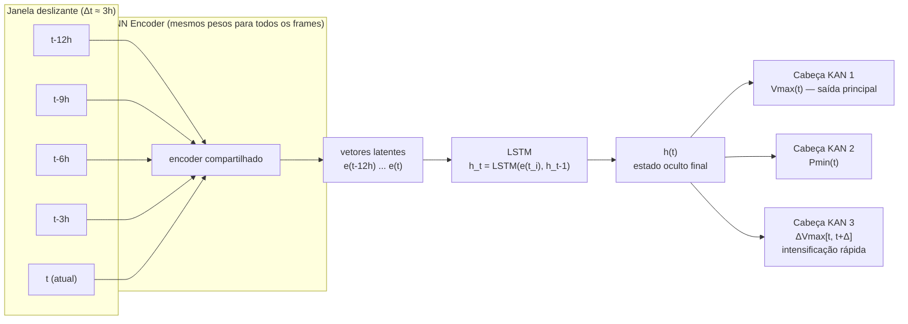

# Metodologia Proposta — Estimativa Temporal da Intensidade de Ciclones Tropicais com CNN + LSTM + KAN Multi-tarefa

> Documento de referência técnica da nova metodologia, construído a partir de diagramas manuscritos do projeto cruzados com a metodologia do TCC (`versão final.pdf`). Serve como base conceitual **antes** da implementação em Python — não contém código.

## Sumário

1. [Nota sobre as fontes](#1-nota-sobre-as-fontes)
2. [Contexto: relação com o TCC](#2-contexto-relação-com-o-tcc)
3. [Visão geral da nova pipeline](#3-visão-geral-da-nova-pipeline)
4. [Etapa 1 — Dados e pré-processamento](#4-etapa-1--dados-e-pré-processamento)
5. [Etapa 2 — Sequência temporal e CNN Encoder](#5-etapa-2--sequência-temporal-e-cnn-encoder)
6. [Etapa 3 — Módulo de dinâmica temporal (LSTM)](#6-etapa-3--módulo-de-dinâmica-temporal-lstm)
7. [Etapa 4 — Cabeças multi-tarefa com KAN](#7-etapa-4--cabeças-multi-tarefa-com-kan)
8. [Etapa 5 — Protocolo de validação estatística](#8-etapa-5--protocolo-de-validação-estatística)
9. [Etapa 6 — Explicabilidade](#9-etapa-6--explicabilidade)
10. [Ponto de partida: resultados do TCC (baseline a superar)](#10-ponto-de-partida-resultados-do-tcc-baseline-a-superar)
11. [Tabela-resumo: o que muda em relação ao TCC](#11-tabela-resumo-o-que-muda-em-relação-ao-tcc)
12. [⚠️ Cuidados de implementação](#12-️-cuidados-de-implementação)
13. [Perguntas em aberto / pontos a confirmar](#13-perguntas-em-aberto--pontos-a-confirmar)
14. [Ordem sugerida de implementação](#14-ordem-sugerida-de-implementação)
15. [Referências adicionais sugeridas](#15-referências-adicionais-sugeridas)

---

## 1. Nota sobre as fontes

Este documento foi construído a partir de três diagramas manuscritos do projeto (`1.jpeg`, `2.jpeg`, `3.jpeg`), cruzados com a metodologia do TCC (`versão final.pdf`).

Um detalhe manuscrito em `1.jpeg` ficou parcialmente ilegível mesmo após zoom: a probabilidade de aplicação da rotação (data augmentation) aparenta ser **"0,5" ou "0,55"** — valor aproximado, listado como pendência na [seção 13](#13-perguntas-em-aberto--pontos-a-confirmar).

---

## 2. Contexto: relação com o TCC

O TCC (`versão final.pdf` — *"Predição da velocidade de ciclones tropicais utilizando redes neurais convolucionais de baixa e alta complexidade com explicabilidade baseada em SHAP"*) estabeleceu uma baseline sólida:

- Dataset **TCIR** (Tropical Cyclone for Image-to-Intensity Regression), 70.501 imagens, 201×201 px, 4 bandas.
- Pré-processamento com seleção de bandas (IR + PMW), normalização z-score, *data augmentation* por rotação, e duas bandas adicionais de diferença temporal (**DTA** e **SDTA**) como forma de injetar informação de movimento em modelos que, até então, recebiam apenas **uma imagem isolada por vez**.
- Cinco arquiteturas comparadas (CNN-TC, CNN-TC-Δ1, CNN-TC-Δ2, ResNet50, MobileNetV2), validadas com teste de Wilcoxon, e explicadas com SHAP.
- Melhor resultado: MobileNetV2, RMSE 9,14 nós, MAE 7,00 nós.

A nova pipeline descrita neste documento é o cerne da proposta do artigo — algo teoricamente novo e relevante — e é uma **evolução conceitual** do TCC, não uma reinicialização:

- Mantém o dataset (TCIR), a lógica de seleção de bandas e os canais de diferença temporal (DTA/SDTA) já validados no TCC.
- **Principal mudança**: em vez de alimentar o modelo com **uma imagem por vez**, a nova pipeline constrói **sequências temporais** de 5 instantes (espaçados em ~3h) por ciclone, processadas por uma **CNN encoder + LSTM**, substituindo a regressão direta por uma modelagem explícita da dinâmica temporal.
- Troca a cabeça final de regressão (3 camadas *fully-connected*, no TCC) por **3 cabeças KAN independentes** (*multi-task learning*), prevendo não só a velocidade atual, mas também a pressão mínima e a intensificação rápida futura.
- Substitui a validação por *split* único (por ano) por uma validação cruzada agrupada por ciclone, com múltiplas seeds e correção estatística mais rigorosa.
- Adiciona uma segunda camada de explicabilidade nativa da própria arquitetura (funções *spline* da KAN), além do Grad-CAM.

---

## 3. Visão geral da nova pipeline



Leitura do diagrama: cada um dos 5 frames da janela passa pelo **mesmo** CNN encoder (pesos compartilhados — não são 5 redes diferentes), virando 5 vetores latentes. A LSTM consome esses vetores **em sequência** (um de cada vez, carregando memória do anterior para o seguinte), produzindo um único estado oculto final `h(t)` que resume "como o ciclone evoluiu" até agora. Esse estado alimenta 3 cabeças KAN independentes, cada uma prevendo uma grandeza diferente.

Cada etapa é detalhada a seguir.

---

## 4. Etapa 1 — Dados e pré-processamento

**Fontes:** `1.jpeg`, seção 4.1–4.2 do TCC.

### 4.1 Base de dados TCIR (recapitulação do TCC)

- 70.501 imagens, 2003–2017, resolução 201×201 px (~7,8 km/pixel).
- 4 bandas originais: Infravermelho (IR), Vapor de Água (WV), Luz Visível (VIS), Taxa de Chuva por Micro-ondas Passiva (PMW).
- Rótulos usados no TCC: ID do ciclone, intensidade (Vmax, nós), tamanho, coordenadas, data/hora.
- **Importante:** o TCC não lista pressão mínima (Pmin) entre os campos utilizados — ver [pendência crítica na seção 13](#13-perguntas-em-aberto--pontos-a-confirmar), pois a nova pipeline precisa desse rótulo para a segunda cabeça KAN.

### 4.2 Deduplicação por ID de ciclone (NOVO)

É preciso verificar se o dataset de treino tem fotos duplicadas do mesmo ciclone no mesmo instante de tempo (erro conhecido de captura por satélite). Uma duplicata é um dado redundante que "vicia" o treino — a rede vê o mesmo exemplo mais de uma vez dentro da mesma época, como se fosse um exemplo novo, distorcendo o gradiente.

Procedimento: agrupar por `ID do ciclone`, verificar se há mais de uma imagem com o mesmo *timestamp*; se houver, manter apenas uma. Isso vale **apenas para o conjunto de treino** (ou seja, só para o ajuste — *fitting* — do modelo).

Além disso, essa etapa deve **garantir espaçamento regular de 3h** entre frames consecutivos de um mesmo ciclone — pré-requisito para a etapa 2 (ver [cuidados de implementação](#12-️-cuidados-de-implementação)).

### 4.3 Seleção de bandas e normalização (igual ao TCC)

- Bandas usadas: **IR** + **PMW** (descartando VIS — sem informação à noite — e WV — redundante com IR, risco de *overfitting*).
- Limpeza: valores `NaN` e valores > 1000 substituídos por 0.
- Normalização z-score por canal: $x_{normalizado} = \dfrac{x - \mu}{\sigma}$.

### 4.4 Canais de diferença temporal: DTA (velocidade) e SDTA (aceleração)

Já eram usados no TCC (CNN-TC-Δ1 e CNN-TC-Δ2), mas como **alternativas mutuamente exclusivas**. Na nova pipeline, os dois passam a ser usados **simultaneamente**, como canais adicionais no mesmo tensor.

- **DTA** (Diferença Temporal Absoluta, 1ª ordem) — análogo a uma "velocidade" de mudança da nuvem entre dois frames consecutivos:

$$\text{DTA}_i^n = |I_i^n - I_i^{n-1}|$$

- **SDTA** (Segunda Diferença Temporal Absoluta, 2ª ordem) — análogo a uma "aceleração", a diferença entre duas diferenças consecutivas:

$$\text{SDTA}_i^n = |(I_i^n - I_i^{n-1}) - (I_i^{n-1} - I_i^{n-2})| = |I_i^n - 2I_i^{n-1} + I_i^{n-2}|$$

onde $I_i^n$ é o valor do pixel $i$ no instante $n$. Ambas calculadas a partir do canal IR (maior resolução espacial, evita redimensionar o PMW — mesma justificativa do TCC).

A ideia: dar à rede, em cada frame, não só o "estado" do ciclone (IR, PMW) mas também sua "velocidade" (DTA) e "aceleração" (SDTA) de mudança — complementar à informação temporal que a LSTM vai extrair *entre* frames.

### 4.5 Data augmentation: rotação aleatória

- Rotação aleatória $\theta \sim \mathcal{U}(0°, 360°)$ — ciclones não têm uma rotação canônica (mesma justificativa do TCC).
- Aplicada **somente no split de treino** (anotação sublinhada em `1.jpeg`).
- Probabilidade de aplicação: aproximadamente **0,5** (anotação manuscrita de difícil leitura — [confirmar valor exato](#13-perguntas-em-aberto--pontos-a-confirmar)).
- Não entra como um canal adicional — é uma transformação geométrica aplicada ao tensor inteiro (ver [cuidado de implementação sobre consistência da rotação](#12-️-cuidados-de-implementação)).

### 4.6 Tensor final por frame

```
Tensor: (4, 64, 64)
  Canal 1: IR
  Canal 2: PMW
  Canal 3: DTA
  Canal 4: SDTA
```

Resolução 64×64 (mesmo recorte do TCC, centrado no olho do ciclone, ~2° de lat/lon ≈ 57 px de diâmetro, arredondado para potência de 2).

---

## 5. Etapa 2 — Sequência temporal e CNN Encoder

**Fontes:** `2.jpeg`.

### 5.1 Janela deslizante (sliding window)

Em vez de uma imagem isolada, cada amostra de treino passa a ser uma **sequência de 5 frames** do mesmo ciclone, espaçados em ~3h: $t-12h,\ t-9h,\ t-6h,\ t-3h,\ t$. Cada frame já é o tensor $(4,64,64)$ da etapa anterior.

### 5.2 CNN Encoder com pesos compartilhados

Cada um dos 5 frames passa pelo **mesmo** CNN encoder (mesmos pesos, aplicado 5 vezes — não são 5 redes diferentes). Esse encoder "amassa" (comprime) cada imagem em um **vetor latente** (*embedding*) $e(t_i)$ — uma representação compacta do conteúdo daquele frame.

> **Analogia:** é como usar os mesmos óculos para olhar 5 fotos diferentes — você não aprende 5 formas diferentes de enxergar, aplica a mesma transformação a cada foto, obtendo uma descrição (vetor) por foto. A tarefa de conectar essas 5 descrições em uma "história" ao longo do tempo é responsabilidade do próximo módulo (LSTM), não do encoder.

Em termos práticos de implementação, esse "CNN Encoder" pode reaproveitar a arquitetura de uma das CNNs já implementadas no TCC (CNN-TC, ResNet50 ou MobileNetV2), removendo a camada final de regressão e expondo o vetor de *features* antes dela — ver [pergunta em aberto sobre qual encoder usar](#13-perguntas-em-aberto--pontos-a-confirmar). Dado que o encoder roda 5× por amostra (uma vez por frame), uma arquitetura mais leve (estilo CNN-TC, entrada 64×64) tende a ser computacionalmente mais viável que ResNet50/MobileNetV2 a 224×224 repetida 5 vezes.

O termo "frame" designa cada imagem da sequência: o ciclone é tratado como uma sequência de quadros (*frames*) evoluindo no tempo — daí o nome "sequência + encoder" no diagrama original.

---

## 6. Etapa 3 — Módulo de dinâmica temporal (LSTM)

**Fontes:** `2.jpeg`. Esta é a parte conceitualmente mais densa da proposta.

### 6.1 Por que não tratar cada frame isoladamente?

A intensidade de um ciclone é resultado de um **processo dinâmico**: o que importa não é só a aparência da nuvem agora, mas como ela mudou desde os instantes anteriores. Tratar os 5 *embeddings* $e(t_i)$ como peças soltas desperdiçaria essa estrutura sequencial — é necessário um mecanismo que "lembre" o que veio antes ao processar o que vem depois.

### 6.2 De RNN a LSTM — o problema do gradiente

Uma Rede Neural Recorrente (RNN) simples processa uma sequência mantendo um estado oculto atualizado a cada passo:

$$h_t = \tanh(W_x x_t + W_h h_{t-1} + b)$$

O problema: durante o treinamento (*backpropagation through time*), o gradiente precisa "voltar" por muitos passos no tempo, sendo multiplicado repetidamente pela mesma matriz de pesos. Isso faz o gradiente **desaparecer** (ficar ≈0, a rede "esquece" dependências de longo prazo) ou **explodir** (ficar enorme, treino instável). A **LSTM** (*Long Short-Term Memory*, Hochreiter & Schmidhuber, 1997) foi criada justamente para resolver esse problema — por isso é considerada a "sucessora" da RNN.

### 6.3 Como a LSTM funciona por dentro

A ideia central: além do estado oculto $h_t$ (memória de "trabalho", exposta a cada passo), a LSTM mantém um **estado de célula** $c_t$ — uma espécie de "esteira" que carrega informação ao longo do tempo com poucas interferências, controlada por três **portões** (*gates*). Cada portão é uma pequena camada com saída sigmoide (entre 0 e 1), funcionando como uma válvula: 0 = bloqueia tudo, 1 = deixa passar tudo.

$$f_t = \sigma(W_f \cdot [h_{t-1}, x_t] + b_f) \quad \text{(portão de esquecimento — quanto da memória antiga mantém)}$$

$$i_t = \sigma(W_i \cdot [h_{t-1}, x_t] + b_i), \quad \tilde{c}_t = \tanh(W_c \cdot [h_{t-1}, x_t] + b_c) \quad \text{(portão de entrada — quanta informação nova entra)}$$

$$c_t = f_t \odot c_{t-1} + i_t \odot \tilde{c}_t \quad \text{(atualização do estado de célula — a "memória" de longo prazo)}$$

$$o_t = \sigma(W_o \cdot [h_{t-1}, x_t] + b_o), \quad h_t = o_t \odot \tanh(c_t) \quad \text{(portão de saída — o que expor como estado oculto)}$$

onde $\sigma$ = sigmoide, $[h_{t-1}, x_t]$ = concatenação, $\odot$ = produto elemento-a-elemento. O estado de célula $c_t$ só sofre interações lineares (soma + multiplicação por portões), o que permite ao gradiente fluir por muitos passos sem desaparecer — essa é a inovação central da LSTM frente à RNN simples.

### 6.4 Notação simplificada usada no projeto

No esboço da arquitetura, isso aparece simplificado como:

$$h_t = \text{LSTM}(e(t_i), h_{t-1})$$

Ou seja: a entrada $x_t$ de cada passo é o vetor latente $e(t_i)$ produzido pelo CNN encoder (não os pixels brutos), e $h_{t-1}$ é a memória vinda do instante anterior (3h antes). A LSTM processa os 5 vetores da sequência em ordem (`t-12h → t-9h → t-6h → t-3h → t`), e o estado oculto final `h(t)` resume "como o ciclone evoluiu" até o instante atual — é esse `h(t)` que alimenta as cabeças KAN.

### 6.5 Limitação conhecida: horizonte fixo e discreto

Ponto central da proposta: a LSTM pressupõe passos **regulares e discretos** (aqui, exatamente 3h). Se um ciclone tiver uma falha de captura (ex.: um *gap* de 6h em vez de 3h), a LSTM não tem noção de "quanto tempo realmente passou" — ela só enxerga "o próximo item da sequência", tratando o intervalo irregular como se fosse regular, o que pode confundir a dinâmica aprendida.

Uma equação diferencial (ou uma rede neural contínua) lidaria naturalmente com intervalos irregulares, pois modela o tempo como uma variável contínua, não uma sequência de passos discretos. Mas essa abordagem é consideravelmente mais complexa e **não é prioridade para o artigo atual** — fica como ideia para trabalho futuro. Por ora, a estratégia é aceitar a limitação e garantir, na etapa de pré-processamento, que as janelas usadas tenham de fato ~3h regulares entre frames (descartando ou tratando à parte janelas com *gaps*).

### 6.6 Alternativa futura: Neural ODE

Para referência futura: a classe de modelos que generaliza RNN/LSTM para tempo contínuo é conhecida como **Neural ODE** (Chen et al., 2018) — o estado oculto é modelado como solução de uma equação diferencial $dh/dt = f(h,t)$, integrável sobre qualquer intervalo de tempo, lidando naturalmente com amostragem irregular. Vale mencionar na seção de trabalhos futuros do artigo.

---

## 7. Etapa 4 — Cabeças multi-tarefa com KAN

**Fontes:** `2.jpeg`, `3.jpeg`.

### 7.1 Aprendizado multi-tarefa (*multi-task learning*)

Em vez de treinar um modelo para prever só Vmax, a nova pipeline treina **um único modelo com um "tronco" compartilhado** (CNN encoder + LSTM) e **3 "cabeças" especializadas**, cada uma prevendo uma grandeza diferente a partir do mesmo `h(t)`. Vantagens:

1. A representação compartilhada é forçada a capturar características úteis para **todas** as tarefas — funciona como um regularizador, reduzindo *overfitting* em tarefas com menos dados.
2. Vmax, Pmin e intensificação rápida são fisicamente correlacionados (relações vento-pressão bem estabelecidas em meteorologia) — aprendê-los juntos permite à rede explorar essas correlações.
3. Mais eficiente que treinar 3 modelos separados do zero.

### 7.2 As 3 tarefas do projeto

| Cabeça | Alvo | Entrada | Natureza |
|---|---|---|---|
| 1 (principal) | $V_{max}(t)$ — velocidade máxima sustentada no instante atual | $h(t)$ "agora" | *Nowcasting* — mesma tarefa do TCC |
| 2 | $P_{min}(t)$ — pressão central mínima no instante atual | $h(t)$ "agora" | *Nowcasting* — tarefa auxiliar nova |
| 3 | $\Delta V_{max}[t, t+\Delta]$ — variação futura da velocidade | $h(t)$ | *Forecasting* — "intensificação rápida" |

A cabeça 1 é fixa (é a principal). As cabeças 2 e 3 são negociáveis: podem ser mantidas, removidas ou substituídas conforme se mostrarem úteis.

**Contexto de domínio — intensificação rápida (RI):** operacionalmente definida (ex.: Kaplan & DeMaria, 2003) como aumento de Vmax ≥ 30 nós em 24h. É um dos fenômenos mais difíceis de prever em meteorologia de ciclones e um dos mais perigosos operacionalmente, pois surpreende sistemas de alerta e populações (ex.: furacões Patricia 2015, Otis 2023). Conseguir prever não só o estado atual, mas a **taxa de mudança futura**, é um ponto forte para a narrativa de contribuição do artigo.

### 7.3 O que é uma KAN? De MLP a Kolmogorov-Arnold

Uma camada MLP tradicional (como as 3 camadas *fully-connected* do CNN-TC) calcula, por neurônio, uma soma ponderada **linear** dos sinais de entrada, seguida de uma função de ativação **fixa** (ex.: ReLU) — a não linearidade mora no **nó**:

$$x_{l+1,j} = \sigma\Big(\sum_i w_{l,j,i} \cdot x_{l,i} + b_{l,j}\Big)$$

Uma **KAN** (*Kolmogorov-Arnold Network*, Liu et al., 2024) inverte essa lógica: em vez de um peso escalar por conexão, cada **aresta** (conexão) carrega uma função univariada **aprendível** $\varphi_{l,j,i}$ (tipicamente parametrizada como uma *spline*, uma curva polinomial por partes com pontos de controle treináveis), e o nó apenas **soma** as saídas — a não linearidade mora na **aresta**, e é aprendida, não fixa:

$$x_{l+1,j} = \sum_i \varphi_{l,j,i}(x_{l,i})$$

Essa ideia é inspirada no **Teorema da Representação de Kolmogorov-Arnold** (Kolmogorov, 1957; Arnold, 1957), que garante que qualquer função contínua multivariada pode ser escrita como composição finita de funções contínuas univariadas e somas:

$$f(x_1, \dots, x_n) = \sum_{q=0}^{2n} \Phi_q\Big(\sum_{p=1}^{n} \varphi_{q,p}(x_p)\Big)$$

A KAN generaliza essa estrutura de 2 camadas para uma pilha profunda de camadas desse tipo, treinada por *backpropagation* como uma rede neural comum.

### 7.4 Por que isso importa para este projeto

1. **Interpretabilidade nativa:** como cada $\varphi_{l,j,i}$ é uma função explícita de uma variável, ela pode ser **plotada diretamente**, mostrando exatamente que relação a rede aprendeu entre cada variável latente e cada saída — sem precisar de um método de explicabilidade *post-hoc* separado (é a origem da ideia de "funções spline da KAN" como técnica de explicabilidade, ver [seção 9](#9-etapa-6--explicabilidade)).
2. **Novidade teórica:** KAN é de 2024 — usá-la para regressão multi-tarefa em ciclones tropicais é uma escolha metodológica genuinamente nova, o que a torna o cerne da proposta do artigo.
3. **Custo computacional:** cada aresta agora guarda uma *spline* com vários pontos de controle, não um único escalar — KANs tendem a ser mais lentas de treinar que MLPs de tamanho comparável. Trade-off a considerar na implementação.

---

## 8. Etapa 5 — Protocolo de validação estatística

**Fontes:** `3.jpeg`.

### 8.1 Cross-validation agrupada por ciclone (k=5)

Um k-fold tradicional embaralha **amostras individuais** entre os folds. Aqui, cada "amostra" é uma sequência de um ciclone específico, e sequências do mesmo ciclone são fortemente correlacionadas (mesma tempestade, janelas sobrepostas, aparência visual semelhante). Se frames do mesmo ciclone caírem tanto no treino quanto no teste, o modelo pode "decorar" aquele ciclone específico em vez de aprender um padrão generalizável — um vazamento de dados (*data leakage*) que infla artificialmente o desempenho.

A solução é agrupar por `ID do ciclone` (em scikit-learn, `GroupKFold`), garantindo que **todas** as sequências de um dado ciclone fiquem inteiramente em um único lado (treino **ou** teste) em cada fold — nunca divididas. Isso testa de forma honesta a capacidade de generalizar para ciclones **nunca vistos**, que é o cenário real de uso do modelo.

### 8.2 Por que 5 seeds?

O treinamento de redes neurais é estocástico: inicialização aleatória dos pesos, ordem aleatória dos lotes (*batches*), e, em GPU, não-determinismo na ordem de operações de ponto flutuante paralelas (cuDNN/cuBLAS). Mesmo com código e dados idênticos, uma *seed* fixa não garante resultado idêntico entre execuções diferentes. Repetir o treino com 5 *seeds* diferentes por fold mede **quanto da diferença observada entre modelos é efeito real** vs. ruído da aleatoriedade do treino — se um modelo supera outro de forma consistente nas 5 seeds (e idealmente nos 5 folds), é evidência mais forte de melhoria genuína. No total: 5 folds × 5 seeds = 25 treinos por variante de modelo.

### 8.3 Teste de Wilcoxon (pareado)

Mesmo teste já usado no TCC (Tabela 5 do TCC, justificado porque o teste de Shapiro-Wilk rejeitou normalidade dos erros — Tabela 4 do TCC). É a alternativa não paramétrica ao teste t pareado: compara os erros absolutos pareados (mesmo exemplo de teste, dois modelos) ranqueando as diferenças, testando se a distribuição das diferenças é simétrica em torno de zero (sem diferença sistemática) ou enviesada (melhoria/piora sistemática). Apropriado aqui porque os erros não são normais e as amostras são pareadas (mesmo conjunto de teste para ambos os modelos).

### 8.4 Correção de Holm-Bonferroni

Ao rodar muitas comparações estatísticas simultâneas (vários modelos × vários folds × várias seeds), a chance de pelo menos um falso positivo cresce rapidamente mesmo com α=0,05 por teste (ex.: com 20 testes independentes, a chance de ≥1 falso positivo é ≈64%). A correção de Holm-Bonferroni controla essa taxa de erro:

1. Ordenar os p-valores do menor para o maior: $p_{(1)} \le p_{(2)} \le \dots \le p_{(m)}$.
2. Comparar sequencialmente $p_{(k)}$ contra $\alpha / (m - k + 1)$.
3. Parar no primeiro $k$ em que $p_{(k)} > \alpha/(m-k+1)$ — rejeitar todas as hipóteses anteriores a esse ponto.

É o procedimento de ranquear os p-valores e testá-los em sequência. Menos conservadora que a correção de Bonferroni simples (mais poder estatístico), mas ainda garante controle rigoroso do erro familywise. Em Python: `statsmodels.stats.multitest.multipletests(method='holm')`.

---

## 9. Etapa 6 — Explicabilidade

**Fontes:** `3.jpeg`.

### 9.1 Grad-CAM no encoder

*Gradient-weighted Class Activation Mapping* (Selvaraju et al., 2017): calcula o gradiente da saída prevista em relação aos mapas de características de uma camada convolucional (tipicamente a última antes do achatamento), faz a média global desses gradientes para obter um peso de importância por canal do mapa de características, soma ponderada dos mapas + ReLU (mantém só influências positivas) → gera um mapa de calor de baixa resolução, re-escalado para o tamanho da imagem de entrada, destacando quais regiões espaciais mais influenciaram a predição. Aplicado aqui ao CNN encoder, cumpre papel equivalente ao SHAP no TCC, mas computacionalmente muito mais barato (gradiente direto vs. abordagem de teoria dos jogos do SHAP) — embora teoricamente menos rigoroso/axiomático.

### 9.2 Funções spline da própria KAN

Complementar ao Grad-CAM: como vimos na [seção 7.3](#7-etapa-4--cabeças-multi-tarefa-com-kan), as funções $\varphi$ aprendidas pela KAN podem ser plotadas diretamente, mostrando a relação funcional entre cada variável latente de `h(t)` e cada saída (Vmax, Pmin, ΔVmax). Enquanto o Grad-CAM responde **"onde"** na imagem o modelo prestou atenção, as *splines* da KAN respondem **"que relação"** o modelo aprendeu entre as variáveis internas e a saída — dois tipos complementares de explicabilidade.

### 9.3 Comparação com o SHAP usado no TCC

| | TCC (SHAP) | Nova pipeline |
|---|---|---|
| Método | SHAP (teoria dos jogos, baseado em gradientes) | Grad-CAM (gradientes) + *splines* da KAN (nativa) |
| O que explica | Contribuição de cada pixel para a saída única | Onde a CNN olhou (Grad-CAM) + que função a KAN aprendeu (splines) |
| Custo computacional | Alto | Mais baixo (Grad-CAM) + gratuito (splines, já fazem parte do modelo) |
| Aplicado a | Melhor modelo (MobileNetV2) | Encoder da pipeline (parte convolucional) |

---

## 10. Ponto de partida: resultados do TCC (baseline a superar)

Para referência ao reportar resultados da nova pipeline (teste 2017, N=4296):

| Modelo | RMSE (nós) | MAE (nós) | MSE |
|---|---|---|---|
| CNN-TC (baseline) | 10,06 | 7,53 | 101,14 |
| CNN-TC-Δ1 (DTA) | 9,56 | 7,22 | 91,38 |
| CNN-TC-Δ2 (SDTA) | 9,72 | 7,23 | 94,52 |
| ResNet50 (SDTA) | 9,24 | 7,01 | 85,36 |
| **MobileNetV2 (SDTA) — melhor** | **9,14** | **7,00** | **83,55** |

*Nota: o artigo original do CNN-TC (Chen; Chen; Lin, 2018) reporta RMSE 10,58 — a reimplementação do TCC obteve 10,06 no mesmo conjunto de teste 2017, usada aqui como referência direta de comparação.*

---

## 11. Tabela-resumo: o que muda em relação ao TCC

| Aspecto | TCC (atual) | Nova pipeline |
|---|---|---|
| Entrada | 1 imagem por amostra | Sequência de 5 frames (~3h de espaçamento) |
| Canais por frame | 2 (IR+PMW) ou 3 (+ DTA **ou** SDTA) | 4 (IR + PMW + DTA **e** SDTA simultâneos) |
| Modelagem temporal | Implícita (só via canal de diferença) | Explícita (LSTM sobre sequência de embeddings) |
| Saída | 1 valor (Vmax) | 3 valores (Vmax, Pmin, ΔVmax) via multi-task |
| Cabeça de regressão | 3 camadas *fully-connected* (MLP) | 3 cabeças KAN independentes |
| Validação | Split único por ano (2003-14/15-16/17) | CV agrupada por ciclone (k=5) × 5 seeds |
| Teste estatístico | Wilcoxon pareado | Wilcoxon pareado + correção Holm-Bonferroni |
| Explicabilidade | SHAP | Grad-CAM (encoder) + splines da KAN |
| Deduplicação de ID | Não mencionada | Nova etapa explícita de verificação |

---

## 12. ⚠️ Cuidados de implementação

Pontos não explicitados no esboço da proposta, mas que decorrem logicamente da arquitetura descrita — vale ter em mente ao programar, para evitar bugs sutis:

1. **Rotação consistente dentro do frame:** a mesma rotação θ deve ser aplicada a **todos os canais** de um frame (IR, PMW, DTA, SDTA) — nunca rotações independentes por canal.
2. **Rotação consistente ao longo da sequência:** a mesma rotação θ deve ser aplicada a **todos os 5 frames** de uma mesma janela temporal — se cada frame girasse para um ângulo diferente, a sequência ficaria espacialmente incoerente entre frames, destruindo o sinal que a LSTM deveria aprender.
3. **Ordem diferença → rotação:** DTA/SDTA devem ser calculados sobre os pares de imagens **antes** da rotação aleatória (na grade de pixels original/alinhada) — rotacionar cada frame do par independentemente antes de subtrair destruiria o alinhamento espacial necessário para a diferença capturar movimento real do ciclone, e não um artefato da rotação. Primeiro calcula-se a diferença, depois aplica-se uma única rotação ao tensor já combinado (mesma ordem sugerida pela Figura 3 do TCC).
4. **Deduplicação antes da janela deslizante:** a deduplicação de IDs deve acontecer **antes** de montar as sequências de 5 frames — um frame duplicado dentro de uma janela quebraria a suposição de espaçamento regular de 3h que a LSTM pressupõe (ver [seção 6.5](#6-etapa-3--módulo-de-dinâmica-temporal-lstm)).
5. **Sem vazamento de dados na cabeça de intensificação rápida:** a Cabeça KAN 3 (ΔVmax) deve consumir **apenas `h(t)`** (informação disponível até o instante atual) — o rótulo de treino (ΔVmax real, histórico) vem de dados já conhecidos, mas o encoder/LSTM nunca deve receber frames futuros (t+Δ) como entrada. A notação "`h(t)+Δ`" do diagrama provavelmente indica apenas o horizonte do **alvo** de previsão, não uma entrada futura — [a confirmar](#13-perguntas-em-aberto--pontos-a-confirmar).
6. **Framework:** o TCC foi implementado em Keras/TensorFlow. A maioria das implementações de referência de KAN (oficial `pykan` e variantes da comunidade como `efficient-kan`) é nativa em PyTorch — avaliar se vale portar a pipeline para PyTorch ou procurar/implementar uma camada KAN em Keras/TensorFlow.

---

## 13. Perguntas em aberto / pontos a confirmar

1. **[Crítico] Fonte do rótulo de Pmin:** o TCIR, como descrito e usado no TCC, não lista pressão mínima entre os campos utilizados (apenas ID, Vmax, tamanho, coordenadas, data/hora). Será necessário verificar a documentação completa do TCIR (pode haver mais colunas não utilizadas no TCC) ou cruzar com uma fonte externa como o **IBTrACS** (que inclui pressão central no *best track*), unindo por ID do ciclone + *timestamp*. Sem esse rótulo, a Cabeça KAN 2 não pode ser treinada.
2. **Valor exato de Δ** (horizonte da intensificação rápida): a definição operacional usual na literatura é 24h (Kaplan & DeMaria, 2003, aumento ≥30 nós) — confirmar se é esse o valor pretendido, ou outro.
3. **Interpretação de "`h(t)+Δ`"** na Cabeça KAN 3 — ver [cuidado de implementação nº 5](#12-️-cuidados-de-implementação).
4. **Qual CNN usar como encoder compartilhado** (CNN-TC simples, ResNet50 ou MobileNetV2) — e se os pesos podem ser inicializados a partir dos modelos já treinados no TCC.
5. **Valor exato da probabilidade de rotação** (anotação manuscrita ambígua em `1.jpeg`: ~0,5 ou 0,55).
6. **Framework de implementação** (manter Keras/TensorFlow como no TCC, ou migrar para PyTorch, mais comum para implementações de KAN).
7. **Cabeças 2 e 3 são negociáveis** — confirmar se ambas entram na primeira versão do artigo ou se começa só com a Cabeça 1 (Vmax) e adiciona as outras depois, como estratégia incremental.

---

## 14. Ordem sugerida de implementação

Priorização sugerida para a implementação:

1. **Camada de dados primeiro:** corrigir a deduplicação de ID de ciclone; verificar se o tensor de canais (IR, PMW, DTA, SDTA) está sendo montado corretamente.
2. **Pipeline principal:** implementar a sequência temporal (janela deslizante) → CNN encoder compartilhado → LSTM → cabeças multi-tarefa KAN. Começar só com a Cabeça 1 (Vmax) se preferir simplificar o primeiro ciclo de validação.
3. **Por último:** protocolo de CV (k=5 × 5 seeds), testes estatísticos (Wilcoxon + Holm-Bonferroni) e explicabilidade (Grad-CAM + splines da KAN) — etapas para o final.

A única modificação em relação à concepção original da pipeline: ela trabalhava num horizonte invariável e irregular, com equações diferenciais; agora trabalha num horizonte fixo e discreto, com LSTM — a única limitação conhecida, aceita por ora.

---

## 15. Referências adicionais sugeridas

Para incorporar à bibliografia do artigo (formato consistente com as referências do TCC), cobrindo os conceitos novos desta pipeline que ainda não constavam no TCC:

```
ARNOLD, V. I. On functions of three variables. Doklady Akademii Nauk SSSR, v. 114, p. 679–681, 1957.

CHEN, R. T. Q. et al. Neural ordinary differential equations. Advances in Neural
Information Processing Systems (NeurIPS), v. 31, 2018.

HOCHREITER, S.; SCHMIDHUBER, J. Long short-term memory. Neural Computation,
v. 9, n. 8, p. 1735–1780, 1997.

HOLM, S. A simple sequentially rejective multiple test procedure. Scandinavian
Journal of Statistics, v. 6, n. 2, p. 65–70, 1979.

KAPLAN, J.; DEMARIA, M. Large-scale characteristics of rapidly intensifying
tropical cyclones in the North Atlantic basin. Weather and Forecasting, v. 18,
n. 6, p. 1093–1108, 2003.

KOLMOGOROV, A. N. On the representation of continuous functions of several
variables by superposition of continuous functions of one variable and
addition. Doklady Akademii Nauk SSSR, v. 114, p. 953–956, 1957.

LIU, Z. et al. KAN: Kolmogorov-Arnold Networks. arXiv preprint arXiv:2404.19756,
2024.

SELVARAJU, R. R. et al. Grad-CAM: Visual explanations from deep networks via
gradient-based localization. In: Proceedings of the IEEE International
Conference on Computer Vision (ICCV). [S.l.: s.n.], 2017. p. 618–626.
```

*(RNN já está coberta pela referência ELMAN, 1990, já presente no TCC.)*
