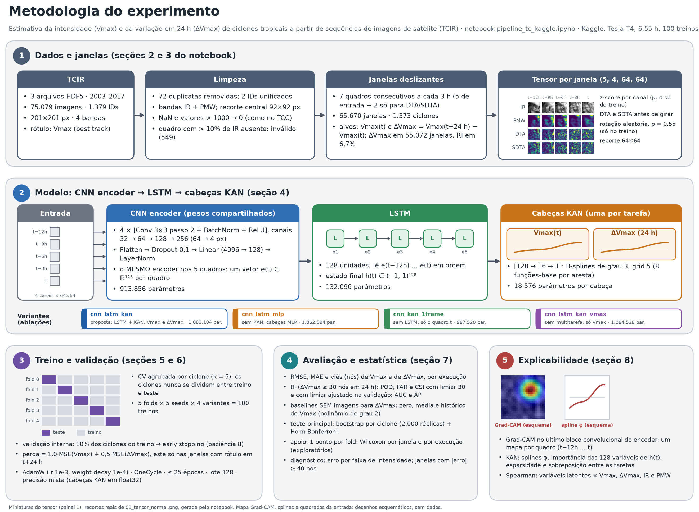
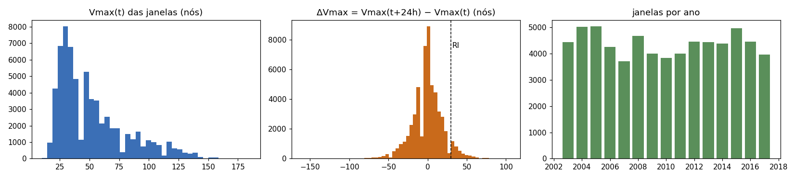
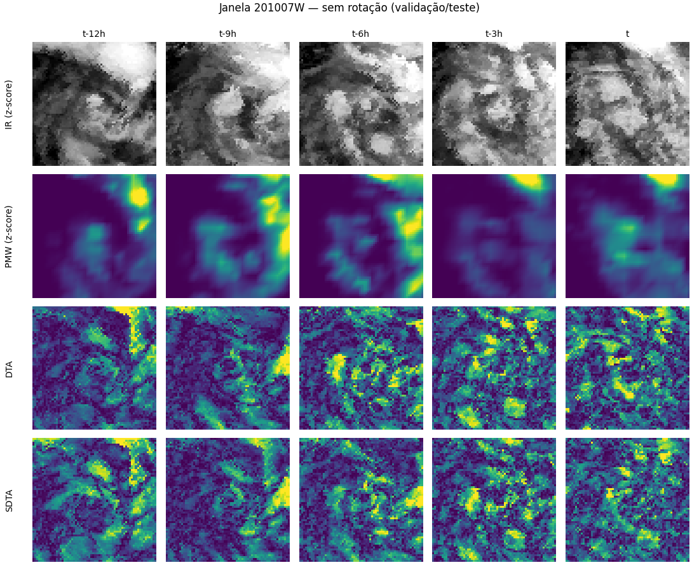
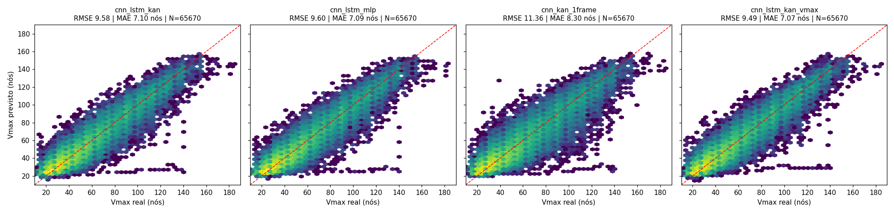
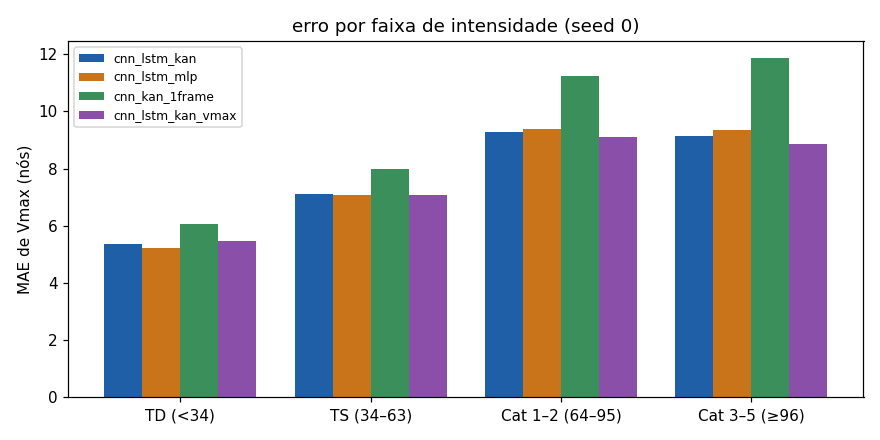
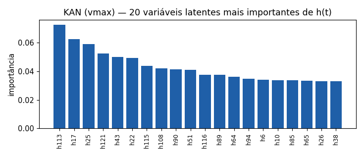
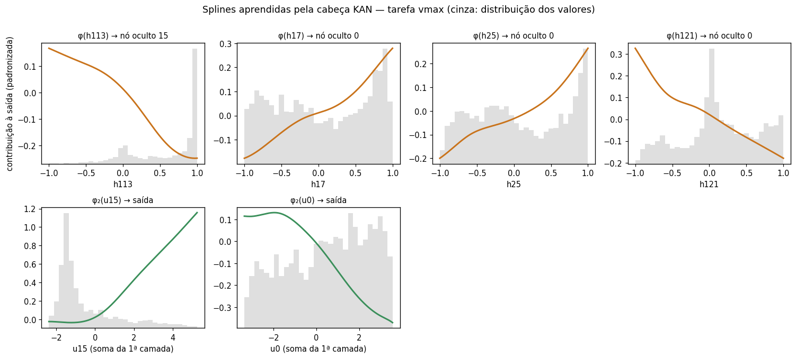
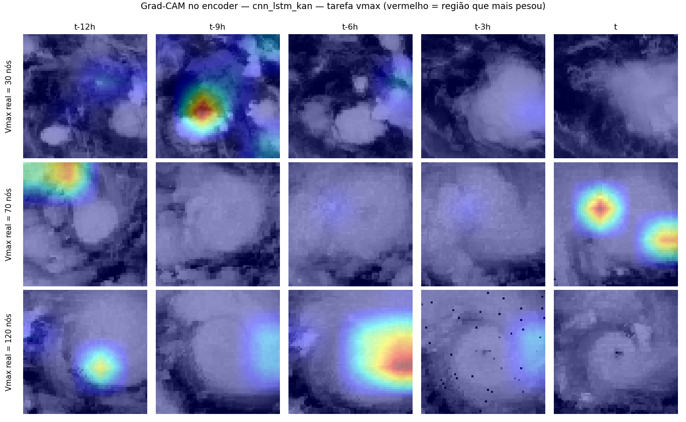
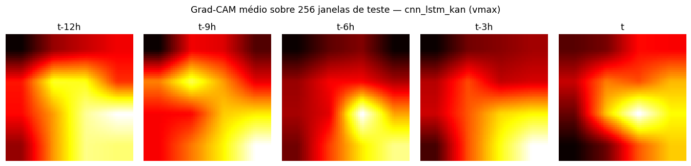

# Resultados do experimento

**CNN encoder (pesos compartilhados) → LSTM → cabeças KAN multitarefa para estimar a intensidade (Vmax) e a variação em 24 h (ΔVmax) de ciclones tropicais a partir de sequências de imagens de satélite (TCIR).**

> Gerado por `montar_resultado.py` em 2026-10-29 a partir dos arquivos que o notebook gravou (`config.json`, `resumo_final.json`, `tabelas/`, `runs/`) e da análise independente `analisar_resultados_pipeline.py`. Os números vêm desses arquivos (as poucas exceções, como o TCC e uma rodada rápida anterior, estão identificadas no texto); a seção 7 mostra o que foi reconferido a partir das 100 predições. Erros em **nós**; decimais com vírgula.

**Conteúdo:** 1. Resumo · 2. A execução · 3. Metodologia · 4. Resultados · 5. O que se sustenta e o que não · 6. Limitações · 7. Verificação independente · 8. Como reproduzir

## 1. Resumo

Rodou-se no Kaggle (Tesla T4) o notebook `pipeline_tc_kaggle.ipynb`: **100 treinos** (5 folds × 5 seeds × 4 variantes), 6,55 h, com 0 execuções pendentes. O modelo proposto (CNN encoder com pesos compartilhados → LSTM → duas cabeças KAN) estima o **Vmax com RMSE de 9,60 ± 0,47 nós** (modelo único; média das 25 execuções fold × seed) e **9,15 nós com o ensemble das 5 seeds**.

| Pergunta | Resposta | Evidência (erros em nós; diferença = proposta − outra, negativa = a proposta erra menos) |
| :--- | :--- | :--- |
| A sequência de quadros (LSTM) ajuda? | **Sim, é o efeito mais forte.** | RMSE de Vmax −1,72 nó [−1,83; −1,61] contra a variante de 1 quadro (−15%); a proposta é melhor em 5/5 folds |
| A KAN é melhor que um MLP? | **Não dá para afirmar.** | Vmax: empate (−0,035 [−0,073; +0,002]; p Holm 0,195). ΔVmax: −0,13 nó (p Holm 0,012), mas em 4/5 folds e, com o ensemble das seeds, −0,08 (p Holm 0,117: não significativo) |
| A multitarefa (Vmax + ΔVmax) ajuda o Vmax? | **Não: piora levemente.** | RMSE de Vmax +0,11 nó [+0,06; +0,16]; a variante só-Vmax é melhor em 5/5 folds |
| Em ΔVmax a rede supera um baseline sem imagens? | **Só o ensemble de 5 seeds.** | modelo único: +0,09 nó [−0,13; +0,33] (empate); ensemble: RMSE 15,13 contra 15,72 (−0,58 [−0,81; −0,33]) |
| E na intensificação rápida (RI)? | **A rede ordena melhor os casos; o alarme com limiar de 30 nós quase não funciona.** | ensemble × histórico: AUC 0,842 × 0,799 e AP 0,321 × 0,233 (AUC +0,043 [+0,029; +0,057]); com o limiar fixo de 30 nós, POD 0,15 e FAR 0,56 |
| Imagens e histórico de Vmax se complementam? | **Indicativo (análise exploratória).** | empilhando os dois, RMSE de ΔVmax 14,58 (ensemble: 14,35) contra 15,72 só com o histórico |
| Comparação com o TCC (teste de 2017)? | **Melhor, com ressalvas.** | RMSE 8,35 ± 0,17 / MAE 6,40 contra 10,06 / 7,53 (CNN-TC) e 9,14 / 7,00 (MobileNetV2+SDTA); o protocolo é outro (seção 4.7) |
| Há problema nos dados? | **Sim: um ciclone com a longitude gravada errada.** | `201407E`: 48 janelas (0,07% do total) respondem por 3,7% do erro quadrático e produzem a faixa horizontal do gráfico predito × real (seção 4.8) |

**Três cuidados ao citar estes números**

1. **Modelo único × ensemble.** O ensemble das 5 seeds é outro modelo (5× o custo de treino e de inferência) e ganha 0,45 nó em Vmax e 0,67 nó em ΔVmax; as conclusões de ΔVmax e de RI mudam entre os dois. Diga sempre qual dos dois está sendo reportado.
2. **A comparação com o TCC não é estrita.** Aqui a validação é cruzada por ciclone (todos os anos) e as janelas exigem 7 quadros consecutivos; o TCC treinou em 2003–2014 e testou em 2017 (4.296 imagens).
3. **O erro de Vmax carrega um defeito dos dados.** Sem as 48 janelas do `201407E`, o RMSE do ensemble cai de 9,15 para 8,98; nenhuma conclusão muda.

## 2. A execução

| Item | Valor |
| :--- | :--- |
| Notebook | `pipeline_tc_kaggle.ipynb` (o notebook **completo**, em oposição ao notebook rápido de 1 seed), na versão ajustada depois da 1ª execução no Kaggle; 60 células, 30 de código |
| Ambiente | Kaggle, Tesla T4 (15,6 GB), Python 3.12.13, PyTorch 2.10.0+cu128 |
| Treino | 100 execuções de 20:45:47 a 03:18:42 (**6,55 h**), 0 pendentes; assinatura da configuração `e6afa7eb` |
| Execução no Kaggle (papermill) | 2026-10-12 20:38:14 UTC → 2026-10-13 03:19:11 UTC (6 h 41 min no total, das quais 6,55 h de treino) |
| Erros e avisos no log | 0 células com erro; 0 saídas em stderr |
| Dados | 75.079 imagens, 1.379 IDs → 1.377 ciclones depois de unir 2 IDs; 72 duplicatas removidas (70 de 72 idênticas bit a bit); 549 quadros inválidos |
| Janelas | **65.670** de 1.373 ciclones; 55.072 com rótulo de ΔVmax; RI (ΔVmax ≥ 30 nós em 24 h) em 3.669 (6,7% das rotuladas) |

- **`resultados_pipeline (1).zip`** (93.725.232 bytes): **idêntico byte a byte ao** `resultados_pipeline.zip` que o projeto já tinha (SHA-256 `0dfaa13926ee…d6c34ba0`). Não há dados novos em relação à análise de 2026-10-16.
- **`kanscnn (4).ipynb`**: 60 células; o código e o texto de todas as células são iguais aos do `__notebook__.ipynb` do zip; o texto de saída é o mesmo, exceto na célula 59 (a última, que empacota a saída: na cópia dentro do zip ela ainda não tem saída, porque o próprio zip é criado por ela; o mesmo vale para o fim do registro do papermill). É o **mesmo notebook executado**: a 2ª execução no Kaggle (a 1ª, de 75 treinos, foi feita antes e não faz parte deste documento).

## 3. Metodologia



*Metodologia do experimento (gerada por figura_metodologia.py com os números da própria execução). As miniaturas do tensor são recortes reais; Grad-CAM e splines são esquemas.*

### 3.1 Dados e janelas

- **TCIR** (75.079 imagens de 201×201 px, 2003–2017): usam-se as bandas **IR** (temperatura do topo das nuvens) e **PMW** (chuva por micro-ondas, que enxerga a parede do olho através das nuvens); WV e VIS são descartadas (WV ≈ IR; VIS é `NaN` à noite).
- **Limpeza.** `NaN` e valores > 1.000 viram 0 (como no TCC); 72 registros duplicados foram removidos e 2 IDs unificados (o mesmo ciclone com um ID em cada bacia), para que as cópias nunca caiam em folds diferentes; quadros com mais de 10% de IR ausente (549) saem da série.
- **Janelas.** Cada janela é uma sequência de 5 quadros a cada 3 h (t−12 h … t); como o SDTA do quadro mais antigo precisa de dois quadros anteriores, leem-se 7 consecutivos. Nenhuma janela atravessa um buraco. Resultado: **65.670 janelas** de 1.373 ciclones.
- **Alvos.** Vmax(t) em nós e ΔVmax = Vmax(t+24 h) − Vmax(t); o valor futuro é só rótulo, **nunca entrada**. RI = ΔVmax ≥ 30 nós.
- **Tensor por quadro** `(4, 64, 64)`: IR, PMW, **DTA** (diferença absoluta entre quadros consecutivos: a «velocidade» de mudança da nuvem) e **SDTA** (a diferença das diferenças: a «aceleração»); z-score por canal com μ e σ só do treino de cada fold; recorte central 92→64 px.



*Distribuição do Vmax(t), do ΔVmax e do número de janelas por ano (figura 00 do notebook).*



*Exemplo de janela (ciclone 201007W, sem rotação): 5 quadros × 4 canais (figura 01 do notebook).*

### 3.2 Modelo

O **mesmo** encoder processa os 5 quadros (pesos compartilhados: uma só forma de descrever um quadro de ciclone); a **LSTM** liga as 5 descrições numa história e entrega o estado final h(t); cada **cabeça KAN** lê h(t) e prevê uma grandeza. Numa KAN, a não linearidade mora nas **arestas** (cada uma carrega uma função φ aprendível, aqui uma B-spline), não nos nós; por isso cada φ pode ser desenhada.

| Bloco | Saída | Parâmetros |
| :--- | ---: | ---: |
| Conv 3×3, passo 2, 32 canais + BatchNorm + ReLU | (32, 32, 32) | 1.216 |
| Conv 3×3, passo 2, 64 canais + BatchNorm + ReLU | (64, 16, 16) | 18.560 |
| Conv 3×3, passo 2, 128 canais + BatchNorm + ReLU | (128, 8, 8) | 73.984 |
| Conv 3×3, passo 2, 256 canais + BatchNorm + ReLU | (256, 4, 4) | 295.424 |
| Flatten → Dropout(0,1) → Linear(4096 → 128) → LayerNorm | (128) | 524.672 |
| LSTM (128 unidades) sobre os 5 vetores e(t−12 h … t); estado final h(t) ∈ (−1, 1) | (128) | 132.096 |
| 2 × cabeça KAN [128 → 16 → 1] (B-splines de grau 3, grid 5, 8 funções-base por aresta) | (1) cada | 18.576 cada |

Total da proposta: **1.083.104 parâmetros** (conferido contra o gravado pela execução).

### 3.3 Variantes (ablações)

| Variante | Modelagem temporal | Cabeça | Tarefas | Isola o efeito de | Parâmetros |
| :--- | :--- | :--- | :--- | :--- | ---: |
| `cnn_lstm_kan` (proposta) | LSTM | KAN | Vmax + ΔVmax | — | 1.083.104 |
| `cnn_lstm_mlp` | LSTM | MLP [128→64→1] | Vmax + ΔVmax | a KAN | 1.062.594 |
| `cnn_kan_1frame` | nenhuma (só o quadro t) | KAN | Vmax + ΔVmax | a sequência / a LSTM | 967.520 |
| `cnn_lstm_kan_vmax` | LSTM | KAN | só Vmax | a multitarefa | 1.064.528 |

### 3.4 Treino

| Item | Valor |
| :--- | :--- |
| Otimizador | AdamW (lr de pico 1×10⁻³, weight decay 1×10⁻⁴) |
| Agenda | OneCycle (aquece nos primeiros 15% dos passos e decai até quase zero) |
| Épocas, lote | até 25 épocas, lote 128, corte de gradiente em norma 1,0 |
| Precisão | mista (float16 com GradScaler) no encoder e na LSTM; **cabeças KAN sempre em float32** |
| Perda | 1,0·MSE(Vmax) + 0,5·MSE(ΔVmax) sobre alvos padronizados; o termo de ΔVmax só nas janelas com rótulo em t+24 h |
| Early stopping | RMSE de Vmax na validação interna (10% dos ciclones do treino, inteiros); paciência 8; guarda os melhores pesos |
| Validação | cruzada agrupada por ciclone, k = 5 (nenhum ciclone aparece em dois folds); 5 seeds por fold; os mesmos folds para todas as variantes (comparação pareada) |
| Aumento de dados | rotação aleatória de 0° a 360° com probabilidade 0,55, só no treino, **a mesma rotação nos 5 quadros e nos 4 canais**; DTA e SDTA calculados antes de girar |

### 3.5 Avaliação e estatística

- **Métricas** (em nós): RMSE (penaliza erros grandes), MAE e viés de Vmax e de ΔVmax. **RI**: POD, FAR e CSI com o limiar fixo de 30 nós e com um limiar **ajustado na validação interna** (o teste nunca é consultado), além de **AUC** e **AP**, que usam o próprio ΔVmax previsto como escore e não dependem de limiar.
- **Baselines sem imagens para ΔVmax**: «prever 0», a média do treino e o **histórico de Vmax** (regressão polinomial de grau 2 no Vmax real de t e nas tendências de 3, 6 e 12 h). Atenção: o baseline de histórico usa uma informação que a rede **não recebe**.
- **Teste principal: bootstrap por ciclone** (2.000 réplicas), com correção de Holm-Bonferroni sobre os 12 testes. A unidade independente é o **ciclone** (1.373), não a janela (janelas vizinhas do mesmo ciclone são quase iguais) nem a seed (as 5 seeds de um fold testam as mesmas janelas). Convenção: diferença = proposta − outra; **negativa = a proposta erra menos**. É convincente quando o intervalo de 95% não contém 0 e a direção se repete nos folds.
- **Apoio (não decide):** 1 ponto por fold (com 5 pontos o menor p do Wilcoxon exato é 0,0625), Wilcoxon por janela (125 testes, p-valores otimistas) e Wilcoxon por execução (exploratório: os 25 pares valem ≈ 5 observações, o que infla a significância).
- **Ensemble das 5 seeds**: média das previsões das 5 seeds de cada fold; é um modelo diferente e mais caro.
- **Explicabilidade**: **Grad-CAM** no último bloco convolucional do encoder (um mapa por quadro; 256 janelas de teste no mapa médio) e, na KAN, as splines, a importância das 128 variáveis de h(t), a esparsidade e a correlação de Spearman das variáveis latentes com grandezas físicas.

## 4. Resultados

Como ler: erros em **nós**; menor é melhor. «Modelo único» = média ± desvio entre as 25 execuções (fold × seed); em cada execução o teste é um fold inteiro de ciclones que o modelo não viu.

### 4.1 Desempenho por variante (modelo único)

| Variante | Vmax RMSE | Vmax MAE | ΔVmax RMSE | ΔVmax MAE | RI AUC | RI AP | RI CSI (limiar ajustado) | Melhor época (média) | Tempo por treino |
| :--- | ---: | ---: | ---: | ---: | ---: | ---: | ---: | ---: | ---: |
| `cnn_lstm_kan` (proposta) | 9,60 ± 0,47 | 7,12 ± 0,24 | 15,80 ± 0,46 | 11,10 ± 0,35 | 0,82 | 0,30 | 0,23 | 19,1 | 4,7 min |
| `cnn_lstm_mlp` | 9,63 ± 0,47 | 7,13 ± 0,24 | 15,93 ± 0,48 | 11,20 ± 0,35 | 0,82 | 0,29 | 0,22 | 19,9 | 4,3 min |
| `cnn_kan_1frame` | 11,31 ± 0,62 | 8,27 ± 0,34 | 16,18 ± 0,34 | 11,42 ± 0,29 | 0,82 | 0,29 | 0,22 | 22,4 | 2,7 min |
| `cnn_lstm_kan_vmax` | 9,49 ± 0,51 | 7,05 ± 0,26 | — | — | — | — | — | 19,5 | 4,0 min |
| baseline de histórico (sem imagens) | — | — | 15,72 ± 0,23 | 11,31 ± 0,15 | 0,80 | 0,23 | 0,18 | — | — |
| «prever 0» (sem imagens) | — | — | 19,72 ± 0,62 | 14,15 ± 0,52 | 0,50 | 0,06 | 0,00 | — | — |
| média do treino (sem imagens) | — | — | 19,72 ± 0,62 | 14,18 ± 0,52 | 0,50 | 0,06 | 0,00 | — | — |

Os baselines sem imagens não têm seeds: a média ± desvio é entre os 5 folds. O AP do baseline de histórico pode sofrer o defeito dos empates na ordenação (a corrigir; o efeito não foi medido). A variante só-Vmax não tem a cabeça de ΔVmax.



*Vmax previsto × real, todas as janelas, seed 0 (os títulos mostram o RMSE da seed 0 e por isso diferem alguns centésimos das médias de 25 execuções da tabela). A faixa horizontal em ≈ 25 nós é explicada na seção 4.8.*

### 4.2 Por fold: o fold pesa mais que a seed

| RMSE de Vmax (média das 5 seeds) | fold 0 | fold 1 | fold 2 | fold 3 | fold 4 | dp entre folds | dp entre seeds |
| :--- | ---: | ---: | ---: | ---: | ---: | ---: | ---: |
| `cnn_lstm_kan` (proposta) | 9,31 | 9,52 | 9,44 | 10,46 | 9,26 | 0,49 | 0,12 |
| `cnn_lstm_mlp` | 9,37 | 9,50 | 9,47 | 10,50 | 9,31 | 0,49 | 0,13 |
| `cnn_kan_1frame` | 10,80 | 11,01 | 11,42 | 12,45 | 10,87 | 0,68 | 0,06 |
| `cnn_lstm_kan_vmax` | 9,13 | 9,48 | 9,32 | 10,42 | 9,07 | 0,55 | 0,13 |

O **fold 3 é o mais difícil** (na proposta, +1,1 nó acima da média dos outros) e é o pior em todas as 4 variantes. Cada fold tem 13.134 janelas e ≈ 275 ciclones. A diferença entre variantes é muito maior que o ruído de seed, mas o fold desloca todas de uma vez.


*RMSE de Vmax (esquerda) e de ΔVmax (centro) por execução: uma bolinha = um fold × seed; no painel de Vmax, o grupo de bolinhas mais alto de cada variante é o fold 3. À direita, o RMSE de Vmax na validação interna a cada época, média ± desvio das execuções (figura 03 do notebook).*

### 4.3 Ensemble das 5 seeds (é outro modelo, 5× mais caro)

| Variante | Vmax RMSE: único | ensemble | ganho | ΔVmax RMSE: único | ensemble | ganho | RI AUC (ensemble) | RI AP (ensemble) |
| :--- | ---: | ---: | ---: | ---: | ---: | ---: | ---: | ---: |
| `cnn_lstm_kan` (proposta) | 9,60 | 9,15 | 0,45 | 15,80 | 15,13 | 0,67 | 0,842 | 0,321 |
| `cnn_lstm_mlp` | 9,63 | 9,18 | 0,45 | 15,93 | 15,21 | 0,72 | 0,840 | 0,318 |
| `cnn_kan_1frame` | 11,31 | 10,91 | 0,40 | 16,18 | 15,73 | 0,45 | 0,833 | 0,308 |
| `cnn_lstm_kan_vmax` | 9,49 | 9,03 | 0,46 | — | — | — | — | — |

Na proposta, o ganho do ensemble é de 0,45 nó em Vmax e de 0,67 nó em ΔVmax (maior em ΔVmax, o que sugere variância mais alta na cabeça de ΔVmax). AUC e AP do ensemble usam os 5 folds juntos.

*Convenção (a da análise independente): o RMSE de Vmax do ensemble usa as 65.670 janelas juntas e o de ΔVmax é a média dos RMSE dos 5 folds, como nas tabelas do notebook; o «modelo único» é a média das 25 execuções. Na outra convenção os valores do ensemble da proposta seriam 9,137 (Vmax, média dos folds) e 15,136 (ΔVmax, janelas juntas), contra 9,149 e 15,130: diferenças de 0,012 e 0,006 nó, pequenas diante dos ganhos.*

### 4.4 Comparações estatísticas (bootstrap por ciclone, modelo único)

| Comparação | Tarefa | Métrica | Diferença (proposta − outra) [IC 95%] | p (Holm) | Veredito | Folds em que a proposta erra menos |
| :--- | :--- | :--- | ---: | ---: | :--- | :--- |
| KAN × MLP (efeito da KAN) | Vmax | MAE | −0,019 [−0,046; +0,007] | 0,332 | sem diferença | 4/5 |
| KAN × MLP (efeito da KAN) | Vmax | RMSE | −0,035 [−0,073; +0,002] | 0,195 | sem diferença | 4/5 |
| KAN × MLP (efeito da KAN) | ΔVmax | MAE | −0,10 [−0,14; −0,05] | 0,012 | proposta melhor | 4/5 |
| KAN × MLP (efeito da KAN) | ΔVmax | RMSE | −0,13 [−0,20; −0,06] | 0,012 | proposta melhor | 4/5 |
| LSTM × 1 quadro (efeito da sequência) | Vmax | MAE | −1,16 [−1,23; −1,09] | 0,012 | proposta melhor | 5/5 |
| LSTM × 1 quadro (efeito da sequência) | Vmax | RMSE | −1,72 [−1,83; −1,61] | 0,012 | proposta melhor | 5/5 |
| LSTM × 1 quadro (efeito da sequência) | ΔVmax | MAE | −0,31 [−0,40; −0,22] | 0,012 | proposta melhor | 5/5 |
| LSTM × 1 quadro (efeito da sequência) | ΔVmax | RMSE | −0,38 [−0,52; −0,24] | 0,012 | proposta melhor | 5/5 |
| multitarefa × só Vmax (efeito da multitarefa) | Vmax | MAE | +0,07 [+0,03; +0,11] | 0,012 | proposta pior | 0/5 |
| multitarefa × só Vmax (efeito da multitarefa) | Vmax | RMSE | +0,11 [+0,06; +0,16] | 0,012 | proposta pior | 0/5 |
| rede × baseline de histórico (sem imagens) | ΔVmax | MAE | −0,21 [−0,36; −0,04] | 0,092 | sem diferença | 4/5 |
| rede × baseline de histórico (sem imagens) | ΔVmax | RMSE | +0,09 [−0,13; +0,33] | 0,469 | sem diferença | 3/5 |

O menor p possível com 2.000 réplicas é ≈ 0,001 e, com 12 testes, **0,012 é o piso do p ajustado**. Leitura:

1. **A LSTM ajuda (robusto).** Vmax: −1,72 nó de RMSE (−15%), IC que exclui 0, proposta melhor em 5/5 folds e em 25/25 execuções; ΔVmax: −0,38 nó, em 5/5 folds. A variante de 1 quadro, que ainda recebe DTA/SDTA, é um baseline forte («estilo TCC com 4 canais»): o ganho vem da sequência.
2. **KAN × MLP é empate em Vmax e frágil em ΔVmax.** Em ΔVmax o modelo único dá −0,13 nó (p Holm 0,012), mas em 4/5 folds; com o ensemble das seeds o efeito cai para −0,080 [−0,152; −0,005] e deixa de ser significativo (p Holm 0,117). As cabeças são só ≈ 3% dos parâmetros: esta ablação tem pouca alavanca.
3. **A multitarefa piora levemente o Vmax**: a variante só-Vmax é melhor nos 5 folds. A premissa de que a multitarefa regulariza e melhora o Vmax **não se confirmou** com o peso 0,5 para ΔVmax.
4. **ΔVmax × baseline de histórico**: o modelo único **empata** (o IC do RMSE contém 0; no MAE o p ajustado é 0,092).

### 4.5 ΔVmax e intensificação rápida (RI) contra os baselines

| Modelo | ΔVmax RMSE | ΔVmax MAE | POD (30) | FAR (30) | CSI (30) | Limiar ajustado (nós) | POD aj. | FAR aj. | CSI aj. | AUC | AP |
| :--- | ---: | ---: | ---: | ---: | ---: | ---: | ---: | ---: | ---: | ---: | ---: |
| `cnn_lstm_kan` (proposta) | 15,80 ± 0,46 | 11,10 ± 0,35 | 0,15 ± 0,04 | 0,56 ± 0,08 | 0,12 ± 0,03 | 17,28 ± 3,05 | 0,46 ± 0,08 | 0,68 ± 0,07 | 0,23 ± 0,04 | 0,82 ± 0,03 | 0,30 ± 0,06 |
| `cnn_lstm_mlp` | 15,93 ± 0,48 | 11,20 ± 0,35 | 0,16 ± 0,04 | 0,57 ± 0,08 | 0,13 ± 0,03 | 17,88 ± 2,73 | 0,45 ± 0,08 | 0,69 ± 0,07 | 0,22 ± 0,03 | 0,82 ± 0,03 | 0,29 ± 0,06 |
| `cnn_kan_1frame` | 16,18 ± 0,34 | 11,42 ± 0,29 | 0,12 ± 0,02 | 0,54 ± 0,10 | 0,11 ± 0,02 | 16,00 ± 2,55 | 0,47 ± 0,07 | 0,70 ± 0,06 | 0,22 ± 0,03 | 0,82 ± 0,02 | 0,29 ± 0,05 |
| baseline de histórico (sem imagens) | 15,72 ± 0,23 | 11,31 ± 0,15 | 0,01 ± 0,00 | 0,59 ± 0,11 | 0,01 ± 0,00 | 12,80 ± 0,45 | 0,38 ± 0,05 | 0,75 ± 0,03 | 0,18 ± 0,03 | 0,80 ± 0,02 | 0,23 ± 0,04 |
| «prever 0» (sem imagens) | 19,72 ± 0,62 | 14,15 ± 0,52 | 0,00 ± 0,00 | — | 0,00 ± 0,00 | 5,00 ± 0,00 | 0,00 ± 0,00 | — | 0,00 ± 0,00 | 0,50 ± 0,00 | 0,06 ± 0,01 |
| média do treino (sem imagens) | 19,72 ± 0,62 | 14,18 ± 0,52 | 0,00 ± 0,00 | — | 0,00 ± 0,00 | 5,00 ± 0,00 | 0,00 ± 0,00 | — | 0,00 ± 0,00 | 0,50 ± 0,00 | 0,06 ± 0,01 |

Média ± desvio (25 execuções para as redes; 5 folds para os baselines). «(30)» = alarme quando o ΔVmax previsto é ≥ 30 nós; «aj.» = limiar escolhido na validação interna. O limiar fixo de 30 nós é enganoso: a regressão por mínimos quadrados encolhe as previsões em direção à média (RI é só 6,7% das amostras), então a rede quase nunca chega a 30 e o POD sai baixo mesmo quando ela ordena bem os casos; por isso AUC e AP são as medidas justas.

**Ranking de RI sem limiar, com os 5 folds juntos e IC por ciclone (ensemble das seeds).** A diferença é «proposta (ensemble) − outra»; positiva = a proposta ordena melhor.

| Escore | AUC [IC 95%] | AP [IC 95%] | Δ AUC vs proposta | Δ AP vs proposta | p AUC (Holm) | p AP (Holm) |
| :--- | ---: | ---: | ---: | ---: | ---: | ---: |
| `cnn_lstm_kan` (ensemble) | 0,842 [0,828; 0,856] | 0,321 [0,287; 0,357] | — | — | — | — |
| `cnn_lstm_mlp` (ensemble) | 0,840 [0,827; 0,855] | 0,318 [0,286; 0,355] | +0,002 [−0,003; +0,006] | +0,003 [−0,008; +0,013] | 0,992 | 0,992 |
| `cnn_kan_1frame` (ensemble) | 0,833 [0,819; 0,846] | 0,308 [0,279; 0,342] | +0,009 [+0,001; +0,017] | +0,013 [−0,006; +0,033] | 0,088 | 0,576 |
| baseline de histórico | 0,799 [0,785; 0,813] | 0,233 [0,209; 0,258] | +0,043 [+0,029; +0,057] | +0,088 [+0,060; +0,117] | 0,008 | 0,008 |
| histórico + rede (empilhamento; exploratório) | 0,860 [0,847; 0,872] | 0,354 [0,320; 0,389] | −0,018 [−0,023; −0,013] | −0,033 [−0,045; −0,022] | 0,008 | 0,008 |

Prevalência de RI: 6,7% (um AP sem habilidade ≈ 0,067). O ensemble **supera o histórico** em AUC e em AP (p ajustado 0,008); o modelo único também fica acima (AUC 0,824, AP 0,293, com os 5 folds juntos). A **sequência quase não ajuda a RI** (LSTM × 1 quadro: AUC +0,009, p ajustado 0,088: não significativo; AP +0,013, p ajustado 0,576): o ganho da sequência está no Vmax, não na RI; KAN × MLP: nada.

**Imagens e histórico se complementam (exploratório).** Uma regressão linear que junta as variáveis do histórico e a previsão de ΔVmax da rede (fora da amostra) dá RMSE de ΔVmax **14,58** (modelo único) e **14,35** (ensemble) contra 15,72 do histórico sozinho (−1,14 a −1,37 nó), AUC 0,851 / 0,860 e AP 0,334 / 0,354. Ressalva: o empilhamento é ajustado nos outros folds com previsões de modelos que viram o fold avaliado (vazamento leve) e **não substitui treinar a rede com o histórico como entrada**.

### 4.6 Erro por faixa de intensidade (regressão à média)

| Faixa de Vmax real (nós) | Janelas | RMSE | MAE | Viés (previsto − real) | RMSE da variante de 1 quadro |
| :--- | ---: | ---: | ---: | ---: | ---: |
| DT (< 34) | 21.525 | 6,98 | 5,11 | +3,79 | 8,07 |
| TS (34–63) | 26.329 | 8,60 | 6,73 | −0,67 | 9,85 |
| Cat 1 (64–82) | 7.345 | 11,20 | 8,80 | −1,86 | 13,17 |
| Cat 2 (83–95) | 3.853 | 11,55 | 8,88 | −2,21 | 14,59 |
| Cat 3 (96–112) | 2.962 | 12,05 | 8,89 | −3,66 | 15,73 |
| Cat 4 (113–136) | 3.035 | 12,65 | 8,62 | −5,18 | 16,38 |
| Cat 5 (≥ 137) | 621 | 15,63 | 10,33 | −8,67 | 18,83 |

Previsão da `cnn_lstm_kan` (média das seeds) sobre todas as janelas. O viés muda de sinal com a intensidade: **superestima as depressões** (+3,8 nós) e **subestima os ciclones fortes** (−8,7 nós na faixa mais alta), o padrão de quem regride à média; o RMSE global esconde isso. A variante de 1 quadro é pior em todas as 7 faixas.



*MAE de Vmax por faixa de intensidade, seed 0 (figura 04 do notebook; faixas agrupadas).*

### 4.7 Só as janelas de 2017, ao lado do TCC

| Modelo | RMSE | MAE | Janelas | Observação |
| :--- | ---: | ---: | ---: | :--- |
| `cnn_lstm_kan` (proposta) | 8,35 | 6,40 | 3.967 | 5 seeds (dp do RMSE entre seeds: 0,17) |
| `cnn_lstm_mlp` | 8,39 | 6,43 | 3.967 | 5 seeds (dp do RMSE entre seeds: 0,20) |
| `cnn_kan_1frame` | 9,87 | 7,49 | 3.967 | 5 seeds (dp do RMSE entre seeds: 0,15) |
| `cnn_lstm_kan_vmax` | 8,37 | 6,44 | 3.967 | 5 seeds (dp do RMSE entre seeds: 0,17) |
| CNN-TC (TCC) | 10,06 | 7,53 | 4.296 | 1 treino (TCC) |
| MobileNetV2+SDTA (TCC) | 9,14 | 7,00 | 4.296 | 1 treino (TCC) |

**Comparação não estrita:** (i) aqui as janelas de 2017 vêm da validação cruzada por ciclone, então os modelos que as preveem treinaram com ciclones de outros anos e de 2017; o TCC treinou em 2003–2014 e testou em 2017; (ii) são 3.967 janelas contra 4.296 imagens; (iii) a entrada é outra (sequência de 5 quadros com IR, PMW, DTA e SDTA, contra uma imagem isolada). A variante de 1 quadro (9,87) fica no nível do CNN-TC (10,06): o encoder é compatível com o do TCC e o ganho vem da sequência. A tabela de 2017 do próprio notebook usa só a seed 0 (RMSE 8,17 para a `cnn_lstm_kan`); a média das 5 seeds, 8,35, é o número a citar. O teste de 2017 é mais fácil que a média da validação cruzada (RMSE 9,60).

### 4.8 A faixa horizontal do gráfico predito × real: um defeito dos dados

No gráfico predito × real há uma faixa de janelas com Vmax real entre ≈ 40 e 140 nós previstas em ≈ 25 nós **pelas quatro variantes**: isso aponta para a entrada ou o rótulo, não para a arquitetura. Contando as janelas com Vmax real ≥ 60 e previsto ≤ 35 nós: **65** (de 19 ciclones), das quais **26** são do ciclone `201407E`; com Vmax real ≥ 80 são 22 de 23, com ≥ 100, 16 de 16 e com ≥ 120, 10 de 10. As outras 39 são ciclones de Vmax 60–80 previstos em ≈ 33 nós (a cauda comum da regressão à média).

**Causa.** A longitude do `201407E` no TCIR nunca passa de −179,8°: depois da linha de data ela volta a *crescer* (−179,3°, −178,7°…) quando deveria continuar para oeste, isto é, está gravada com o sinal trocado. O recorte de 201×201 px é centrado nessa posição, que passa a ficar **2·(180 − |lon|)° a leste do ciclone**: por volta de 07/ago/2014 15 h o ciclone sai do recorte 92×92 que a rede usa e, em 08/ago 00 h, do quadro inteiro. Entre as janelas do `201407E` com Vmax real ≥ 100 nós, as 3 anteriores à virada têm erro absoluto médio de 5,2 nós e as 20 posteriores, de 89,6 nós (16 delas previstas em ≤ 35 nós).


*Quadros de IR do `201407E`: «+» = centro do recorte (posição gravada), retângulo ciano = recorte 92×92 que a rede usa, «×» = onde o ciclone estaria se a longitude tivesse o sinal trocado. O ciclone aparece exatamente onde a hipótese manda e sai do recorte.*


*`cnn_lstm_kan` (média das seeds): com todas as janelas (esquerda, RMSE 9,15) e sem as 48 janelas afetadas do `201407E` (direita, RMSE 8,98); em vermelho, as janelas afetadas.*

**Não é um problema geral da linha de data.** Os outros 62 ciclones com janelas a ≤ 5° da linha (1.117 janelas) têm RMSE 9,11 (resto do conjunto: 8,99), 0 janelas na faixa e 0 com erro ≥ 40 nós.

**Peso e sensibilidade.** As **48 janelas** (0,07% do total) respondem por **3,7% do erro quadrático**. Sem elas o RMSE de Vmax cai de 9,60 para 9,45 (modelo único; −0,15 nó, parecido nas quatro variantes) e o do ensemble de 9,15 para 8,98; o RMSE de ΔVmax praticamente não muda (15,80 → 15,79). Refazendo os 12 testes por ciclone sem elas, **os vereditos são os mesmos**.

**Os demais erros grandes não são de recorte.** Dos 107 erros com valor absoluto ≥ 40 nós (26 ciclones; 6,4% do erro quadrático), 28 são do `201407E`; o resto são ciclones intensos subestimados em 40–58 nós, com o ciclone centrado e bem formado nos quadros vistos: regressão à média ou erro de rótulo.

**Não verificado:** a causa foi concluída pelos quadros e pela trilha, **não contra a longitude original** (GridSat/best track). O TCC, com o mesmo dataset, provavelmente carrega as mesmas imagens (não conferido). Uma triagem pela trilha só acusou outro ciclone (`200310E`, inconclusivo, sem peso no erro); um ciclone fraco com o recorte errado seria previsto como fraco e não apareceria nos erros, então outros casos não estão excluídos.

### 4.9 Sobreajuste e early stopping

| Variante | Pararam antes da época 25 | Melhor época (média) | RMSE de validação na época 10 | 15 | 20 | 25 (última) | no melhor ponto |
| :--- | ---: | ---: | ---: | ---: | ---: | ---: | ---: |
| `cnn_lstm_kan` (proposta) | 7/25 | 19,1 | 10,42 | 9,86 | 9,67 | 9,59 | 9,52 |
| `cnn_lstm_mlp` | 3/25 | 19,9 | 10,37 | 9,92 | 9,74 | 9,66 | 9,60 |
| `cnn_kan_1frame` | 0/25 | 22,4 | 12,34 | 11,77 | 11,42 | 11,34 | 11,31 |
| `cnn_lstm_kan_vmax` | 5/25 | 19,5 | 10,17 | 9,72 | 9,64 | 9,46 | 9,40 |

- **15 das 75 execuções com LSTM pararam antes da época 25** (a de 1 quadro nunca parou); na média, o RMSE da última época fica só 0,06 a 0,07 nó acima do melhor: não há degradação forte no fim.
- **Há folga entre treino e validação.** Na variante só-Vmax a perda de treino é o MSE de Vmax padronizado, então o RMSE de treino é ≈ **6,2 nós** (medido com *dropout* e rotação, logo é um limite superior do erro de treino em modo de avaliação) contra **9,5 nós** na validação: folga de ≥ 3,2 nós (o erro de treino é ≥ 34% menor).
- O ganho do ensemble (seção 4.3) confirma **variância alta**, maior na cabeça de ΔVmax. O notebook completo não grava o RMSE de treino em modo de avaliação, então a folga só se estima de forma indireta. Uma medida direta existe em **outra rodada** (o notebook rápido de 1 seed, 2026-10-23; notas do projeto, seção 9.11): folga de +3,6 nós em Vmax e de +9,0 nós em ΔVmax, isto é, a cabeça de ΔVmax decora o treino.

### 4.10 Explicabilidade

**KAN** (`cnn_lstm_kan`, 1º fold executado). As 10 variáveis latentes mais importantes concentram **17,5%** (Vmax) e **16,7%** (ΔVmax) da importância (se fosse uniforme: 7,8%); o número efetivo de variáveis é **103 de 128**: **não há esparsidade**. Das 10 mais importantes de cada tarefa, 3 coincidem (h17, h113, h115) contra 0,8 esperado ao acaso (P = 0,03; teste isolado, sem correção). As splines da 1ª camada de Vmax são **suaves e quase monótonas** (h113 e h121 decrescentes; h17 e h25 crescentes): a cabeça se comporta como um mapa quase aditivo e monótono, coerente com KAN ≈ MLP.



*As 20 variáveis latentes de h(t) mais importantes para a cabeça de Vmax (figura 07 do notebook).*



*Splines aprendidas pela cabeça KAN de Vmax: linha de cima, φ das 4 variáveis principais; linha de baixo, a função da 2ª camada (cinza: distribuição dos valores; figura 08 do notebook).*

**O que as variáveis latentes codificam** (Spearman). A h113 correlaciona −0,81 com o Vmax real; a maior correlação com o **ΔVmax real** é só 0,47 (h12): a cabeça de ΔVmax se apoia em variáveis que codificam a **intensidade atual**, como o baseline de histórico. As variáveis não têm nome físico (uma h_i é uma coordenada arbitrária do espaço da LSTM); interpreta-se a forma da curva, não um significado meteorológico.

**Grad-CAM.** Os mapas são difusos (grade 4×4 ampliada); nos exemplos o calor cai em manchas de convecção, nem sempre no núcleo (no exemplo de 120 nós, o olho visível em `t` não é destacado), e o mapa médio sobre 256 janelas se concentra no quadrante inferior direito e, em `t`, no centro-direita, não no olho. **Sem teste de sanidade** (randomização dos pesos, inserção/remoção de pixels): não usar como evidência de «a rede olha o olho».



*Grad-CAM do encoder para três janelas (Vmax real ≈ 30, 70 e 120 nós), um mapa por quadro (figura 05 do notebook).*



*Grad-CAM médio sobre 256 janelas de teste (figura 06 do notebook).*

## 5. O que os resultados sustentam e o que não

| Afirmação | Situação | Base |
| :--- | :--- | :--- |
| A LSTM melhora a estimativa de Vmax | ✔ sustentada (robusta) | −1,72 nó [−1,83; −1,61], 5/5 folds |
| A sequência melhora ΔVmax | ✔ sustentada (efeito pequeno) | −0,38 nó [−0,52; −0,24], 5/5 folds |
| A KAN é melhor que o MLP em Vmax | ✘ **não** sustentada (empate) | −0,035 [−0,073; +0,002]; p Holm 0,195 |
| A KAN é melhor que o MLP em ΔVmax | ✘ frágil: não afirmar | modelo único −0,134 (p Holm 0,012), 4/5 folds; ensemble −0,080 (p Holm 0,117). O teste por execução (exploratório) dá p Holm 0,035: artefato da pseudorreplicação (as 25 execuções valem ≈ 5 observações) |
| A multitarefa melhora o Vmax | ✘ **falsa**: piora | +0,11 nó [+0,06; +0,16]; a só-Vmax é melhor em 5/5 folds |
| A rede (modelo único) supera o baseline de histórico em ΔVmax | ✘ empate | +0,09 [−0,13; +0,33] |
| O ensemble de 5 seeds supera o baseline de histórico em ΔVmax | ✔ sustentada | −0,58 [−0,81; −0,33]; custa 5× mais |
| A rede ordena a RI melhor que o histórico (AUC/AP) | ✔ sustentada (ensemble; o modelo único também fica acima) | AUC +0,043, AP +0,088 (p Holm 0,008) |
| A sequência melhora a RI | ✘ não significativa | AUC +0,009 (p Holm 0,088) |
| Imagens e histórico se complementam | ~ indicativo | empilhamento exploratório, com vazamento leve (seção 4.5) |
| A KAN é esparsa e interpretável | ✘ não (sem esparsificar) | número efetivo de variáveis 103 de 128; splines quase monótonas |
| O Grad-CAM mostra que a rede olha o olho | ✘ não demonstrado | mapas difusos e sem teste de sanidade |
| Supera o TCC em 2017 | ~ indicativo | comparação não estrita (seção 4.7) |

*Diferença = proposta − outra; negativa = a proposta erra menos. Viés da proposta na faixa mais alta de intensidade: −8,7 nós (seção 4.6).*

## 6. Limitações

- **Uma execução** (100 treinos, uma só rodada no Kaggle): as seeds medem o ruído do treino, não a variação entre rodadas. Os intervalos do bootstrap embutem a variação entre ciclones.
- **Modelo único × ensemble** (seção 4.3): as comparações do protocolo são de modelo único; o ensemble muda o veredito de ΔVmax × histórico.
- **O baseline de histórico usa o Vmax real** de t, t−3 h, t−6 h e t−12 h, informação que a rede não recebe. Dar o histórico como entrada da rede muda o modelo proposto e exige nova execução completa (decisão em aberto).
- **Comparação com o TCC não é estrita** (seção 4.7).
- **Horizonte fixo e discreto.** A LSTM supõe passos de 3 h e janelas com buracos são descartadas; um instante sem imagem não teria previsão. Neural ODE (tempo contínuo) é o caminho natural.
- **RI é um evento raro** (6,7%) e a cabeça é de regressão: a rede ordena bem, mas o alarme com limiar fixo falha. Cabeça de classificação (BCE ou *focal loss*) fica como trabalho futuro.
- **Regressão à média** nas categorias altas (viés de −8,7 nós na faixa mais alta) e **sobreajuste moderado**, maior na cabeça de ΔVmax.
- **KAN sem esparsificação nem grid adaptativo**: a importância se espalha entre as variáveis latentes; as splines mostram a forma da relação, não um significado meteorológico.
- **Grad-CAM grosseiro** (4×4) e sem teste de sanidade.
- **Defeito de dados no TCIR** (`201407E`; seção 4.8): 48 janelas com o recorte fora do ciclone; outros casos mascarados não estão excluídos.
- **AP com empates:** a função de precisão média ordena escores iguais pela ordem das janelas; as previsões das redes não têm empates, mas o AP do baseline de histórico pode ser afetado (efeito não medido; exige o `data/` completo).
- **Rótulos do *best track*** têm incerteza própria (cerca de 80% dos Vmax do TCIR são múltiplos de 5 nós, verificado nos dados), o que limita o RMSE alcançável.

## 7. Verificação independente (feita por este script)

Antes de escrever este documento, o `montar_resultado.py` releu as **100 predições** (`runs/*.npz`, sem pickle) e recalculou as métricas. Diferença máxima, em valor absoluto, contra as tabelas (tolerância 1e-04):

| Quantidade | Diferença máxima |
| :--- | ---: |
| rmse_vmax | 1,04e-06 |
| mae_vmax | 8,29e-07 |
| vies_vmax | 1,72e-07 |
| rmse_dvmax | 1,27e-06 |
| mae_dvmax | 1,26e-06 |
| ensemble das 5 seeds (RMSE de Vmax com as janelas juntas; RMSE e MAE de ΔVmax como média dos 5 folds) | 1,78e-15 |

- Cada janela é testada exatamente uma vez por (variante, seed) (65.670 janelas): **confere**.
- As 5 seeds de um fold testam as mesmas janelas, na mesma ordem (pré-condição do ensemble): **confere** (o script aborta se não).
- Resultado: **tudo confere**. A análise de 2026-10-16 (`analisar_resultados_pipeline.py`) já havia conferido as janelas contra o conjunto reconstruído dos dados; isso não foi refeito aqui porque o `data/` local não tem o arquivo `TCIR-ATLN_EPAC_WPAC-001.h5` completo. Os números de 2017, do bootstrap, de AUC/AP com IC, do empilhamento e da sensibilidade vêm daquela análise (`resultados_analise_pipeline/`).

## 8. Como reproduzir

```bash
python3 -I scripts/analise/analisar_resultados_pipeline.py   # análise independente (≈ 1,5 min; exige data/ completo) → resultados_analise_pipeline/
python3 -I scripts/relatorio/figura_metodologia.py           # figura da metodologia → docs/resultado_figuras/metodologia_pipeline.png (.pdf)
python3 -I scripts/relatorio/montar_resultado.py             # este documento (reconfere as 100 predições antes de escrever)
```

| Arquivo | O que é |
|---|---|
| `resultados_pipeline/saida_pipeline/` | saída do notebook no Kaggle: `config.json`, `resumo_final.json`, `tabelas/`, `figuras/`, `runs/` (100 `.npz` e 20 `.pt`) |
| `resultados_pipeline/__notebook__.ipynb` | o notebook executado, com o log (dado não confiável: ler só como JSON, nunca executar) |
| `resultados_analise_pipeline/` | relatório, tabelas e figuras da análise independente |
| `docs/resultado_figuras/` | as figuras usadas neste documento |
| `scripts/relatorio/figura_metodologia.py`, `scripts/relatorio/montar_resultado.py` | geram a figura da metodologia e este documento |
